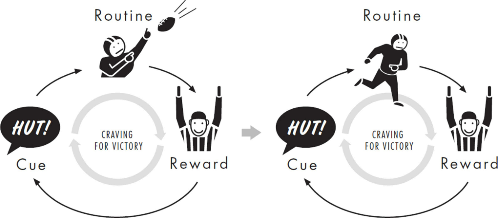
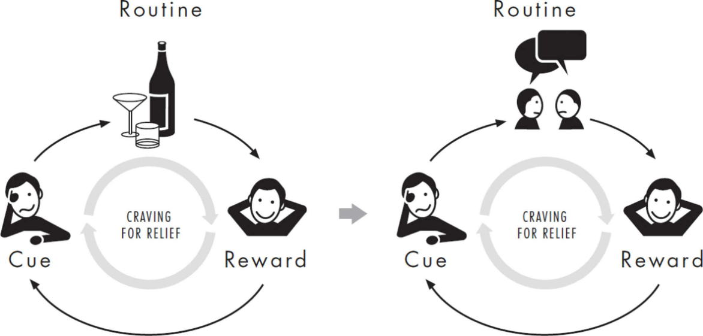
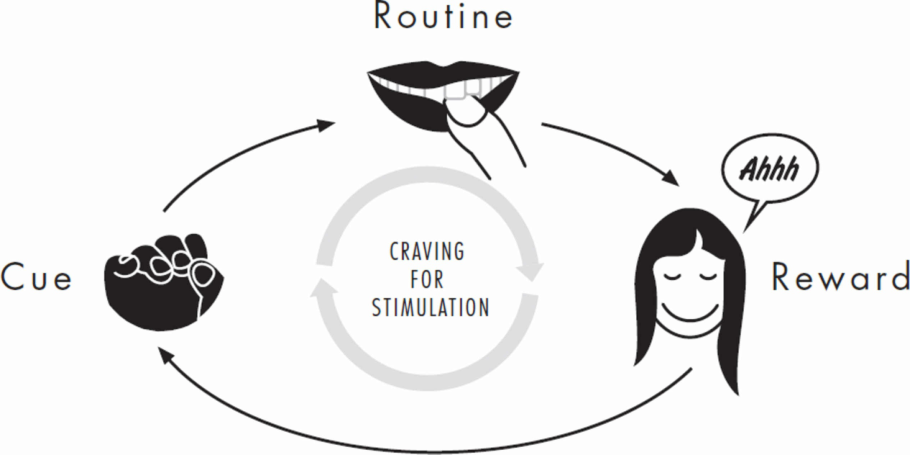
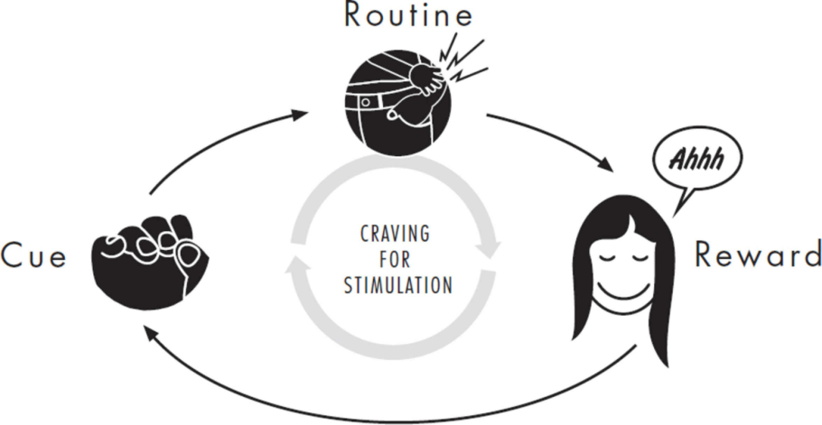
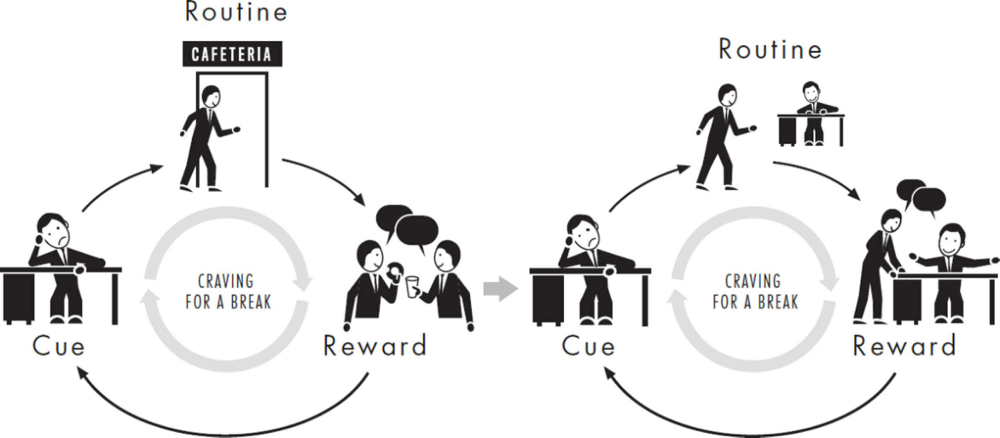
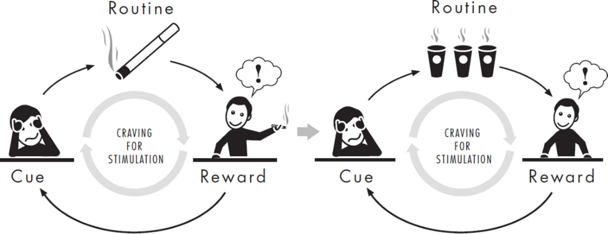

# Chapter 3: The Golden Rule of Habit Change

*Why Transformation Occurs*

## I.

The game clock at the far end[^1] of the field says there are eight minutes and nineteen seconds left when Tony Dungy, the new head coach of the Tampa Bay Buccaneers—one of the worst teams in the National Football League, not to mention the history of professional football—starts to feel a tiny glimmer of hope.

It’s late on a Sunday[^2] afternoon, November 17, 1996. The Buccaneers are playing in San Diego against the Chargers, a team that appeared in the Super Bowl the previous year. The Bucs are losing, 17 to 16. They’ve been losing all game. They’ve been losing all season. They’ve been losing all decade. The Buccaneers have not won a game on the West Coast in sixteen years, and many of the team’s current players were in grade school the last time the Bucs had a victorious season. So far this year, their record is 2–8. In one of those games, the Detroit Lions—a team so bad it would later be described as putting the “less” in “hopeless”[^3]—beat the Bucs 21 to 6, and then, three weeks later, beat them again, 27 to 0. One newspaper columnist has started referring to the Bucs as “America’s Orange Doormat.”[^4] ESPN is predicting that Dungy, who got his job only in January, could be fired before the year is done.

On the sidelines, however, as Dungy watches his team arrange itself for the next play, it feels like the sun has finally broken through the clouds. He doesn’t smile. He never lets his emotions show during a game. But something is taking place on the field, something he’s been working toward for years. As the jeers from the hostile crowd of fifty thousand rain down upon him, Tony Dungy sees something that no one else does. He sees proof that his plan is starting to work.

* * *

Tony Dungy had waited an eternity for this job. For seventeen years, he prowled the sidelines as an assistant coach, first at the University of Minnesota, then with the Pittsburgh Steelers, then the Kansas City Chiefs, and then back to Minnesota with the Vikings. Four times in the past decade, he had been invited to interview for head coaching positions with NFL teams.

All four times, the interviews hadn’t gone well.

Part of the problem was Dungy’s coaching philosophy. In his job interviews, he would patiently explain his belief that the key to winning was changing players’ habits. He wanted to get players to stop making so many decisions during a game, he said. He wanted them to react automatically, habitually. If he could instill the right habits, his team would win. Period.

“Champions don’t do extraordinary things,” Dungy would explain. “They do ordinary things, but they do them without thinking, too fast for the other team to react. They follow the habits they’ve learned.”

How, the owners would ask, are you going to create those new habits?

Oh, no, he wasn’t going to create new habits, Dungy would answer. Players spent their lives building the habits that got them to the NFL. No athlete is going to abandon those patterns simply because some new coach says to.

So rather than creating new habits, Dungy was going to change players’ old ones. And the secret to changing old habits was using what was already inside players’ heads. Habits are a three-step loop—the cue, the routine, and the reward—but Dungy only wanted to attack the middle step, the routine. He knew from experience[^5] that it was easier to convince someone to adopt a new behavior if there was something familiar at the beginning and end.

His coaching strategy embodied an axiom, a Golden Rule of habit change that study after study has shown is among the most powerful tools for creating change. Dungy recognized that you can never truly extinguish bad habits.

Rather, to change a habit, you must keep the old cue, and deliver the old reward, but insert a new routine.

That’s the rule: If you use the same cue, and provide the same reward, you can shift the routine and change the habit. Almost any behavior can be transformed if the cue and reward stay the same.

The Golden Rule has influenced treatments for alcoholism, obesity, obsessive-compulsive disorders, and hundreds of other destructive behaviors, and understanding it can help anyone change their own habits. (Attempts to give up snacking, for instance, will often fail unless there’s a new routine to satisfy old cues and reward urges. A smoker usually can’t quit unless she finds some activity to replace cigarettes when her nicotine craving is triggered.)

Four times Dungy explained his habit-based philosophy to team owners. Four times they listened politely, thanked him for his time, and then hired someone else.

Then, in 1996, the woeful Buccaneers called. Dungy flew to Tampa Bay and, once again, laid out his plan for how they could win. The day after the final interview, they offered him the job.

*THE GOLDEN RULE OF HABIT CHANGE You Can’t Extinguish a Bad Habit, You Can Only Change It.*

*HOW IT WORKS: USE THE SAME CUE. PROVIDE THE SAME REWARD. CHANGE THE ROUTINE.*

Dungy’s system would eventually turn the Bucs into one of the league’s winningest teams. He would become the only coach in NFL history to reach the play-offs in ten consecutive years, the first African American coach to win a Super Bowl, and one of the most respected figures in professional athletics. His coaching techniques would spread throughout the league and all of sports. His approach would help illuminate how to remake the habits in anyone’s life.

But all of that would come later. Today, in San Diego, Dungy just wanted to win.

* * *

From the sidelines, Dungy looks up at the clock: 8:19 remaining. The Bucs have been behind all game and have squandered opportunity after opportunity, in typical fashion. If their defense doesn’t make something happen right now, this game will effectively be over. San Diego has the ball on their own twenty-yard line, and the Chargers’ quarterback, Stan Humphries, is preparing to lead a drive that, he hopes, will put the game away. The play clock begins, and Humphries is poised to take the snap.

But Dungy isn’t looking at Humphries. Instead, he’s watching his own players align into a formation they have spent months perfecting. Traditionally, football is a game of feints and counterfeints, trick plays and misdirection. Coaches with the thickest playbooks and most complicated schemes usually win. Dungy, however, has taken the opposite approach. He isn’t interested in complication or obfuscation. When Dungy’s defensive players line up, it is obvious to everyone exactly which play they are going to use.

Dungy has opted for this approach because, in theory, he doesn’t need misdirection. He simply needs his team to be faster than everyone else. In football, milliseconds matter. So instead of teaching his players hundreds of formations, he has taught them only a handful, but they have practiced over and over until the behaviors are automatic. When his strategy works,[^6] his players can move with a speed that is impossible to overcome.

But only when it works. If his players think too much or hesitate or second-guess their instincts, the system falls apart. And so far, Dungy’s players have been a mess.

This time, however, as the Bucs line up on the twenty-yard line, something is different. Take Regan Upshaw, a Buccaneer defensive end who has settled into a three-point stance on the scrimmage line. Instead of looking up and down the line, trying to absorb as much information as possible, Upshaw is looking only at the cues that Dungy taught him to focus on. First, he glances at the outside foot of the opposite lineman (his toes are back, which means he is preparing to step backward and block while the quarterback passes); next, Upshaw looks at the lineman’s shoulders (rotated slightly inward), and the space between him and the next player (a fraction narrower than expected).

Upshaw has practiced how to react to each of these cues so many times that, at this point, he doesn’t have to think about what to do. He just follows his habits.

San Diego’s quarterback approaches the line of scrimmage and glances right, then left, barks the count and takes the ball. He drops back five steps and stands tall, swiveling his head, looking for an open receiver. Three seconds have passed since the play started. The stadium’s eyes and the television cameras are on him.

So most observers fail to see what’s happening among the Buccaneers. As soon as Humphries took the snap, Upshaw sprang into action. Within the first second of the play, he darted right, across the line of scrimmage, so fast the offensive lineman couldn’t block him. Within the next second, Upshaw ran four more paces downfield, his steps a blur. In the next second, Upshaw moved three strides closer to the quarterback, his path impossible for the offensive lineman to predict.

As the play moves into its fourth second, Humphries, the San Diego quarterback, is suddenly exposed. He hesitates, sees Upshaw from the corner of his eye. And that’s when Humphries makes his mistake. He starts thinking.

Humphries spots a teammate, a rookie tight end named Brian Roche, twenty yards downfield. There’s another San Diego receiver much closer, waving his arms, calling for the ball. The short pass is the safe choice. Instead, Humphries, under pressure, performs a split-second analysis, cocks his arm, and heaves to Roche.

That hurried decision is precisely what Dungy was hoping for. As soon as the ball is in the air, a Buccaneer safety named John Lynch starts moving. Lynch’s job was straightforward: When the play started, he ran to a particular point on the field and waited for his cue. There’s enormous pressure to improvise in this situation. But Dungy has drilled Lynch until his routine is automatic. And as a result, when the ball leaves the quarterback’s hands, Lynch is standing ten yards from Roche, waiting.

As the ball spins through the air, Lynch reads his cues—the direction of the quarterback’s face mask and hands, the spacing of the receivers —and starts moving before it’s clear where the ball will land. Roche, the San Diego receiver, springs forward, but Lynch cuts around him and intercepts the pass. Before Roche can react, Lynch takes off down the field toward the Chargers’ end zone. The other Buccaneers are perfectly positioned to clear his route. Lynch runs 10, then 15, then 20, then almost 25 yards before he is finally pushed out of bounds. The entire play has taken less than ten seconds.

Two minutes later, the Bucs score a touchdown, taking the lead for the first time all game. Five minutes later, they kick a field goal. In between, Dungy’s defense shuts down each of San Diego’s comeback attempts. The Buccaneers win, 25 to 17, one of the biggest upsets of the season.

At the end of the game, Lynch and Dungy exit the field together.

“It feels like something was different out there,” Lynch says as they walk into the tunnel.

“We’re starting to believe,” Dungy replies.

## II.

To understand how a coach’s focus on changing habits could remake a team, it’s necessary to look outside the world of sports. Way outside, to a dingy basement on the Lower East Side of New York City in 1934, where one of the largest and most successful attempts at wide-scale habit change was born.

Sitting in the basement[^7] was a thirty-nine-year-old alcoholic named Bill Wilson.[^8] Years earlier, Wilson had taken his first drink during officers’ training camp in New Bedford, Massachusetts, where he was learning to fire machine guns before getting shipped to France and World War I. Prominent families who lived near the base often invited officers to dinner, and one Sunday night, Wilson attended a party where he was served rarebit and beer. He was twenty-two years old and had never had alcohol before. The only polite thing, it seemed, was to drink the glass served to him. A few weeks later, Wilson was invited to another elegant affair. Men were in tuxedos, women were flirting. A butler came by and put a Bronx cocktail—a combination of gin, dry and sweet vermouth, and orange juice—into Wilson’s hand. He took a sip and felt,[^9] he later said, as if he had found “the elixir of life.”

By the mid-1930s, back from Europe, his marriage falling apart and a fortune from selling stocks vaporized, Wilson was consuming three bottles of booze a day. On a cold November afternoon, while he was sitting in the gloom, an old drinking buddy called. Wilson invited him over[^10] and mixed a pitcher of pineapple juice and gin. He poured his friend a glass.

His friend handed it back. He’d been sober for two months, he said.

Wilson was astonished. He started describing his own struggles with alcohol, including the fight he’d gotten into at a country club that had cost him his job. He had tried to quit, he said, but couldn’t manage it. He’d been to detox and had taken pills. He’d made promises to his wife and joined abstinence groups. None of it worked. How, Wilson asked, had his friend done it?

“I got religion,” the friend said. He talked about hell and temptation, sin and the devil. “Realize you are licked, admit it, and get willing to turn your life over to God.”

Wilson thought the guy was nuts. “Last summer an alcoholic crackpot; now, I suspected, a little cracked about religion,” he later wrote. When his friend left, Wilson polished off the booze and went to bed.

A month later, in December 1934, Wilson checked into the Charles B. Towns Hospital for Drug and Alcohol Addictions, an upscale Manhattan detox center. A physician started hourly infusions of a hallucinogenic drug called belladonna, then in vogue for the treatment of alcoholism. Wilson floated in and out of consciousness on a bed in a small room.

Then, in an episode that has been described at millions of meetings in cafeterias, union halls, and church basements, Wilson began writhing in agony. For days, he hallucinated. The withdrawal pains made it feel as if insects were crawling across his skin. He was so nauseous he could hardly move, but the pain was too intense to stay still. “If there is a God, let Him show Himself!” Wilson yelled to his empty room. “I am ready to do anything. Anything!” At that moment, he later wrote,[^11] a white light filled his room, the pain ceased, and he felt as if he were on a mountaintop, “and that a wind not of air but of spirit was blowing. And then it burst upon me that I was a free man. Slowly the ecstasy subsided. I lay on the bed, but now for a time I was in another world, a new world of consciousness.”

Bill Wilson would never have another drink. For the next thirty-six years, until he died of emphysema in 1971, he would devote himself to founding, building, and spreading Alcoholics Anonymous, until it became the largest, most well-known and successful habit-changing organization in the world.

An estimated 2.1 million people[^12] seek help from AA each year, and as many as 10 million alcoholics[^13] may have achieved sobriety through the group. AA doesn’t work for everyone—success rates are difficult to measure, because of participants’ anonymity—but millions credit the program with saving their lives. AA’s foundational credo, the famous twelve steps, have become cultural lodestones incorporated into treatment programs for overeating, gambling, debt, sex, drugs, hoarding, self-mutilation, smoking, video game addictions, emotional dependency, and dozens of other destructive behaviors. The group’s techniques offer, in many respects, one of the most powerful formulas for change.

All of which is somewhat unexpected, because AA has almost no grounding in science or most accepted therapeutic methods.

Alcoholism, of course, is more than a habit. It’s a physical addiction with psychological and perhaps genetic roots. What’s interesting about AA,[^14] however, is that the program doesn’t directly attack many of the psychiatric or biochemical issues that researchers say are often at the core of why alcoholics drink. In fact, AA’s methods seem to sidestep scientific and medical findings altogether, as well as the types of intervention many psychiatrists say alcoholics really need.[^fn1]

What AA provides instead[^15] is a method for attacking the habits that surround alcohol use. AA, in essence, is a giant machine for changing habit loops. And though the habits associated with alcoholism are extreme, the lessons AA provides demonstrate how almost any habit—even the most obstinate—can be changed.

* * *

Bill Wilson didn’t read academic journals or consult many doctors before founding AA. A few years after he achieved sobriety, he wrote the now-famous twelve steps in a rush one night while sitting in bed.[^16] He chose the number twelve[^17] because there were twelve apostles. And some aspects of the program are not just unscientific, they can seem downright strange.

Take, for instance, AA’s insistence that alcoholics attend “ninety meetings in ninety days”—a stretch of time, it appears, chosen at random. Or the program’s intense focus on spirituality, as articulated in step three, which says[^18] that alcoholics can achieve sobriety by making “a decision to turn our will and our lives over to the care of God as we understand him.” Seven of the twelve steps mention God or spirituality, which seems odd for a program founded by a onetime agnostic who, throughout his life, was openly hostile toward organized religion. AA meetings don’t have a prescribed schedule or curriculum. Rather, they usually begin with a member telling his or her story, after which other people can chime in. There are no professionals who guide conversations and few rules about how meetings are supposed to function. In the past five decades, as almost every aspect of psychiatry and addiction research has been revolutionized by discoveries in behavioral sciences, pharmacology, and our understanding of the brain, AA has remained frozen in time.

Because of the program’s lack[^19] of rigor, academics and researchers have often criticized it. AA’s emphasis on spirituality, some claimed, made it more like a cult than a treatment. In the past fifteen years, however, a reevaluation has begun. Researchers now say the program’s methods offer valuable lessons. Faculty at Harvard, Yale, the University of Chicago, the University of New Mexico, and dozens of other research centers have found a kind of science within AA that is similar to the one Tony Dungy used on the football field. Their findings endorse the Golden Rule of habit change: AA succeeds because it helps alcoholics use the same cues, and get the same reward, but it shifts the routine.

Researchers say that AA works because the program forces people to identify the cues and rewards that encourage their alcoholic habits, and then helps them find new behaviors. When Claude Hopkins was selling Pepsodent, he found a way to create a new habit by triggering a new craving. But to change an old habit, you must address an old craving. You have to keep the same cues and rewards as before, and feed the craving by inserting a new routine.

Take steps four (to make “a searching and fearless inventory of ourselves”) and five (to admit “to God, to ourselves, and to another human being the exact nature of our wrongs”).

“It’s not obvious from the way they’re written,[^20] but to complete those steps, someone has to create a list of all the triggers for their alcoholic urges,” said J. Scott Tonigan, a researcher at the University of New Mexico who has studied AA for more than a decade. “When you make a self-inventory, you’re figuring out all the things that make you drink. And admitting to someone else all the bad things you’ve done is a pretty good way of figuring out the moments where everything spiraled out of control.”

Then, AA asks alcoholics to search for the rewards they get from alcohol. What cravings, the program asks, are driving your habit loop? Often, intoxication itself doesn’t make the list. Alcoholics crave a drink because it offers escape, relaxation, companionship, the blunting of anxieties, and an opportunity for emotional release. They might crave a cocktail to forget their worries. But they don’t necessarily crave feeling drunk. The physical effects of alcohol are often one of the least rewarding parts of drinking for addicts.

“There is a hedonistic element to alcohol,” said Ulf Mueller, a German neurologist who has studied brain activity among alcoholics. “But people also use alcohol because they want to forget something or to satisfy other cravings, and these relief cravings occur in totally different parts of the brain than the craving for physical pleasure.”

In order to offer alcoholics the same rewards they get at a bar, AA has built a system of meetings and companionship—the “sponsor” each member works with—that strives to offer as much escape, distraction, and catharsis as a Friday night bender. If someone needs relief, they can get it from talking to their sponsor or attending a group gathering, rather than toasting a drinking buddy.

“AA forces you to create new routines for what to do each night instead of drinking,” said Tonigan. “You can relax and talk through your anxieties at the meetings. The triggers and payoffs stay the same, it’s just the behavior that changes.”

*KEEP THE CUE, PROVIDE THE SAME REWARD, INSERT A NEW ROUTINE*

One particularly dramatic demonstration[^21] of how alcoholics’ cues and rewards can be transferred to new routines occurred in 2007, when Mueller, the German neurologist, and his colleagues at the University of Magdeburg implanted small electrical devices inside the brains of five alcoholics who had repeatedly tried to give up booze. The alcoholics in the study had each spent at least six months in rehab without success. One of them had been through detox more than sixty times.

The devices implanted in the men’s heads were positioned inside their basal ganglia—the same part of the brain where the MIT researchers found the habit loop—and emitted an electrical charge that interrupted the neurological reward that triggers habitual cravings. After the men recovered from the operations, they were exposed to cues that had once triggered alcoholic urges, such as photos of beer or trips to a bar. Normally, it would have been impossible for them to resist a drink. But the devices inside their brains “overrode” each man’s neurological cravings. They didn’t touch a drop.

“One of them told me the craving disappeared as soon as we turned the electricity on,” Mueller said. “Then, we turned it off, and the craving came back immediately.”

Eradicating the alcoholics’ neurological cravings, however, wasn’t enough to stop their drinking habits. Four of them relapsed soon after the surgery, usually after a stressful event. They picked up a bottle because that’s how they automatically dealt with anxiety. However, once they learned alternate routines for dealing with stress, the drinking stopped for good. One patient, for instance, attended AA meetings. Others went to therapy. And once they incorporated those new routines for coping with stress and anxiety into their lives, the successes were dramatic. The man who had gone to detox sixty times never had another drink. Two other patients had started drinking at twelve, were alcoholics by eighteen, drank every day, and now have been sober for four years.

Notice how closely this study hews to the Golden Rule of habit change: Even when alcoholics’ brains were changed through surgery, it wasn’t enough. The old cues and cravings for rewards were still there, waiting to pounce. The alcoholics only permanently changed once they learned new routines that drew on the old triggers and provided a familiar relief. “Some brains are so addicted to alcohol that only surgery can stop it,” said Mueller. “But those people also need new ways for dealing with life.”

AA provides a similar, though less invasive, system for inserting new routines into old habit loops. As scientists have begun understanding how AA works, they’ve started applying the program’s methods to other habits, such as two-year-olds’ tantrums, sex addictions, and even minor behavioral tics. As AA’s methods have spread, they’ve been refined into therapies that can be used to disrupt almost any pattern.

* * *

In the summer of 2006, a twenty-four-year-old graduate student named Mandy[^22] walked into the counseling center at Mississippi State University.[^23] For most of her life, Mandy had bitten her nails, gnawing them until they bled. Lots of people bite their nails. For chronic nail biters, however, it’s a problem of a different scale. Mandy would often bite until her nails pulled away from the skin underneath. Her fingertips were covered with tiny scabs. The end of her fingers had become blunted without nails to protect them and sometimes they tingled or itched, a sign of nerve injury. The biting habit had damaged her social life. She was so embarrassed around her friends that she kept her hands in her pockets and, on dates, would become preoccupied with balling her fingers into fists. She had tried to stop by painting her nails with foul-tasting polishes or promising herself, starting right now, that she would muster the willpower to quit. But as soon as she began doing homework or watching television, her fingers ended up in her mouth.

The counseling center referred Mandy[^24] to a doctoral psychology student who was studying a treatment known as “habit reversal training.” The psychologist was well acquainted with the Golden Rule of habit change. He knew that changing Mandy’s nail biting habit required inserting a new routine into her life.

“What do you feel right before you bring your hand up to your mouth to bite your nails?” he asked her.

“There’s a little bit of tension in my fingers,” Mandy said. “It hurts a little bit here, at the edge of the nail. Sometimes I’ll run my thumb along, looking for hangnails, and when I feel something catch, I’ll bring it up to my mouth. Then I’ll go finger by finger, biting all the rough edges. Once I start, it feels like I have to do all of them.”

Asking patients to describe what triggers their habitual behavior is called awareness training, and like AA’s insistence on forcing alcoholics to recognize their cues, it’s the first step in habit reversal training. The tension that Mandy felt in her nails cued her nail biting habit.

“Most people’s habits have occurred for so long they don’t pay attention to what causes it anymore,” said Brad Dufrene, who treated Mandy. “I’ve had stutterers come in, and I’ll ask them which words or situations trigger their stuttering, and they won’t know because they stopped noticing so long ago.”

Next, the therapist asked Mandy to describe why she bit her nails. At first, she had trouble coming up with reasons. As they talked, though, it became clear that she bit when she was bored. The therapist put her in some typical situations, such as watching television and doing homework, and she started nibbling. When she had worked through all of the nails, she felt a brief sense of completeness, she said. That was the habit’s reward: a physical stimulation she had come to crave.

*MANDY’S HABIT LOOP*

At the end of their first session, the therapist sent Mandy home with an assignment: Carry around an index card, and each time you feel the cue—a tension in your fingertips—make a check mark on the card. She came back a week later with twenty-eight checks. She was, by that point, acutely aware of the sensations that preceded her habit. She knew how many times it occurred during class or while watching television.

Then the therapist taught Mandy what is known as a “competing response.” Whenever she felt that tension in her fingertips, he told her, she should immediately put her hands in her pockets or under her legs, or grip a pencil or something else that made it impossible to put her fingers in her mouth. Then Mandy was to search for something that would provide a quick physical stimulation—such as rubbing her arm or rapping her knuckles on a desk—anything that would produce a physical response.

The cues and rewards stayed the same. Only the routine changed.

*MANDY’S NEW HABIT LOOP*

They practiced in the therapist’s office for about thirty minutes and Mandy was sent home with a new assignment: Continue with the index card, but make a check when you feel the tension in your fingertips and a hash mark when you successfully override the habit.

A week later, Mandy had bitten her nails only three times and had used the competing response seven times. She rewarded herself with a manicure, but kept using the note cards. After a month, the nail-biting habit was gone. The competing routines had become automatic. One habit had replaced another.

“It seems ridiculously simple, but once you’re aware of how your habit works, once you recognize the cues and rewards, you’re halfway to changing it,” Nathan Azrin, one of the developers of habit reversal training,[^25] told me. “It seems like it should be more complex. The truth is, the brain can be reprogrammed. You just have to be deliberate about it.”[^fn2]

Today, habit reversal therapy[^26] is used to treat verbal and physical tics,[^27] depression, smoking, gambling problems, anxiety, bedwetting, procrastination, obsessive-compulsive disorders, and other behavioral problems. And its techniques lay bare one of the fundamental principles of habits: Often, we don’t really understand the cravings driving our behaviors until we look for them. Mandy never realized that a craving for physical stimulation was causing her nail biting, but once she dissected the habit, it became easy to find a new routine that provided the same reward.

Say you want to stop snacking at work. Is the reward you’re seeking to satisfy your hunger? Or is it to interrupt boredom? If you snack for a brief release, you can easily find another routine—such as taking a quick walk, or giving yourself three minutes on the Internet—that provides the same interruption without adding to your waistline.

If you want to stop smoking, ask yourself, do you do it because you love nicotine, or because it provides a burst of stimulation, a structure to your day, a way to socialize? If you smoke because you need stimulation, studies indicate that some caffeine in the afternoon can increase the odds you’ll quit. More than three dozen studies[^28] of former smokers have found that identifying the cues and rewards they associate with cigarettes, and then choosing new routines that provide similar payoffs—a piece of Nicorette, a quick series of push-ups, or simply taking a few minutes to stretch and relax—makes it more likely they will quit.

If you identify the cues and rewards, you can change the routine.

At least, most of the time. For some habits, however, there’s one other ingredient that’s necessary: belief.

## III.

“Here are the six reasons everyone thinks we can’t win,” Dungy told his Buccaneers after becoming head coach in 1996. It was months before the season started and everyone was sitting in the locker room. Dungy started listing the theories they had all read in the newspapers or heard on the radio: The team’s management was messed up. Their new coach was untested. The players were spoiled. The city didn’t care. Key players were injured. They didn’t have the talent they needed.

“Those are the supposed reasons,” Dungy said. “Now here is a fact: Nobody is going to outwork us.”

Dungy’s strategy, he explained, was to shift the team’s behaviors until their performances were automatic. He didn’t believe the Buccaneers needed the thickest playbook. He didn’t think they had to memorize hundreds of formations. They just had to learn a few key moves and get them right every time.

However, perfection is hard to achieve in football. “Every play in football—every play—someone messes up,” said Herm Edwards, one of Dungy’s assistant coaches in Tampa Bay. “Most of the time, it’s not physical.[^29] It’s mental.” Players mess up when they start thinking too much or second-guessing their plays. What Dungy wanted was to take all that decision making out of their game.

And to do that, he needed them to recognize their existing habits and accept new routines.

He started by watching how his team already played.

“Let’s work on the Under Defense,” Dungy shouted at a morning practice one day. “Number fifty-five, what’s your read?”

“I’m watching the running back and guard,” said Derrick Brooks, an outside linebacker.

“What precisely are you looking at? Where are your eyes?”

“I’m looking at the movement of the guard,” said Brooks. “I’m watching the QB’s legs and hips after he gets the ball. And I’m looking for gaps in the line, to see if they’re gonna pass and if the QB is going to throw to my side or away.”

In football, these visual cues are known as “keys,” and they’re critical to every play. Dungy’s innovation was to use these keys as cues for reworked habits. He knew that, sometimes, Brooks hesitated a moment too long at the start of a play. There were so many things for him to think about—is the guard stepping out of formation? Does the running back’s foot indicate he’s preparing for a running or passing play?—that sometimes he slowed down.

Dungy’s goal was to free Brooks’s mind from all that analysis. Like Alcoholics Anonymous, he used the same cues that Brooks was already accustomed to, but gave him different routines that, eventually, occurred automatically.

“I want you to use those same keys,” Dungy told Brooks. “But at first, focus only on the running back. That’s it. Do it without thinking. Once you’re in position, then start looking for the QB.”

This was a relatively modest shift—Brooks’s eyes went to the same cues, but rather than looking multiple places at once, Dungy put them in a sequence and told him, ahead of time, the choice to make when he saw each key. The brilliance of this system was that it removed the need for decision making. It allowed Brooks to move faster, because everything was a reaction—and eventually a habit— rather than a choice.

Dungy gave every player similar instructions, and practiced the formations over and over. It took almost a year for Dungy’s habits to take hold. The team lost early, easy games. Sports columnists asked why the Bucs were wasting so much time on psychological quackery.

But slowly, they began to improve. Eventually, the patterns became so familiar to players that they unfolded automatically when the team took the field. In Dungy’s second season as coach, the Bucs won their first five games and went to the play-offs for the first time in fifteen years. In 1999, they won the division championship.

Dungy’s coaching style started drawing national attention. The sports media fell in love with his soft-spoken demeanor, religious piety, and the importance he placed on balancing work and family. Newspaper stories described how he brought his sons, Eric and Jamie, to the stadium so they could hang out during practice. They did their homework in his office and picked up towels in the locker room. It seemed like, finally, success had arrived.

In 2000, the Bucs made it to the play-offs again, and then again in 2001. Fans now filled the stadium every week. Sportscasters talked about the team as Super Bowl contenders. It was all becoming real.

* * *

But even as the Bucs became a powerhouse, a troubling problem emerged. They often played tight, disciplined games. However, during crucial, high-stress moments,[^30] everything would fall apart.

In 1999, after racking up six wins in a row at the end of the season, the Bucs blew the conference championship against the St. Louis Rams. In 2000, they were one game away from the Super Bowl when they disintegrated against the Philadelphia Eagles, losing 21 to 3. The next year, the same thing happened again, and the Bucs lost to the Eagles, 31 to 9, blowing their chance of advancing.

“We would practice, and everything would come together and then we’d get to a big game and it was like the training disappeared,” Dungy told me. “Afterward, my players would say, ‘Well, it was a critical play and I went back to what I knew,’ or ‘I felt like I had to step it up.’ What they were really saying[^31] was they trusted our system most of the time, but when everything was on the line, that belief broke down.”

At the conclusion of the 2001 season, after the Bucs had missed the Super Bowl for the second straight year, the team’s general manager asked Dungy to come to his house. He parked near a huge oak tree, walked inside, and thirty seconds later was fired.

The Bucs would go on to win the Super Bowl the next year using Dungy’s formations and players, and by relying on the habits he had shaped. He would watch on television as the coach who replaced him lifted up the Lombardi trophy. But by then, he would already be far away.

## IV.

About sixty people—soccer moms and lawyers on lunch breaks, old guys with fading tattoos and hipsters in skinny jeans—are sitting in a church and listening to a man with a slight paunch and a tie that complements his pale blue eyes. He looks like a successful politician, with the warm charisma of assured reelection.

“My name is John,” he says, “and I’m an alcoholic.”

“Hi, John,” everyone replies.

“The first time I decided to get help was when my son broke his arm,” John says. He’s standing behind a podium. “I was having an affair with a woman at work, and she told me that she wanted to end it. So I went to a bar and had two vodkas, and went back to my desk, and at lunch I went to Chili’s with a friend, and we each had a few beers, and then at about two o’clock, me and another friend left and found a place with a two-for-one happy hour. It was my day to pick up the kids—my wife didn’t know about the affair yet—so I drove to their school and got them, and I was driving home on a street I must have driven a thousand times, and I slammed into a stop sign at the end of the block. Up on the sidewalk and, bam, right into the sign. Sam—that’s my boy—hadn’t put on his seat belt, so he flew against the windshield and broke his arm. There was blood on the dash where he hit his nose and the windshield was cracked and I was so scared. That’s when I decided I needed help.

“So I checked into a clinic and then came out, and everything was pretty good for a while. For about thirteen months, everything was great. I felt like I was in control and I went to meetings every couple of days, but eventually I started thinking, I’m not such a loser that I need to hang out with a bunch of drunks. So I stopped going.

“Then my mom got cancer, and she called me at work, almost two years after I got sober. She was driving home from the doctor’s office, and she said, ‘He told me we can treat it, but it’s pretty advanced.’ The first thing I did after I hung up is find a bar, and I was pretty much drunk for the next two years until my wife moved out, and I was supposed to pick up my kids again. I was in a really bad place by then. A friend was teaching me to use coke, and every afternoon I would do a line inside my office, and five minutes later I would get that little drip into the back of my throat and do another line.

“Anyways, it was my turn to get the kids. I was on the way to their school and I felt totally fine, like I was on top of everything, and I pulled into an intersection when the light was red and this huge truck slammed into my car. It actually flipped the car on its side. I didn’t have a scratch on me. I got out, and started trying to push my car over, because I figured, if I can make it home and leave before the cops arrive, I’ll be fine. Of course that didn’t work out, and when they arrested me for DUI they showed me how the passenger side of the car was completely crushed in. That’s where Sammy usually sat. If he had been there, he would have been killed.

“So I started going to meetings again, and my sponsor told me that it didn’t matter if I felt in control. Without a higher power in my life, without admitting my powerlessness, none of it was going to work. I thought that was bull—I’m an atheist. But I knew that if something didn’t change, I was going to kill my kids. So I started working at that, working at believing in something bigger than me. And it’s working. I don’t know if it’s God or something else, but there is a power that has helped me stay sober for seven years now and I’m in awe of it. I don’t wake up sober every morning—I mean, I haven’t had a drink in seven years, but some mornings I wake up feeling like I’m gonna fall down that day. Those days, I look for the higher power, and I call my sponsor, and most of the time we don’t talk about drinking. We talk about life and marriage and my job, and by the time I’m ready for a shower, my head is on straight.”

The first cracks in the theory that Alcoholics Anonymous succeeded solely by reprogramming participants’ habits started appearing a little over a decade ago and were caused by stories from alcoholics like John. Researchers began finding that habit replacement worked pretty well for many people until the stresses of life—such as finding out your mom has cancer, or your marriage is coming apart—got too high, at which point alcoholics often fell off the wagon. Academics asked why, if habit replacement is so effective, it seemed to fail at such critical moments. And as they dug into alcoholics’ stories to answer that question, they learned that replacement habits only become durable new behaviors when they are accompanied by something else.

One group of researchers at the Alcohol Research Group in California, for instance, noticed a pattern in interviews. Over and over again, alcoholics said the same thing: Identifying cues and choosing new routines is important, but without another ingredient, the new habits never fully took hold.

The secret, the alcoholics said, was God.

Researchers hated that explanation. God and spirituality are not testable hypotheses. Churches are filled with drunks who continue drinking despite a pious faith. In conversations with addicts, though, spirituality kept coming up again and again. So in 2005, a group of scientists—this time affiliated with UC Berkeley, Brown University, and the National Institutes of Health—began asking alcoholics[^32] about all kinds of religious and spiritual topics. Then they looked at the data[^33] to see if there was any correlation between religious belief and how long people stayed sober.

A pattern emerged. Alcoholics who practiced the techniques of habit replacement, the data indicated, could often stay sober until there was a stressful event in their lives—at which point, a certain number started drinking again, no matter how many new routines they had embraced.

However, those alcoholics who believed, like John in Brooklyn, that some higher power had entered their lives were more likely to make it through the stressful periods with their sobriety intact.

It wasn’t God that mattered, the researchers figured out. It was belief itself that made a difference. Once people learned how to believe in something, that skill started spilling over to other parts of their lives, until they started believing they could change. Belief was the ingredient that made a reworked habit loop into a permanent behavior.

“I wouldn’t have said this a year ago—that’s how fast our understanding is changing,” said Tonigan, the University of New Mexico researcher, “but belief seems critical. You don’t have to believe in God, but you do need the capacity to believe that things will get better.

“Even if you give people better habits, it doesn’t repair why they started drinking in the first place. Eventually they’ll have a bad day, and no new routine is going to make everything seem okay. What can make a difference is believing that they can cope with that stress without alcohol.”

By putting alcoholics in meetings where belief is a given—where, in fact, belief is an integral part of the twelve steps—AA trains people in how to believe in something until they believe in the program and themselves. It lets people practice believing that things will eventually get better, until things actually do.

“At some point, people in AA look around the room and think, if it worked for that guy, I guess it can work for me,” said Lee Ann Kaskutas, a senior scientist at the Alcohol Research Group. “There’s something really powerful about groups and shared experiences. People might be skeptical about their ability to change if they’re by themselves, but a group will convince them to suspend disbelief. A community creates belief.”

As John was leaving the AA meeting, I asked him why the program worked now, after it had failed him before. “When I started coming to meetings after the truck accident, someone asked for volunteers to help put away the chairs,” he told me. “I raised my hand. It wasn’t a big thing, it took like five minutes, but it felt good to do something that wasn’t all about me. I think that started me on a different path.

“I wasn’t ready to give in to the group the first time, but when I came back, I was ready to start believing in something.”

## V.

Within a week of Dungy’s firing by the Bucs, the owner of the Indianapolis Colts left an impassioned fifteen-minute message on his answering machine. The Colts, despite having one of the NFL’s best quarterbacks, Peyton Manning, had just finished a dreadful season. The owner needed help. He was tired of losing, he said. Dungy moved to Indianapolis and became head coach.

He immediately started implementing the same basic game plan: remaking the Colts’ routines and teaching players to use old cues to build reworked habits. In his first season, the Colts went 10–6 and qualified for the play-offs. The next season, they went 12–4 and came within one game of the Super Bowl. Dungy’s celebrity grew. Newspaper and television profiles appeared around the country. Fans flew in so they could visit the church Dungy attended. His sons became fixtures in the Colts’ locker room and on the sidelines. In 2005, Jamie, his eldest boy, graduated from high school and went to college in Florida.

Even as Dungy’s successes mounted, however, the same troubling patterns emerged. The Colts would play a season of disciplined, winning football, and then under play-off pressure, choke.

“Belief is the biggest part of success in professional football,” Dungy told me. “The team wanted to believe, but when things got really tense, they went back to their comfort zones and old habits.”

The Colts finished the 2005 regular season with fourteen wins and two losses, the best record in its history.

Then tragedy struck.

Three days before Christmas, Tony Dungy’s phone rang in the middle of the night. His wife answered and handed him the receiver, thinking it was one of his players. There was a nurse on the line. Dungy’s son Jamie had been brought into the hospital earlier in the evening, she said, with compression injuries on his throat. His girlfriend had found him hanging in his apartment, a belt around his neck. Paramedics had rushed him[^34] to the hospital, but efforts at revival were unsuccessful. He was gone.

A chaplain flew to spend Christmas with the family. “Life will never be the same again,” the chaplain told them, “but you won’t always feel like you do right now.”

A few days after the funeral, Dungy returned to the sidelines. He needed something to distract himself, and his wife and team encouraged him to go back to work. “I was overwhelmed by their love and support,” he later wrote. “As a group, we had always leaned on each other in difficult times; I needed them now more than ever.”

The team lost their first play-off game, concluding their season. But in the aftermath of watching Dungy during this tragedy, “something changed,” one of his players from that period told me. “We had seen Coach through this terrible thing and all of us wanted to help him somehow.”

It is simplistic, even cavalier, to suggest that a young man’s death can have an impact on football games. Dungy has always said that nothing is more important to him than his family. But in the wake of Jamie’s passing, as the Colts started preparing for the next season, something shifted, his players say. The team gave in to Dungy’s vision of how football should be played in a way they hadn’t before. They started to believe.

“I had spent a lot of previous seasons worrying about my contract and salary,” said one player who, like others, spoke about that period on the condition of anonymity. “When Coach came back, after the funeral, I wanted to give him everything I could, to take away his hurt. I kind of gave myself to the team.”

“Some men like hugging each other,” another player told me. “I don’t. I haven’t hugged my sons in a decade. But after Coach came back, I walked over and I hugged him as long as I could, because I wanted him to know that I was there for him.”

After the death of Dungy’s son, the team started playing differently. A conviction emerged among players about the strength of Dungy’s strategy. In practices and scrimmages leading up to the start of the 2006 season, the Colts played tight, precise football.

“Most football teams aren’t really teams. They’re just guys who work together,” a third player from that period told me. “But we became a team. It felt amazing. Coach was the spark, but it was about more than him. After he came back, it felt like we really believed in each other, like we knew how to play together in a way we didn’t before.”

For the Colts, a belief in their team—in Dungy’s tactics and their ability to win—began to emerge out of tragedy. But just as often, a similar belief can emerge without any kind of adversity.

In a 1994 Harvard study[^35] that examined people who had radically changed their lives, for instance, researchers found that some people had remade their habits after a personal tragedy, such as a divorce or a life-threatening illness. Others changed after they saw a friend go through something awful, the same way that Dungy’s players watched him struggle.

Just as frequently, however, there was no tragedy that preceded people’s transformations. Rather, they changed because they were embedded in social groups that made change easier. One woman said her entire life shifted when she signed up for a psychology class and met a wonderful group. “It opened a Pandora’s box,” the woman told researchers. “I could not tolerate the status quo any longer. I had changed in my core.” Another man said that he found new friends among whom he could practice being gregarious. “When I do make the effort to overcome my shyness, I feel that it is not really me acting, that it’s someone else,” he said. But by practicing with his new group, it stopped feeling like acting. He started to believe he wasn’t shy, and then, eventually, he wasn’t anymore. When people join groups where change seems possible, the potential for that change to occur becomes more real. For most people who overhaul their lives, there are no seminal moments or life-altering disasters. There are simply communities—sometimes of just one other person—who make change believable. One woman told researchers her life transformed after a day spent cleaning toilets—and after weeks of discussing with the rest of the cleaning crew whether she should leave her husband.

“Change occurs among other people,” one of the psychologists involved in the study, Todd Heatherton, told me. “It seems real when we can see it in other people’s eyes.”

The precise mechanisms of belief are still little understood. No one is certain why a group encountered in a psychology class can convince a woman that everything is different, or why Dungy’s team came together after their coach’s son passed away. Plenty of people talk to friends about unhappy marriages and never leave their spouses; lots of teams watch their coaches experience adversity and never gel.

But we do know that for habits to permanently change, people must believe that change is feasible. The same process that makes AA so effective—the power of a group to teach individuals how to believe—happens whenever people come together to help one another change. Belief is easier when it occurs within a community.

* * *

Ten months after Jamie’s death, the 2006 football season began. The Colts played peerless football, winning their first nine games, and finishing the year 12–4. They won their first play-off game, and then beat the Baltimore Ravens for the divisional title. At that point, they were one step away from the Super Bowl, playing for the conference championship—the game that Dungy had lost eight times before.

The matchup occurred on January 21, 2007, against the New England Patriots, the same team that had snuffed out the Colts’ Super Bowl aspirations twice.

The Colts started the game strong, but before the first half ended, they began falling apart. Players were afraid of making mistakes or so eager to get past the final Super Bowl hurdle that they lost track of where they were supposed to be focusing. They stopped relying on their habits and started thinking too much. Sloppy tackling led to missed opportunities. One of Peyton Manning’s passes was intercepted and returned for a touchdown. Their opponents, the Patriots, pulled ahead 21 to 3. No team in the history of the NFL had ever overcome so big a deficit in a conference championship. Dungy’s team, once again, was[^36] going to lose.

At halftime, the team filed into the locker room, and Dungy asked everyone to gather around. The noise from the stadium filtered through the closed doors, but inside everyone was quiet. Dungy looked at his players.

They had to believe, he said.

“We faced this same situation—against this same team—in 2003,” Dungy told them. In that game, they had come within one yard of winning. One yard. “Get your sword ready because this time we’re going to win. This is our game. It’s our time.”[^37]

The Colts came out in the second half and started playing as they had in every preceding game. They stayed focused on their cues and habits. They carefully executed the plays they had spent the past five years practicing until they had become automatic. Their offense, on the opening drive, ground out seventy-six yards over fourteen plays and scored a touchdown. Then, three minutes after taking the next possession, they scored again.

As the fourth quarter wound down, the teams traded points. Dungy’s Colts tied the game, but never managed to pull ahead. With 3:49 left in the game, the Patriots scored, putting Dungy’s players at a three-point disadvantage, 34 to 31. The Colts got the ball and began driving down the field. They moved seventy yards in nineteen seconds, and crossed into the end zone. For the first time, the Colts had the lead, 38 to 34. There were now sixty seconds left on the clock. If Dungy’s team could stop the Patriots from scoring a touchdown, the Colts would win.

Sixty seconds is an eternity in football.

The Patriots’ quarterback, Tom Brady, had scored touchdowns in far less time. Sure enough, within seconds of the start of play, Brady moved his team halfway down the field. With seventeen seconds remaining, the Patriots were within striking distance, poised for a final big play that would hand Dungy another defeat and crush, yet again, his team’s Super Bowl dreams.

As the Patriots approached the line of scrimmage, the Colts’ defense went into their stances. Marlin Jackson, a Colts cornerback, stood ten yards back from the line. He looked at his cues: the width of the gaps between the Patriot linemen and the depth of the running back’s stance. Tom Brady, the Patriots’ quarterback, took the snap and dropped back to pass. Jackson was already moving. Brady cocked his arm and heaved the ball. His intended target was a Patriot receiver twenty-two yards away, wide open, near the middle of the field. If the receiver caught the ball, it was likely he could make it close to the end zone or score a touchdown. The football flew through the air. Jackson, the Colts cornerback, was already running at an angle, following his habits. He rushed past the receiver’s right shoulder, cutting in front of him just as the ball arrived. Jackson plucked the ball out of the air for an interception, ran a few more steps and then slid to the ground, hugging the ball to his chest. The whole play had taken less than five seconds. The game was over. Dungy and the Colts had won.

Two weeks later, they won the Super Bowl. There are dozens of reasons that might explain why the Colts finally became champions that year. Maybe they got lucky. Maybe it was just their time. But Dungy’s players say it’s because they believed, and because that belief made everything they had learned—all the routines they had practiced until they became automatic—stick, even at the most stressful moments.

“We’re proud to have won this championship for our leader, Coach Dungy,” Peyton Manning told the crowd afterward, cradling the Lombardi Trophy.

Dungy turned to his wife. “We did it,” he said.

* * *

How do habits change?

There is, unfortunately, no specific set of steps guaranteed to work for every person. We know that a habit cannot be eradicated—it must, instead, be replaced. And we know that habits are most malleable when the Golden Rule of habit change is applied: If we keep the same cue and the same reward, a new routine can be inserted.

But that’s not enough. For a habit to stay changed, people must believe change is possible. And most often, that belief only emerges with the help of a group.

If you want to quit smoking, figure out a different routine that will satisfy the cravings filled by cigarettes. Then, find a support group, a collection of other former smokers, or a community that will help you believe you can stay away from nicotine, and use that group when you feel you might stumble.

If you want to lose weight, study your habits to determine why you really leave your desk for a snack each day, and then find someone else to take a walk with you, to gossip with at their desk rather than in the cafeteria, a group that tracks weight-loss goals together, or someone who also wants to keep a stock of apples, rather than chips, nearby.

The evidence is clear: If you want to change a habit, you must find an alternative routine, and your odds of success go up dramatically when you commit to changing as part of a group. Belief is essential, and it grows out of a communal experience, even if that community is only as large as two people.

We know that change can happen. Alcoholics can stop drinking. Smokers can quit puffing. Perennial losers can become champions. You can stop biting your nails or snacking at work, yelling at your kids, staying up all night, or worrying over small concerns. And as scientists have discovered, it’s not just individual lives that can shift when habits are tended to. It’s also companies, organizations, and communities, as the next chapters explain.

## Footnotes

[^fn1]: The line separating habits and addictions is often difficult to measure. For instance, the American Society of Addiction Medicine defines addiction as “a primary, chronic disease of brain reward, motivation, memory and related circuitry….Addiction is characterized by impairment in behavioral control, craving, inability to consistently abstain, and diminished relationships.”

    By that definition, some researchers note, it is difficult to determine why spending fifty dollars a week on cocaine is bad, but fifty dollars a week on coffee is okay. Someone who craves a latte every afternoon may seem clinically addicted to an observer who thinks five dollars for coffee demonstrates an “impairment in behavioral control.” Is someone who would prefer running to having breakfast with his kids addicted to exercise?

    In general, say many researchers, while addiction is complicated and still poorly understood, many of the behaviors that we associate with it are often driven by habit. Some substances, such as drugs, cigarettes, or alcohol, can create physical dependencies. But these physical cravings often fade quickly after use is discontinued. A physical addiction to nicotine, for instance, lasts only as long as the chemical is in a smoker’s bloodstream—about one hundred hours after the last cigarette. Many of the lingering urges that we think of as nicotine’s addictive twinges are really behavioral habits asserting themselves—we crave a cigarette at breakfast a month later not because we physically need it, but because we remember so fondly the rush it once provided each morning. Attacking the behaviors we think of as addictions by modifying the habits surrounding them has been shown, in clinical studies, to be one of the most effective modes of treatment. (Though it is worth noting that some chemicals, such as opiates, can cause prolonged physical addictions, and some studies indicate that a small group of people seem predisposed to seek out addictive chemicals, regardless of behavioral interventions. The number of chemicals that cause long-term physical addictions, however, is relatively small, and the number of predisposed addicts is estimated to be much less than the number of alcoholics and addicts seeking help.)

[^fn2]: It is important to note that though the process of habit change is easily described, it does not necessarily follow that it is easily accomplished. It is facile to imply that smoking, alcoholism, overeating, or other ingrained patterns can be upended without real effort. Genuine change requires work and self-understanding of the cravings driving behaviors. Changing any habit requires determination. No one will quit smoking cigarettes simply because they sketch a habit loop.

    However, by understanding habits’ mechanisms, we gain insights that make new behaviors easier to grasp. Anyone struggling with addiction or destructive behaviors can benefit from help from many quarters, including trained therapists, physicians, social workers, and clergy. Even professionals in those fields, though, agree that most alcoholics, smokers, and other people struggling with problematic behaviors quit on their own, away from formal treatment settings. Much of the time, those changes are accomplished because people examine the cues, cravings, and rewards that drive their behaviors and then find ways to replace their self-destructive routines with healthier alternatives, even if they aren’t fully aware of what they are doing at the time. Understanding the cues and cravings driving your habits won’t make them suddenly disappear—but it will give you a way to plan how to change the pattern.

## Notes

[^1]: **The game clock at the far end** I am indebted to the time and writings of Tony Dungy and Nathan Whitacker, including Quiet Strength: The Principles, Practices, and Priorities of a Winning Life (Carol Stream, Ill.: Tyndale House, 2008); The Mentor Leader: Secrets to Building People and Teams That Win Consistently (Carol Stream, Ill.: Tyndale House, 2010); Uncommon: Finding Your Path to Significance (Carol Stream, Ill.: Tyndale House, 2011). I also owe a debt to Jene Bramel of Footballguys.com; Matthew Bowen of National Football Post and the St. Louis Rams, Green Bay Packers, Washington Redskins, and Buffalo Bills; Tim Layden of Sports Illustrated and his book Blood, Sweat, and Chalk: The Ultimate Football Playbook: How the Great Coaches Built Today’s Teams (New York: Sports Illustrated, 2010); Pat Kirwan, Take Your Eye Off the Ball: How to Watch Football by Knowing Where to Look (Chicago: Triumph Books, 2010); Nunyo Demasio, “The Quiet Leader,” Sports Illustrated, February 2007; Bill Plaschke, “Color Him Orange,” Los Angeles Times, September 1, 1996; Chris Harry, “ ‘Pups’ Get to Bark for the Bucs,” Orlando Sentinel, September 5, 2001; Jeff Legwold, “Coaches Find Defense in Demand,” Rocky Mountain News, November 11, 2005; and Martin Fennelly, “Quiet Man Takes Charge with Bucs,” The Tampa Tribune, August 9, 1996.

[^2]: **It’s late on a Sunday** I am indebted to Fox Sports for providing game tapes, and to Kevin Kernan, “The Bucks Stomp Here,” The San Diego Union-Tribune, November 18, 1996; Jim Trotter, “Harper Says He’s Done for Season,” The San Diego Union-Tribune, November 18, 1996; Les East, “Still Worth the Wait,” The Advocate (Baton Rouge, La.), November 21, 1996.

[^3]: **described as putting the “less” in “hopeless”** Mitch Albom, “The Courage of Detroit,” Sports Illustrated, September 22, 2009.

[^4]: **“America’s Orange Doormat”** Pat Yasinskas, “Behind the Scenes,” The Tampa Tribune, November 19, 1996.

[^5]: **He knew from experience** In a fact-checking letter, Dungy emphasized that these were not new strategies, but instead were approaches “I had learned from working with the Steelers in the seventies and eighties. What was unique, and what I think spread, was the idea of how to get those ideas across….[My plan was] not overwhelming opponents with strategy or abundance of plays and formations but winning with execution. Being very sure of what we were doing and doing it well. Minimize the mistakes we would make. Playing with speed because we were not focusing on too many things.”

[^6]: **When his strategy works** For more on the Tampa 2 defense, see Rick Gosselin, “The Evolution of the Cover Two,” The Dallas Morning News, November 3, 2005; Mohammed Alo, “Tampa 2 Defense,” The Football Times, July 4, 2006; Chris Harry, “Duck and Cover,” Orlando Sentinel, August 26, 2005; Jason Wilde, “What to Do with Tampa-2?” Wisconsin State Journal, September 22, 2005; Jim Thomas, “Rams Take a Run at Tampa 2,” St. Louis Post-Dispatch, October 16, 2005; Alan Schmadtke, “Dungy’s ‘D’ No Secret,” Orlando Sentinel, September 6, 2006; Jene Bramel, “Guide to NFL Defenses,” The Fifth Down (blog), The New York Times, September 6, 2010.

[^7]: **Sitting in the basement** William L. White, Slaying the Dragon (Bloomington, Ill.: Lighthouse Training Institute, 1998).

[^8]: **named Bill Wilson** Alcoholics Anonymous World Service, The A.A. Service Manual Combined with Twelve Concepts for World Service (New York: Alcoholics Anonymous, 2005); Alcoholics Anonymous World Service, Alcoholics Anonymous: The Story of How Many Thousands of Men and Women Have Recovered from Alcoholism (New York: Alcoholics Anonymous, 2001); Alcoholics Anonymous World Service, Alcoholics Anonymous Comes of Age: A Brief History of A.A. (New York: Alcoholics Anonymous, 1957); Alcoholics Anonymous World Service, As Bill Sees It (New York: Alcoholics Anonymous, 1967); Bill W., Bill W.: My First 40 Years—An Autobiography by the Cofounder of Alcoholics Anonymous (Hazelden Center City, Minn.: Hazelden Publishing, 2000); Francis Hartigan, Bill W.: A Biography of Alcoholics Anonymous Cofounder Bill Wilson (New York: Thomas Dunne Books, 2009).

[^9]: **He took a sip and felt** Susan Cheever, My Name Is Bill: Bill Wilson —His Life and the Creation of Alcoholics Anonymous (New York: Simon and Schuster, 2004).

[^10]: **Wilson invited him over** Ibid.

[^11]: **At that moment, he later wrote** Ernest Kurtz, Not-God: A History of Alcoholics Anonymous (Hazelden Center City, Minn.: Hazelden Publishing, 1991).

[^12]: **An estimated 2.1 million people** Data provided by AA General Service Office Staff, based on 2009 figures.

[^13]: **as many as 10 million alcoholics** Getting firm figures on AA’s membership or those who have achieved sobriety through the program is notoriously difficult, in part because membership is anonymous and in part because there is no requirement to register with a central authority. However, the 10 million person figure, based on conversations with AA researchers, seems reasonable (if unverifiable) given the program’s long history.

[^14]: **What’s interesting about AA** In psychology, this kind of treatment — targeting habits—is often referred to under the umbrella term of “cognitive behavioral therapy,” or in an earlier era, “relapse prevention.” CBT, as it is generally used within the treatment community, often incorporates five basic techniques: (1) Learning, in which the therapist explains the illness to the patient and teaches the patient to identify the symptoms; (2) Monitoring, in which the patient uses a diary to monitor the behavior and the situations triggering it; (3) Competing response, in which the patient cultivates new routines, such as relaxation methods, to offset the problematic behavior; (4) Rethinking, in which a therapist guides the patient to reevaluate how the patient sees situations; and (5) Exposing, in which the therapist helps the patient expose him- or herself to situations that trigger the behavior.

[^15]: **What AA provides instead** Writing about AA is always a difficult proposition, because the program has so many critics and supporters, and there are dozens of interpretations for how and why the program works. In an email, for instance, Lee Ann Kaskutas, a senior scientist at the Alcohol Research Group, wrote that AA indirectly “provides a method for attacking the habits that surround alcohol use. But that is via the people in AA, not the program of AA. The program of AA attacks the base problem, the alcoholic ego, the self-centered, spiritually bereft alcoholic.” It is accurate, Kaskutas wrote, that AA provides solutions for alcoholic habits, such as the slogans “go to a meeting if you want to drink,” and “avoid slippery people, places, and things.” But, Kaskutas wrote, “The slogans aren’t the program. The program is the steps. AA aims to go much deeper than addressing the habit part of drinking, and AA founders would argue that attacking the habit is a half measure that won’t hold you in good stead; you will eventually succumb to drink unless you change more basic things.” For more on the explorations of AA’s science, and debates over the program’s effectiveness, see C. D. Emrick et al., “Alcoholics Anonymous: What Is Currently Known?” in B. S. McCrady and W. R. Miller, eds., Research on Alcoholics Anonymous: Opportunities and Alternatives (New Brunswick, N.J.: Rutgers, 1993), 41–76; John F. Kelly and Mark G. Myers, “Adolescents’ Participation in Alcoholics Anonymous and Narcotics Anonymous: Review, Implications, and Future Directions,” Journal of Psychoactive Drugs 39, no. 3 (September 2007): 259–69; D. R. Groh, L. A. Jason, and C. B. Keys, “Social Network Variables in Alcoholics Anonymous: A Literature Review,” Clinical Psychology Review 28, no. 3 (March 2008): 430– 50; John Francis Kelly, Molly Magill, and Robert Lauren Stout, “How Do People Recover from Alcohol Dependence? A Systematic Review of the Research on Mechanisms of Behavior Change in Alcoholics Anonymous,” Addiction Research and Theory 17, no. 3 (2009): 236– 59.

[^16]: **sitting in bed** Kurtz, Not-God.

[^17]: **He chose the number twelve** I am indebted to Brendan I. Koerner for his advice, and to his article, “Secret of AA: After 75 Years, We Don’t Know How It Works,” Wired, July 2010; D. R. Davis and G. G. Hansen, “Making Meaning of Alcoholics Anonymous for Social Workers: Myths, Metaphors, and Realities,” Social Work 43, no. 2 (1998): 169–82.

[^18]: **step three, which says** Alcoholics Anonymous World Services, Twelve Steps and Twelve Traditions (New York: Alcoholics Anonymous World Services, Inc., 2002), 34. Alcoholics Anonymous World Services, Alcoholics Anonymous: The Big Book, 4th ed. (New York: Alcoholics Anonymous World Services, Inc., 2002), 59.

[^19]: **Because of the program’s lack** Arthur Cain, “Alcoholics Anonymous: Cult or Cure?” Harper’s Magazine, February 1963, 48– 52; M. Ferri, L. Amato, and M. Davoli, “Alcoholics Anonymous and Other 12-Step Programmes for Alcohol Dependence,” Addiction 88, no. 4 (1993): 555–62; Harrison M. Trice and Paul Michael Roman, “Delabeling, Relabeling, and Alcoholics Anonymous,” Social Problems 17, no. 4 (1970): 538–46; Robert E. Tournie, “Alcoholics Anonymous as Treatment and as Ideology,” Journal of Studies on Alcohol 40, no. 3 (1979): 230–39; P. E. Bebbington, “The Efficacy of Alcoholics Anonymous: The Elusiveness of Hard Data,” British Journal of Psychiatry 128 (1976): 572–80.

[^20]: **“It’s not obvious from the way they’re written”** Emrick et al., “Alcoholics Anonymous: What Is Currently Known?”; J. S. Tonigan, R. Toscova, and W. R. Miller, “Meta-analysis of the Literature on Alcoholics Anonymous: Sample and Study Characteristics Moderate Findings,” Journal of Studies on Alcohol 57 (1995): 65–72; J. S. Tonigan, W. R. Miller, and G. J. Connors, “Project MATCH Client Impressions About Alcoholics Anonymous: Measurement Issues and Relationship to Treatment Outcome,” Alcoholism Treatment Quarterly 18 (2000): 25–41; J. S. Tonigan, “Spirituality and Alcoholics Anonymous,” Southern Medical Journal 100, no. 4 (2007): 437–40.

[^21]: **One particularly dramatic demonstration** Heinze et al., “Counteracting Incentive Sensitization in Severe Alcohol Dependence Using Deep Brain Stimulation of the Nucleus Accumbens: Clinical and Basic Science Aspects,” Frontiers in Human Neuroscience 3, no. 22 (2009).

[^22]: **graduate student named Mandy** “Mandy” is a pseudonym used by the author of the case study this passage draws from.

[^23]: **Mississippi State University** B. A. Dufrene, Steuart Watson, and J. S. Kazmerski, “Functional Analysis and Treatment of Nail Biting,” Behavior Modification 32 (2008): 913–27.

[^24]: **The counseling center referred Mandy** In a fact-checking letter, the author of this study, Brad Dufrene, wrote that the patient “consented to services at a university-based clinic which was a training and research clinic. At the outset of participating in therapy, she consented to allowing us to use data from her case as in research presentations or publications.”

[^25]: **one of the developers of habit reversal training** N. H. Azrin and R. G. Nunn, “Habit-Reversal: A Method of Eliminating Nervous Habits and Tics,” Behaviour Research and Therapy 11, no. 4 (1973): 619–28; Nathan H. Azrin and Alan L. Peterson, “Habit Reversal for the Treatment of Tourette Syndrome,” Behaviour Research and Therapy 26, no. 4 (1988): 347–51; N. H. Azrin, R. G. Nunn, and S. E. Frantz, “Treatment of Hairpulling (Trichotillomania): A Comparative Study of Habit Reversal and Negative Practice Training,” Journal of Behavior Therapy and Experimental Psychiatry 11 (1980): 13–20; R. G. Nunn and N. H. Azrin, “Eliminating Nail-Biting by the Habit Reversal Procedure,” Behaviour Research and Therapy 14 (1976): 65–67; N. H. Azrin, R. G. Nunn, and S. E. Frantz-Renshaw, “Habit Reversal Versus Negative Practice Treatment of Nervous Tics,” Behavior Therapy 11, no. 2 (1980): 169–78; N. H. Azrin, R. G. Nunn, and S. E. Frantz- Renshaw, “Habit Reversal Treatment of Thumbsucking,” Behaviour Research and Therapy 18, no. 5 (1980): 395–99.

[^26]: **Today, habit reversal therapy** In a fact-checking letter, Dufrene emphasized that methods such as those used with Mandy—known as “simplified habit reversal training”—sometimes differ from other methods of HRT. “My understanding is that Simplified Habit Reversal is effective for reducing habits (e.g., hair pulling, nail biting, thumb sucking), tics (motor and vocal), and stuttering,” he wrote. However, other conditions might require more intense forms of HRT. “Effective treatments for depression, smoking, gambling problems, etc. fall under the umbrella term ‘Cognitive Behavioral Therapy,’ ” Dufrene wrote, emphasizing that simplified habit replacement is often not effective for those problems, which require more intensive interventions.

[^27]: **verbal and physical tics** R. G. Nunn, K. S. Newton, and P. Faucher, “2.5 Years Follow-up of Weight and Body Mass Index Values in the Weight Control for Life! Program: A Descriptive Analysis,” Addictive Behaviors 17, no. 6 (1992): 579–85; D. J. Horne, A. E. White, and G. A. Varigos, “A Preliminary Study of Psychological Therapy in the Management of Atopic Eczema,” British Journal of Medical Psychology 62, no. 3 (1989): 241–48; T. Deckersbach et al., “Habit Reversal Versus Supportive Psychotherapy in Tourette’s Disorder: A Randomized Controlled Trial and Predictors of Treatment Response,” Behaviour Research and Therapy 44, no. 8 (2006): 1079–90; Douglas W. Woods and Raymond G. Miltenberger, “Habit Reversal: A Review of Applications and Variations,” Journal of Behavior Therapy and Experimental Psychiatry 26, no. 2 (1995): 123–31; D. W. Woods, C. T. Wetterneck, and C. A. Flessner, “A Controlled Evaluation of Acceptance and Commitment Therapy Plus Habit Reversal for Trichotillomania,” Behaviour Research and Therapy 44, no. 5 (2006): 639–56.

[^28]: **More than three dozen studies** J. O. Prochaska and C. C. DiClemente, “Stages and Processes of Self-Change in Smoking: Toward an Integrative Model of Change,” Journal of Consulting and Clinical Psychology 51, no. 3 (1983): 390–95; James Prochaska, “Strong and Weak Principles for Progressing from Precontemplation to Action on the Basis of Twelve Problem Behaviors,” Health Psychology 13 (1994): 47–51; James Prochaska et al., “Stages of Change and Decisional Balance for 12 Problem Behaviors,” Health Psychology 13 (1994): 39–46; James Prochaska and Michael Goldstein, “Process of Smoking Cessation: Implications for Clinicians,” Clinics in Chest Medicine 12, no. 4 (1991): 727–35; James O. Prochaska, John Norcross, and Carlo DiClemente, Changing for Good: A Revolutionary Six-Stage Program for Overcoming Bad Habits and Moving Your Life Positively Forward (New York: HarperCollins, 1995).

[^29]: **“Most of the time, it’s not physical”** Devin Gordon, “Coach Till You Drop,” Newsweek, September 2, 2002, 48.

[^30]: **during crucial, high-stress moments** In fact-checking correspondence, Dungy said he “would not characterize it as falling apart in big games. I would call it not playing well enough in crucial situations, not being able to put those lessons into practice when it was all on the line. St. Louis had one of the highest scoring offenses in the history of the NFL. They managed one TD that game with about 3 minutes left. A team that was scoring almost 38 points a game got 1 TD and 1 FG against the defense, so I hardly think they ‘fell apart.’ ”

[^31]: **“What they were really saying”** In fact-checking correspondence, Dungy said “we did lose again in the playoffs to Phil, in another poor showing. This was probably our worst playoff game and it was done under the cloud of rumors, so everyone knew that…ownership would be making a coaching change. I think we had instances in the past where we didn’t truly trust the system, but I’m not sure that was the case here. Philadelphia was just a tough match-up for us and we couldn’t get past them. And not playing well, the score turned out to be ugly. However, it was one of our worst games since the ’96 season.”

[^32]: **began asking alcoholics** John W. Traphagan, “Multidimensional Measurement of Religiousness/Spirituality for Use in Health Research in Cross-Cultural Perspective,” Research on Aging 27 (2005): 387– 419. Many of those studies use the scale published in G. J. Conners et al., “Measure of Religious Background and Behavior for Use in Behavior Change Research,” Psychology of Addictive Behaviors 10, no. 2 (June 1996): 90–96.

[^33]: **Then they looked at the data** Sarah Zemore, “A Role for Spiritual Change in the Benefits of 12-Step Involvement,” Alcoholism: Clinical and Experimental Research 31 (2007): 76s–79s; Lee Ann Kaskutas et al., “The Role of Religion, Spirituality, and Alcoholics Anonymous in Sustained Sobriety,” Alcoholism Treatment Quarterly 21 (2003): 1– 16; Lee Ann Kaskutas et al., “Alcoholics Anonymous Careers: Patterns of AA Involvement Five Years After Treatment Entry,” Alcoholism: Clinical and Experimental Research 29, no. 11 (2005): 1983–1990; Lee Ann Kaskutas, “Alcoholics Anonymous Effectiveness: Faith Meets Science,” Journal of Addictive Diseases 28, no. 2 (2009): 145–57; J. Scott Tonigan, W. R. Miller, and Carol Schermer, “Atheists, Agnostics, and Alcoholics Anonymous,” Journal of Studies on Alcohol 63, no. 5 (2002): 534–54.

[^34]: **Paramedics had rushed him** Jarrett Bell, “Tragedy Forces Dungy ‘to Live in the Present,’ ” USA Today, September 1, 2006; Ohm Youngmisuk, “The Fight to Live On,” New York Daily News, September 10, 2006; Phil Richards, “Dungy: Son’s Death Was a ‘Test,’ ” The Indianapolis Star, January 25, 2007; David Goldberg, “Tragedy Lessened by Game,” Tulsa World, January 30, 2007; “Dungy Makes History After Rough Journey,” Akron Beacon Journal, February 5, 2007; “From Pain, a Revelation,” The New York Times, July 2007; “Son of Colts’ Coach Tony Dungy Apparently Committed Suicide,” Associated Press, December 22, 2005; Larry Stone, “Colts Take Field with Heavy Hearts,” The Seattle Times, December 25, 2005; Clifton Brown, “Dungy’s Son Is Found Dead; Suicide Suspected,” The New York Times, December 23, 2005; Peter King, “A Father’s Wish,” Sports Illustrated, February 2007.

[^35]: **In a 1994 Harvard study** Todd F. Heatherton and Patricia A. Nichols, “Personal Accounts of Successful Versus Failed Attempts at Life Change,” Personality and Social Psychology Bulletin 20, no. 6 (1994): 664–75.

[^36]: **Dungy’s team, once again, was** I am indebted to Michael Smith, “ ‘Simple’ Scheme Nets Big Gains for Trio of Defenses,” ESPN.com, December 26, 2005.

[^37]: **It’s our time** Michael Silver, “This Time, It’s Manning’s Moment,” Sports Illustrated, February 2007.
