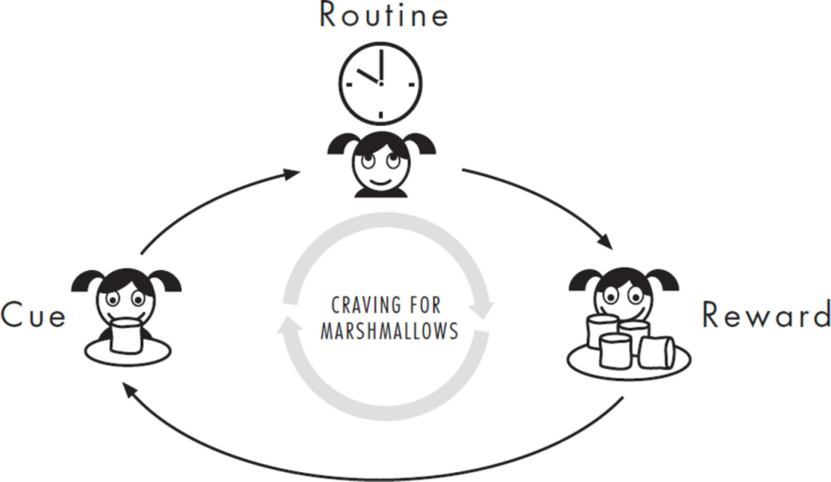
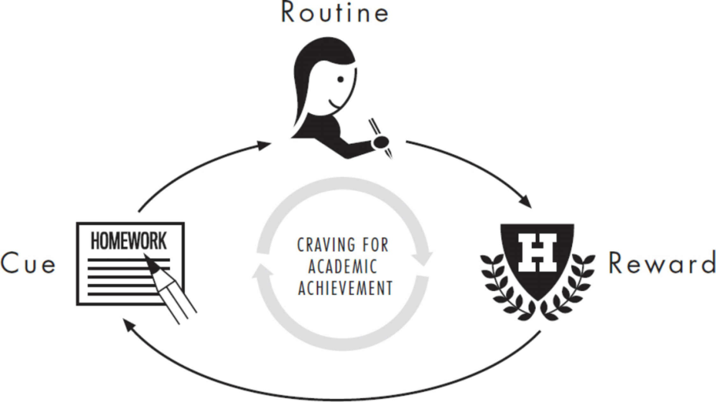
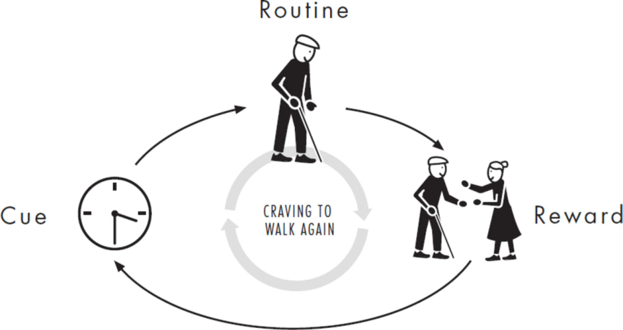
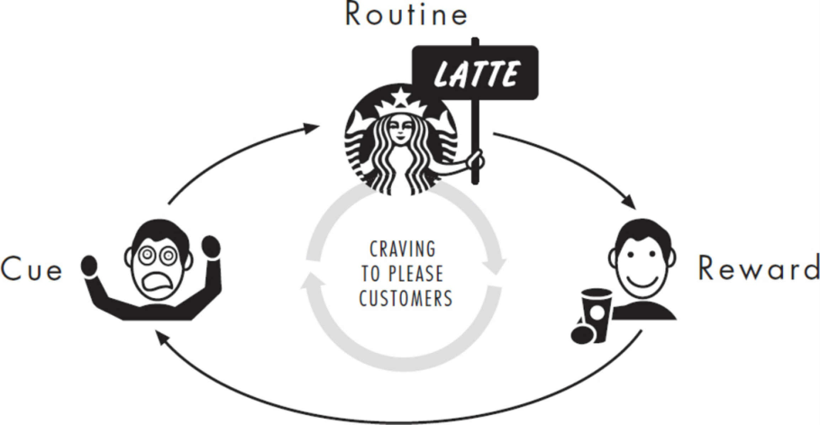

# Chapter 5: Starbucks and the Habit of Success

*When Willpower Becomes Automatic*

## I.

The first time Travis Leach saw his father overdose, he was nine years old. His family had just moved into a small apartment at the end of an alleyway, the latest in a seemingly endless series of relocations that had most recently caused them to abandon their previous home in the middle of the night, throwing everything they owned into black garbage bags after receiving an eviction notice. Too many people coming and going too late at night, the landlord said. Too much noise.

Sometimes, at his old house, Travis would come home from school and find the rooms neatly cleaned, leftovers meticulously wrapped in the fridge and packets of hot sauce and ketchup in Tupperware containers. He knew this meant his parents had temporarily abandoned heroin for crank and spent the day in a cleaning frenzy. Those usually ended badly. Travis felt safer when the house was messy and his parents were on the couch, their eyes half-lidded, watching cartoons. There is no chaos at the end of a heroin fog.

Travis’s father was a gentle man who loved to cook and, except for a stint in the navy, spent his entire life within a few miles of his parents in Lodi, California. Travis’s mother, by the time everyone moved into the alleyway apartment, was in prison for heroin possession and prostitution. His parents were, essentially, functional addicts and the family maintained a veneer of normalcy. They went camping every summer and on most Friday nights attended his sister and brother’s softball games. When Travis was four years old, he went to Disneyland with his dad and was photographed for the first time in his life, by a Disney employee. The family camera had been sold to a pawn shop years before.

On the morning of the overdose, Travis and his brother were playing in the living room on top of blankets they laid out on the floor each night for sleeping. Travis’s father was getting ready to make pancakes when he stepped into the bathroom. He was carrying the tube sock that contained his needle, spoon, lighter, and cotton swabs. A few moments later, he came out, opened the refrigerator to get the eggs, and crashed to the floor. When the kids ran around the corner, their father was convulsing, his face turning blue.

Travis’s siblings had seen an overdose before and knew the drill. His brother rolled him onto his side. His sister opened his mouth to make sure he wouldn’t choke on his tongue, and told Travis to run next door, ask to use the neighbor’s phone, and dial 911.

“My name is Travis, my dad is passed out, and we don’t know what happened. He’s not breathing,” Travis lied to the police operator. Even at nine years old, he knew why his father was unconscious. He didn’t want to say it in front of the neighbor. Three years earlier, one of his dad’s friends had died in their basement after shooting up. When the paramedics had taken the body away, neighbors gawked at Travis and his sister while they held the door open for the gurney. One of the neighbors had a cousin whose son was in his class, and soon everyone in school had known.

After hanging up the phone, Travis walked to the end of the alleyway and waited for the ambulance. His father was treated at the hospital that morning, charged at the police station in the afternoon, and home again by dinnertime. He made spaghetti. Travis turned ten a few weeks later.

* * *

When Travis was sixteen, he dropped out of high school. “I was tired of being called a faggot,” he said, “tired of people following me home and throwing things at me. Everything seemed really overwhelming. It was easier to quit and go somewhere else.” He moved two hours south, to Fresno, and got a job at a car wash. He was fired for insubordination. He got jobs at McDonald’s and Hollywood Video, but when customers were rude—“I wanted ranch dressing, you moron!”—he would lose control.

“Get out of my drive-through!” he shouted at one woman, throwing the chicken nuggets at her car before his manager pulled him inside.

Sometimes he’d get so upset that he would start crying in the middle of a shift. He was often late, or he’d take a day off for no reason. In the morning, he would yell at his reflection in the mirror, order himself to be better, to suck it up. But he couldn’t get along with people, and he wasn’t strong enough to weather the steady drip of criticisms and indignities. When the line at his register would get too long and the manager would shout at him, Travis’s hands would start shaking and he’d feel like he couldn’t catch his breath. He wondered if this is what his parents felt like, so defenseless against life, when they started using drugs.

One day, a regular customer at Hollywood Video who’d gotten to know Travis a little bit suggested he think about working at Starbucks. “We’re opening a new store on Fort Washington, and I’m going to be an assistant manager,” the man said. “You should apply.” A month later, Travis was a barista on the morning shift.

That was six years ago. Today, at twenty-five, Travis is the manager of two Starbucks where he oversees forty employees and is responsible for revenues exceeding $2 million per year. His salary is $44,000 and he has a 401(k) and no debt. He’s never late to work. He does not get upset on the job. When one of his employees started crying after a customer screamed at her, Travis took her aside.

“Your apron is a shield,” he told her. “Nothing anyone says will ever hurt you. You will always be as strong as you want to be.”

He picked up that lecture in one of his Starbucks training courses, an education program that began on his first day and continues throughout an employee’s career. The program is sufficiently structured that he can earn college credits by completing the modules. The training has, Travis says, changed his life. Starbucks has taught him how to live, how to focus, how to get to work on time, and how to master his emotions. Most crucially, it has taught him willpower.

“Starbucks is the most important thing that has ever happened to me,” he told me. “I owe everything to this company.”

* * *

For Travis and thousands of others, Starbucks—like a handful of other companies—has succeeded in teaching the kind of life skills that schools, families, and communities have failed to provide. With more than 137,000 current employees and more than one million alumni, Starbucks is now, in a sense, one of the nation’s largest educators. All of those employees, in their first year alone, spent at least fifty hours in Starbucks classrooms, and dozens more at home with Starbucks’ workbooks and talking to the Starbucks mentors assigned to them.

At the core of that education is an intense focus on an all-important habit: willpower. Dozens of studies show that willpower is the single most important[^1] keystone habit for individual success. In a 2005 study, for instance, researchers from the University of Pennsylvania analyzed 164 eighth-grade students, measuring their IQs and other factors, including how much willpower the students demonstrated, as measured by tests of their self-discipline.

Students who exerted high levels of willpower were more likely to earn higher grades in their classes and gain admission into more selective schools. They had fewer absences and spent less time watching television and more hours on homework. “Highly self-disciplined adolescents outperformed their more impulsive peers on every academic-performance variable,” the researchers wrote. “Self-discipline predicted academic performance more robustly than did IQ. Self-discipline also predicted which students would improve their grades over the course of the school year, whereas IQ did not….Self-discipline has a bigger effect on[^2] academic performance than does intellectual talent.”

And the best way to strengthen willpower and give students a leg up, studies indicate, is to make it into a habit. “Sometimes it looks like people with great self-control aren’t working hard—but that’s because they’ve made it automatic,” Angela Duckworth, one of the University of Pennsylvania researchers told me. “Their willpower occurs without them having to think about it.”

For Starbucks, willpower is more than an academic curiosity. When the company began plotting its massive growth strategy in the late 1990s, executives recognized that success required cultivating an environment that justified paying four dollars for a fancy cup of coffee. The company needed to train its employees to deliver a bit of joy alongside lattes and scones. So early on, Starbucks started researching how they could teach employees to regulate their emotions and marshal their self-discipline to deliver a burst of pep with every serving. Unless baristas are trained to put aside their personal problems, the emotions of some employees will inevitably spill into how they treat customers. However, if a worker knows how to remain focused and disciplined, even at the end of an eight-hour shift, they’ll deliver the higher class of fast food service that Starbucks customers expect.

The company spent millions of dollars developing curriculums to train employees on self-discipline. Executives wrote workbooks that,[^3] in effect, serve as guides to how to make willpower a habit in workers’ lives. Those curriculums are, in part, why Starbucks has grown from a sleepy Seattle company into a behemoth with more than seventeen thousand stores and revenues of more than $10 billion a year.

So how does Starbucks do it? How do they take people like Travis—the son of drug addicts and a high school dropout who couldn’t muster enough self-control to hold down a job at McDonald’s—and teach him to oversee dozens of employees and tens of thousands of dollars in revenue each month? What, precisely, did Travis learn?

## II.

Everyone who walked into the room where the experiment was being conducted at Case Western Reserve University agreed on one thing: The cookies smelled delicious. They had just come out of the oven and were piled in a bowl, oozing with chocolate chips. On the table next to the cookies was a bowl of radishes. All day long, hungry students walked in, sat in front of the two foods, and submitted, unknowingly, to a test of their willpower that would upend our understanding of how self-discipline works.

At the time, there was relatively little academic scrutiny into willpower. Psychologists considered such subjects to be aspects of something they called “self-regulation,” but it wasn’t a field that inspired great curiosity. There was one famous experiment, conducted in the 1960s, in which scientists at Stanford had tested the willpower of a group of four-year-olds. The kids were brought into a room and presented with a selection of treats, including marshmallows. They were offered a deal: They could eat one marshmallow right away, or, if they waited a few minutes, they could have two marshmallows. Then the researcher left the room. Some kids gave in to temptation and ate the marshmallow as soon as the adult left. About 30 percent managed to ignore their urges, and doubled their treats when the researcher came back fifteen minutes later. Scientists, who were watching everything from behind a two-way mirror, kept careful track of which kids had enough self-control to earn the second marshmallow.

Years later, they tracked down many of the study’s participants. By now, they were in high school. The researchers asked about their grades and SAT scores, ability to maintain friendships, and their capacity to “cope with important problems.” They discovered that the four-year-olds who could delay gratification the longest ended up with the best grades and with SAT scores 210 points higher, on average, than everyone else. They were more popular and did fewer drugs. If you knew how to avoid the temptation of a marshmallow as a preschooler, it seemed, you also knew how to get yourself to class on time and finish your homework once you got older, as well as how to make friends and resist peer pressure. It was as if the marshmallow-ignoring kids[^4] had self-regulatory skills that gave them an advantage throughout their lives.

Scientists began conducting related experiments, trying to figure out how to help kids increase their self-regulatory skills. They learned that teaching them simple tricks—such as distracting themselves by drawing a picture, or imagining a frame around the marshmallow, so it seemed more like a photo and less like a real temptation—helped them learn self-control. By the 1980s, a theory emerged that became generally accepted: Willpower is a learnable skill, something that can be taught the same way kids learn to do math and say “thank you.” But funding for these inquiries was scarce. The topic of willpower wasn’t in vogue. Many of the Stanford scientists moved on to other areas of research.

*WHEN KIDS LEARN HABITS FOR DELAYING THEIR CRAVINGS…*

*THOSE HABITS SPILL OVER TO OTHER PARTS OF LIFE*

However, when a group of psychology PhD candidates at Case Western—including one named Mark Muraven—discovered those studies in the mid-nineties, they started asking questions the previous research didn’t seem to answer. To Muraven, this model of willpower-as-skill wasn’t a satisfying explanation. A skill, after all, is something that remains constant from day to day. If you have the skill to make an omelet on Wednesday, you’ll still know how to make it on Friday.

In Muraven’s experience, though, it felt like he forgot how to exert willpower all the time. Some evenings he would come home from work and have no problem going for a jog. Other days, he couldn’t do anything besides lie on the couch and watch television. It was as if his brain—or, at least, that part of his brain responsible for making him exercise—had forgotten how to summon the willpower to push him out the door. Some days, he ate healthily. Other days, when he was tired, he raided the vending machines and stuffed himself with candy and chips.

If willpower is a skill, Muraven wondered, then why doesn’t it remain constant from day to day? He suspected there was more to willpower than the earlier experiments had revealed. But how do you test that in a laboratory?

* * *

Muraven’s solution was the lab containing one bowl of freshly baked cookies and one bowl of radishes. The room was essentially a closet with a two-way mirror, outfitted with a table, a wooden chair, a hand bell, and a toaster oven. Sixty-seven undergraduates were recruited and told to skip a meal. One by one, the undergrads sat in front of the two bowls.

“The point of this experiment is to test taste perceptions,” a researcher told each student, which was untrue. The point was to force students—but only some students—to exert their willpower. To that end, half the undergraduates were instructed to eat the cookies and ignore the radishes; the other half were told to eat the radishes and ignore the cookies. Muraven’s theory was that ignoring cookies is hard —it takes willpower. Ignoring radishes, on the other hand, hardly requires any effort at all.

“Remember,” the researcher said, “eat only the food that has been assigned to you.” Then she left the room.

Once the students were alone, they started munching. The cookie eaters were in heaven. The radish eaters were in agony. They were miserable forcing themselves to ignore the warm cookies. Through the two-way mirror, the researchers watched one of the radish eaters pick up a cookie, smell it longingly, and then put it back in the bowl. Another grabbed a few cookies, put them down, and then licked melted chocolate off his fingers.

After five minutes, the researcher reentered the room. By Muraven’s estimation, the radish eaters’ willpower had been thoroughly taxed by eating the bitter vegetable and ignoring the treats; the cookie eaters had hardly used any of their self-discipline.

“We need to wait about fifteen minutes for the sensory memory of the food you ate to fade,” the researcher told each participant. To pass the time, she asked them to complete a puzzle. It looked fairly simple: trace a geometric pattern without lifting your pencil from the page or going over the same line twice. If you want to quit, the researcher said, ring the bell. She implied the puzzle wouldn’t take long.

In truth, the puzzle was impossible to solve.

This puzzle wasn’t a way to pass time; it was the most important part of the experiment. It took enormous willpower to keep working on the puzzle, particularly when each attempt failed. The scientists wondered, would the students who had already expended their willpower by ignoring the cookies give up on the puzzle faster? In other words, was willpower a finite resource?

From behind their two-way mirror, the researchers watched. The cookie eaters, with their unused reservoirs of self-discipline, started working on the puzzle. In general, they looked relaxed. One of them tried a straightforward approach, hit a roadblock, and then started again. And again. And again. Some worked for over half an hour before the researcher told them to stop. On average, the cookie eaters spent almost nineteen minutes apiece trying to solve the puzzle before they rang the bell.

The radish eaters, with their depleted willpower, acted completely different. They muttered as they worked. They got frustrated. One complained that the whole experiment was a waste of time. Some of them put their heads on the table and closed their eyes. One snapped at the researcher when she came back in. On average, the radish eaters worked for only about eight minutes, 60 percent less time than the cookie eaters, before quitting. When the researcher asked afterward how they felt, one of the radish eaters said he was “sick of this dumb experiment.”

“By making people use a little bit of their willpower to ignore cookies, we had put them into a state where they were willing to quit much faster,” Muraven told me. “There’s been more than two hundred studies on this idea since then, and they’ve all found the same thing. Willpower isn’t just a skill. It’s a muscle, like the muscles in your arms or legs, and it gets tired as it works harder, so there’s less power left over for other things.”

Researchers have built on this finding to explain all sorts of phenomena. Some have suggested it helps clarify[^5] why otherwise successful people succumb to extramarital affairs (which are most likely to start late at night after a long day of using willpower at work) or why good physicians make dumb mistakes (which most often occur after a doctor has finished a long, complicated task that requires intense focus). “If you want to do something that requires willpower—like going for a run after work—you have to conserve your willpower muscle during the day,” Muraven told me. “If you use it up too early[^6] on tedious tasks like writing emails or filling out complicated and boring expense forms, all the strength will be gone by the time you get home.”

* * *

But how far does this analogy extend? Will exercising willpower muscles make them stronger the same way using dumbbells strengthen biceps?

In 2006, two Australian researchers—Megan Oaten and Ken Cheng —tried to answer that question by creating a willpower workout. They enrolled two dozen people[^7] between the ages of eighteen and fifty in a physical exercise program and, over two months, put them through an increasing number of weight lifting, resistance training, and aerobic routines. Week after week, people forced themselves to exercise more frequently, using more and more willpower each time they hit the gym.

After two months, the researchers scrutinized the rest of the participants’ lives to see if increased willpower at the gym resulted in greater willpower at home. Before the experiment began, most of the subjects were self-professed couch potatoes. Now, of course, they were in better physical shape. But they were also healthier in other parts of their lives, as well. The more time they spent at the gym, the fewer cigarettes they smoked and the less alcohol, caffeine, and junk food they consumed. They were spending more hours on homework and fewer watching TV. They were less depressed.

Maybe, Oaten and Cheng wondered, those results had nothing to do with willpower. What if exercise just makes people happier and less hungry for fast food?

So they designed another experiment.[^8] This time, they signed up twenty-nine people for a four-month money management program. They set savings goals and asked participants to deny themselves luxuries, such as meals at restaurants or movies. Participants were asked to keep detailed logs of everything they bought, which was annoying at first, but eventually people worked up the self-discipline to jot down every purchase.

People’s finances improved as they progressed through the program. More surprising, they also smoked fewer cigarettes and drank less alcohol and caffeine—on average, two fewer cups of coffee, two fewer beers, and, among smokers, fifteen fewer cigarettes each day.[^9] They ate less junk food and were more productive at work and school. It was like the exercise study: As people strengthened their willpower muscles in one part of their lives—in the gym, or a money management program—that strength spilled over into what they ate or how hard they worked. Once willpower became stronger, it touched everything.

Oaten and Cheng did one more experiment. They enrolled forty-five[^10] students in an academic improvement program that focused on creating study habits. Predictably, participants’ learning skills improved. And the students also smoked less, drank less, watched less television, exercised more, and ate healthier, even though all those things were never mentioned in the academic program. Again, as their willpower muscles strengthened, good habits seemed to spill over into other parts of their lives.

“When you learn to force yourself to go to the gym or start your homework or eat a salad instead of a hamburger, part of what’s happening is that you’re changing how you think,” said Todd Heatherton, a researcher at Dartmouth[^11] who has worked on willpower studies. “People get better at regulating their impulses. They learn how to distract themselves from temptations. And once you’ve gotten into that willpower groove, your brain is practiced at helping you focus on a goal.”

There are now hundreds of researchers, at nearly every major university, studying willpower. Public and charter schools in Philadelphia, Seattle, New York, and elsewhere have started incorporating willpower-strengthening lessons into curriculums. At KIPP, or the “Knowledge Is Power Program”—a collection of charter schools serving low-income students across the nation—teaching self-control is part of the schools’ philosophy. (A KIPP school in Philadelphia gave students shirts proclaiming “Don’t Eat the Marshmallow.”) Many of these schools have dramatically[^12] raised students’ test scores.

“That’s why signing kids up for piano lessons or sports is so important. It has nothing to do with creating a good musician or a five-year-old soccer star,” said Heatherton. “When you learn to force yourself to practice for an hour or run fifteen laps, you start building self-regulatory strength. A five-year-old who can follow[^13] the ball for ten minutes becomes a sixth grader who can start his homework on time.”

As research on willpower has become a hot topic in scientific journals and newspaper articles, it has started to trickle into corporate America. Firms such as Starbucks—and the Gap, Walmart, restaurants, or any other business that relies on entry-level workers—all face a common problem: No matter how much their employees want to do a great job, many will fail because they lack self-discipline. They show up late. They snap at rude customers. They get distracted or drawn into workplace dramas. They quit for no reason.

“For a lot of employees, Starbucks is their first professional experience,” said Christine Deputy, who helped oversee the company’s training programs for more than a decade. “If your parents or teachers have been telling you what to do your entire life, and suddenly customers are yelling and your boss is too busy to give you guidance, it can be really overwhelming. A lot of people can’t make the transition. So we try to figure out how to give our employees the self-discipline they didn’t learn in high school.”

But when companies like Starbucks tried to apply the willpower lessons from the radish-and-cookie studies to the workplace, they encountered difficulties. They sponsored weight-loss classes[^14] and offered employees free gym memberships, hoping the benefits would spill over to how they served coffee. Attendance was spotty. It was hard to sit through a class or hit the gym after a full day at work, employees complained. “If someone has trouble with self-discipline at work, they’re probably also going to have trouble attending a program designed to strengthen their self-discipline after work,” Muraven said.

But Starbucks was determined to solve this problem. By 2007, during the height of its expansion, the company was opening seven new stores every day[^15] and hiring as many as fifteen hundred employees each week. Training them to excel at customer service—to show up on time and not get angry at patrons and serve everyone with a smile while remembering customers’ orders and, if possible, their names—was essential. People expect an expensive latte delivered with a bit of sparkle. “We’re not in the coffee business serving people,” Howard Behar, the former president of Starbucks, told me. “We’re in the people business serving coffee. Our entire business model is based on fantastic customer service. Without that, we’re toast.”

The solution, Starbucks discovered, was turning self-discipline into an organizational habit.

## III.

In 1992, a British psychologist[^16] walked into two of Scotland’s busiest orthopedic hospitals and recruited five-dozen patients for an experiment she hoped would explain how to boost the willpower of people exceptionally resistant to change.

The patients, on average, were sixty-eight years old. Most of them earned less than $10,000 a year and didn’t have more than a high school degree. All of them had recently undergone hip or knee replacement surgeries, but because they were relatively poor and uneducated, many had waited years for their operations. They were retirees, elderly mechanics, and store clerks. They were in life’s final chapters, and most had no desire to pick up a new book.

Recovering from a hip or knee surgery is incredibly arduous. The operation involves severing joint muscles and sawing through bones. While recovering, the smallest movements—shifting in bed or flexing a joint—can be excruciating. However, it is essential that patients begin exercising almost as soon as they wake from surgery. They must begin moving their legs and hips before the muscles and skin have healed, or scar tissue will clog the joint, destroying its flexibility. In addition, if patients don’t start exercising, they risk developing blood clots. But the agony is so extreme that it’s not unusual for people to skip out on rehab sessions. Patients, particularly elderly ones, often refuse to comply with doctors’ orders.

The Scottish study’s participants were the types of people most likely to fail at rehabilitation. The scientist conducting the experiment wanted to see if it was possible to help them harness their willpower. She gave each patient a booklet after their surgeries that detailed their rehab schedule, and in the back were thirteen additional pages—one for each week—with blank spaces and instructions: “My goals for this week are __________ ? Write down exactly what you are going to do. For example, if you are going to go for a walk this week, write down where and when you are going to walk.” She asked patients to fill in each of those pages with specific plans. Then she compared the recoveries of those who wrote out goals with those of patients who had received the same booklets, but didn’t write anything.

It seems absurd to think that giving people a few pieces of blank paper might make a difference in how quickly they recover from surgery. But when the researcher visited the patients three months later, she found a striking difference between the two groups. The patients who had written plans in their booklets had started walking almost twice as fast as the ones who had not. They had started getting in and out of their chairs, unassisted, almost three times as fast. They were putting on their shoes, doing the laundry, and making themselves meals quicker than the patients who hadn’t scribbled out goals ahead of time.

The psychologist wanted to understand why. She examined the booklets, and discovered that most of the blank pages had been filled in with specific, detailed plans about the most mundane aspects of recovery. One patient, for example, had written, “I will walk to the bus stop tomorrow to meet my wife from work,” and then noted what time he would leave, the route he would walk, what he would wear, which coat he would bring if it was raining, and what pills he would take if the pain became too much. Another patient, in a similar study, wrote a series of very specific schedules regarding the exercises he would do each time he went to the bathroom. A third wrote a minute-by-minute itinerary for walking around the block.

As the psychologist scrutinized the booklets, she saw that many of the plans had something in common: They focused on how patients would handle a specific moment of anticipated pain. The man who exercised on the way to the bathroom, for instance, knew that each time he stood up from the couch, the ache was excruciating. So he wrote out a plan for dealing with it: Automatically take the first step, right away, so he wouldn’t be tempted to sit down again. The patient who met his wife at the bus stop dreaded the afternoons, because that stroll was the longest and most painful each day. So he detailed every obstacle he might confront, and came up with a solution ahead of time.

Put another way, the patients’ plans were built around inflection points when they knew their pain—and thus the temptation to quit—would be strongest. The patients were telling themselves how they were going to make it over the hump.

Each of them, intuitively, employed the same rules that Claude Hopkins had used to sell Pepsodent. They identified simple cues and obvious rewards. The man who met his wife at the bus stop, for instance, identified an easy cue—It’s 3:30, she’s on her way home!—and he clearly defined his reward—Honey, I’m here! When the temptation to give up halfway through the walk appeared, the patient could ignore it because he had crafted self-discipline into a habit.

*PATIENTS DESIGNED WILLPOWER HABITS TO HELP THEM OVERCOME PAINFUL INFLECTION POINTS*

There’s no reason why the other patients—the ones who didn’t write out recovery plans—couldn’t have behaved the same way. All the patients had been exposed to the same admonitions and warnings at the hospital. They all knew exercise was essential for their recovery. They all spent weeks in rehab.

But the patients who didn’t write out any plans were at a significant disadvantage, because they never thought ahead about how to deal with painful inflection points. They never deliberately designed willpower habits. Even if they intended to walk around the block, their resolve abandoned them when they confronted the agony of the first few steps.

* * *

When Starbucks’s attempts at boosting workers’ willpower through gym memberships and diet workshops faltered, executives decided they needed to take a new approach. They started by looking more closely at what was actually happening inside their stores. They saw that, like the Scottish patients, their workers were failing when they ran up against inflection points. What they needed were institutional habits that made it easier to muster their self-discipline.

Executives determined that, in some ways, they had been thinking about willpower all wrong. Employees with willpower lapses, it turned out, had no difficulty doing their jobs most of the time. On the average day, a willpower-challenged worker was no different from anyone else. But sometimes, particularly when faced with unexpected stresses or uncertainties, those employees would snap and their self-control would evaporate. A customer might begin yelling, for instance, and a normally calm employee would lose her composure. An impatient crowd might overwhelm[^17] a barista, and suddenly he was on the edge of tears.

What employees really needed were clear instructions about how to deal with inflection points—something similar to the Scottish patients’ booklets: a routine for employees to follow when their willpower muscles went limp. So the company developed new training materials that spelled out routines for employees to use when they hit rough patches. The manuals taught workers how to respond to specific cues, such as a screaming customer or a long line at a cash register. Managers drilled employees, role-playing with them until the responses became automatic. The company identified specific rewards[^18] —a grateful customer, praise from a manager—that employees could look to as evidence of a job well done.

Starbucks taught their employees how to handle moments of adversity by giving them willpower habit loops.

When Travis started at Starbucks, for instance, his manager introduced him to the habits right away. “One of the hardest things about this job is dealing with an angry customer,” Travis’s manager told him. “When someone comes up and starts yelling at you because they got the wrong drink, what’s your first reaction?”

“I don’t know,” Travis said. “I guess I feel kind of scared. Or angry.”

“That’s natural,” his manager said. “But our job is to provide the best customer service, even when the pressure’s on.” The manager flipped open the Starbucks manual, and showed Travis a page that was largely blank. At the top, it read, “When a customer is unhappy, my plan is to…”

“This workbook is for you to imagine unpleasant situations, and write out a plan for responding,” the manager said. “One of the systems we use is called the LATTE method. We Listen to the customer,[^19] Acknowledge their complaint, Take action by solving the problem, Thank them, and then Explain why the problem occurred.

*THE LATTE HABIT LOOP*

“Why don’t you take a few minutes, and write out a plan for dealing with an angry customer. Use the LATTE method. Then we can role-play a little bit.”

Starbucks has dozens of routines that employees are taught to use during stressful inflection points. There’s the What What Why system of giving criticism and the Connect, Discover, and Respond system for taking orders when things become hectic. There are learned habits to help baristas tell the difference between patrons who just want their coffee (“A hurried customer speaks with a sense of urgency and may seem impatient or look at their watch”) and those who need a bit more coddling (“A regular customer knows other baristas by name and normally orders the same beverage each day”). Throughout the training manuals are dozens of blank pages where employees can write out plans that anticipate how they will surmount inflection points. Then they practice those plans,[^20] again and again, until they become automatic.

This is how willpower becomes a habit: by choosing a certain behavior ahead of time, and then following that routine when an inflection point arrives. When the Scottish patients filled out their booklets, or Travis studied the LATTE method, they decided ahead of time how to react to a cue—a painful muscle or an angry customer. When the cue arrived, the routine occurred.

Starbucks isn’t the only company to use such training methods. For instance, at Deloitte Consulting, the largest tax and financial services company in the world, employees are trained in a curriculum named “Moments That Matter,” which focuses on dealing with inflection points such as when a client complains about fees, when a colleague is fired, or when a Deloitte consultant has made a mistake. For each of those moments, there are preprogrammed routines—Get Curious, Say What No One Else Will, Apply the 5/5/5 Rule—that guide employees in how they should respond. At the Container Store, employees receive more than 185 hours of training in their first year alone. They are taught to recognize inflection points such as an angry coworker or an overwhelmed customer, and habits, such as routines for calming shoppers or defusing a confrontation. When a customer comes in who seems overwhelmed, for example, an employee immediately asks them to visualize the space in their home they are hoping to organize, and describe how they’ll feel when everything is in its place. “We’ve had customers come up to us and say, ‘This is better than a visit[^21] to my shrink,’ ” the company’s CEO told a reporter.

## IV.

Howard Schultz, the man who built Starbucks[^22] into a colossus, isn’t so different from Travis in some ways. He grew up in a public housing project in Brooklyn, sharing a two-bedroom apartment with his parents and two siblings. When he was seven years old, Schultz’s father broke his ankle and lost his job driving a diaper truck. That was all it took to throw the family into crisis. His father, after his ankle healed, began cycling through a series of lower-paying jobs. “My dad never found his way,” Schultz told me. “I saw his self-esteem get battered. I felt like there was so much more he could have accomplished.”

Schultz’s school was a wild, overcrowded place with asphalt playgrounds and kids playing football, basketball, softball, punch ball, slap ball, and any other game they could devise. If your team lost, it could take an hour to get another turn. So Schultz made sure his team always won, no matter the cost. He would come home with bloody scrapes on his elbows and knees, which his mother would gently rinse with a wet cloth. “You don’t quit,” she told him.

His competitiveness earned him a college football scholarship (he broke his jaw and never played a game), a communications degree, and eventually a job as a Xerox salesman in New York City. He’d wake up every morning, go to a new midtown office building, take the elevator to the top floor, and go door-to-door, politely inquiring if anyone was interested in toner or copy machines. Then he’d ride the elevator down one floor and start all over again.

By the early 1980s, Schultz was working for a plastics manufacturer when he noticed that a little-known retailer in Seattle was ordering an inordinate number of coffee drip cones. Schultz flew out and fell in love with the company. Two years later, when he heard that Starbucks, then just six stores, was for sale, he asked everyone he knew for money and bought it.

That was 1987. Within three years, there were eighty-four stores; within six years, more than a thousand. Today, there are seventeen thousand stores in more than fifty countries.

Why did Schultz turn out so different from all the other kids on that playground? Some of his old classmates are today cops and firemen in Brooklyn. Others are in prison. Schultz is worth more than $1 billion. He’s been heralded as one of the greatest CEOs of the twentieth century. Where did he find the determination—the willpower—to climb from a housing project to a private jet?

“I don’t really know,” he told me. “My mom always said, ‘You’re going to be the first person to go to college, you’re going to be a professional, you’re going to make us all proud.’ She would ask these little questions, ‘How are you going to study tonight? What are you going to do tomorrow? How do you know you’re ready for your test?’ It trained me to set goals.

“I’ve been really lucky,” he said. “And I really, genuinely believe that if you tell people that they have what it takes to succeed, they’ll prove you right.”

Schultz’s focus on employee training and customer service made Starbucks into one of the most successful companies in the world. For years, he was personally involved in almost every aspect of how the company was run. In 2000, exhausted, he handed over day-to-day operations to other executives, at which point, Starbucks began to stumble. Within a few years, customers were complaining about the quality of the drinks and customer service. Executives, focused on a frantic expansion, often ignored the complaints. Employees grew unhappy. Surveys indicated people were starting to equate Starbucks with tepid coffee and empty smiles.

So Schultz stepped back into the chief executive position in 2008. Among his priorities was restructuring the company’s training program to renew its focus on a variety of issues, including bolstering employees’—or “partners,” in Starbucks’ lingo—willpower and self-confidence. “We had to start earning customer and partner trust again,” Schultz told me.

At about the same time, a new wave of studies was appearing that looked at the science of willpower in a slightly different way. Researchers had noticed that some people, like Travis, were able to create willpower habits relatively easily. Others, however, struggled, no matter how much training and support they received. What was causing the difference?

Mark Muraven, who was by then[^23] a professor at the University of Albany, set up a new experiment. He put undergraduates in a room that contained a plate of warm, fresh cookies and asked them to ignore the treats. Half the participants were treated kindly. “We ask that you please don’t eat the cookies. Is that okay?” a researcher said. She then discussed the purpose of the experiment, explaining that it was to measure their ability to resist temptations. She thanked them for contributing their time. “If you have any suggestions or thoughts about how we can improve this experiment, please let me know. We want you to help us make this experience as good as possible.”

The other half of the participants weren’t coddled the same way. They were simply given orders.

“You must not eat the cookies,” the researcher told them. She didn’t explain the experiment’s goals, compliment them, or show any interest in their feedback. She told them to follow the instructions. “We’ll start now,” she said.

The students from both groups had to ignore the warm cookies for five minutes after the researcher left the room. None gave in to temptation.

Then the researcher returned. She asked each student to look at a computer monitor. It was programmed to flash numbers on the screen, one at a time, for five hundred milliseconds apiece. The participants were asked to hit the space bar every time they saw a “6” followed by a “4.” This has become a standard way to measure willpower—paying attention to a boring sequence of flashing numbers requires a focus akin to working on an impossible puzzle.

Students who had been treated kindly did well on the computer test. Whenever a “6” flashed and a “4” followed, they pounced on the space bar. They were able to maintain their focus for the entire twelve minutes. Despite ignoring the cookies, they had willpower to spare.

Students who had been treated rudely, on the other hand, did terribly. They kept forgetting to hit the space bar. They said they were tired and couldn’t focus. Their willpower muscle, researchers determined, had been fatigued by the brusque instructions.

When Muraven started exploring why students who had been treated kindly had more willpower he found that the key difference was the sense of control they had over their experience. “We’ve found this again and again,” Muraven told me. “When people are asked to do something that takes self-control, if they think they are doing it for personal reasons—if they feel like it’s a choice or something they enjoy because it helps someone else—it’s much less taxing. If they feel like they have no autonomy, if they’re just following orders, their willpower muscles get tired much faster. In both cases, people ignored the cookies. But when the students were treated like cogs, rather than people, it took a lot more willpower.”

For companies and organizations, this insight has enormous implications. Simply giving employees a sense of agency—a feeling that they are in control, that they have genuine decision-making authority—can radically increase how much energy and focus they bring to their jobs. One 2010 study[^24] at a manufacturing plant in Ohio, for instance, scrutinized assembly-line workers who were empowered to make small decisions about their schedules and work environment. They designed their own uniforms and had authority over shifts. Nothing else changed. All the manufacturing processes and pay scales stayed the same. Within two months, productivity at the plant increased by 20 percent. Workers were taking shorter breaks. They were making fewer mistakes. Giving employees a sense of control improved how much self-discipline they brought to their jobs.

The same lessons hold true at Starbucks. Today, the company is focused on giving employees a greater sense of authority. They have asked workers to redesign how espresso machines and cash registers are laid out, to decide for themselves how customers should be greeted and where merchandise should be displayed. It’s not unusual for a store manager to spend hours discussing with his employees where a blender should be located.

“We’ve started asking partners to use their intellect and creativity, rather than telling them ‘take the coffee out of the box, put the cup here, follow this rule,’ ” said Kris Engskov, a vice president at Starbucks. “People want to be in control of their lives.”

Turnover has gone down. Customer satisfaction is up. Since Schultz’s return, Starbucks has boosted revenues by more than $1.2 billion per year.

## V.

When Travis was sixteen, before he dropped out of school and started working for Starbucks, his mother told him a story. They were driving together, and Travis asked why he didn’t have more siblings. His mother had always tried to be completely honest with her children, and so she told him that she had become pregnant two years before Travis was born but had gotten an abortion. They already had two children at that point, she explained, and were addicted to drugs. They didn’t think they could support another baby. Then, a year later, she became pregnant with Travis. She thought about having another abortion, but it was too much to bear. It was easier to let nature take its course. Travis was born.

“She told me that she had made a lot of mistakes, but that having me was one of the best things that ever happened to her,” Travis said. “When your parents are addicts, you grow up knowing you can’t always trust them for everything you need. But I’ve been really lucky to find bosses who gave me what was missing. If my mom had been as lucky as me, I think things would have turned out different for her.”

A few years after that conversation, Travis’s father called to say that an infection had entered his mother’s bloodstream through one of the places on her arm she used to shoot up. Travis immediately drove to the hospital in Lodi, but she was unconscious by the time he arrived. She died a half hour later, when they removed her life support.

A week later, Travis’s father was in the hospital with pneumonia. His lung had collapsed. Travis drove to Lodi again, but it was 8:02 P.M. when he got to the emergency room. A nurse brusquely told him he’d have to come back tomorrow; visiting hours were over.

Travis has thought a lot about that moment since then. He hadn’t started working at Starbucks yet. He hadn’t learned how to control his emotions. He didn’t have the habits that, since then, he’s spent years practicing. When he thinks about his life now, how far he is from a world where overdoses occur and stolen cars show up in driveways and a nurse seems like an insurmountable obstacle, he wonders how it’s possible to travel such a long distance in such a short time.

“If he had died a year later, everything would have been different,” Travis told me. By then, he would have known how to calmly plead with the nurse. He would have known to acknowledge her authority, and then ask politely for one small exception. He could have gotten inside the hospital. Instead, he gave up and walked away. “I said, ‘All I want to do is talk to him once,’ and she was like, ‘He’s not even awake, it’s after visiting hours, come back tomorrow.’ I didn’t know what to say. I felt so small.”

Travis’s father died that night.

On the anniversary of his death, every year, Travis wakes up early, takes an extra-long shower, plans out his day in careful detail, and then drives to work. He always arrives on time.

## Notes

[^1]: **willpower is the single most important** J. P. Tangney, R. F. Baumeister, and A. L. Boone, “High Self-Control Predicts Good Adjustment, Less Pathology, Better Grades, and Interpersonal Success,” Journal of Personality 72, no. 2 (2004): 271–324; Paul Karoly, “Mechanisms of Self-Regulation: A Systems View,” Annual Review of Psychology 44 (1993): 23–52; James J. Gross, Jane M. Richards, and Oliver P. John, “Emotional Regulation in Everyday Life,” in Emotion Regulation in Families: Pathways to Dysfunction and Health, ed. Douglas K. Snyder, Jeffry A. Simpson, and Jan N. Hughes (Washington, D.C.: American Psychological Association, 2006); Katleen De Stobbeleir, Susan Ashford, and Dirk Buyens, “From Trait and Context to Creativity at Work: Feedback-Seeking Behavior as a Self-Regulation Strategy for Creative Performance,” Vlerick Leuven Gent Working Paper Series, September 17, 2008; Babette Raabe, Michael Frese, and Terry A. Beehr, “Action Regulation Theory and Career Self-Management,” Journal of Vocational Behavior 70 (2007): 297–311; Albert Bandura, “The Primacy of Self-Regulation in Health Promotion,” Applied Psychology 54 (2005): 245–54; Robert G. Lord et al., “Self-Regulation at Work,” Annual Review of Psychology 61 (2010): 543–68; Colette A. Frayne and Gary P. Latham, “Application of Social Learning Theory to Employee Self-Management of Attendance,” Journal of Applied Psychology 72 (1987): 387–92; Colette Frayne and J. M. Geringer, “Self-Management Training for Improving Job Performance: A Field Experiment Involving Salespeople,” Journal of Applied Psychology 85 (2000): 361–72.

[^2]: **“Self-discipline has a bigger effect on”** Angela L. Duckworth and Martin E. P. Seligman, “Self-Discipline Outdoes IQ in Predicting Academic Performance of Adolescents,” Psychological Science 16 (2005): 939–44.

[^3]: **Executives wrote workbooks that** Information on Starbucks training methods is drawn from numerous interviews, as well as the company’s training materials. Information on training materials comes from copies provided by Starbucks employees and court records, including the following internal Starbucks documents and training manuals: Starbucks Coffee Company Partner Guide, U.S. Store Version; Learning Coach Guide; In-Store Learning Coaches Guide; Shift Supervisor Learning Journey; Retail Management Training; Supervisory Skills Facilitator Guide; Supervisory Skills Partner Workbook; Shift Supervisor Training: Store Manager’s Planning and Coaches Guide; Managers’ Guide: Learning to Lead, Level One and Two; Supervisory Skills: Learning to Lead Facilitators Guide; First Impressions Guide; Store Manager Training Plan/Guide; District Manager Training Plan/Guide; Partner Resources Manual; Values Walk. In a statement sent in response to fact-checking inquiries, a Starbucks representative wrote: “In reviewing, we felt that your overall theme focuses on emotional intelligence (EQ) and that we attract partners who need development in this area—this is not true holistically. It’s important to note that 70 percent of U.S. partners are students and learning in a lot of ways in their life. What Starbucks provides—and partners are inclined to join because of it—is an environment that matches their values, a place to be a part of something bigger (like community), an approach that focuses on problem solving by showing not telling and a successful way to deliver inspired service.” The company added that “we’d like to note that as part of our Customer Service Vision, our partners are trusted completely and are empowered to use their best judgment. We believe that this level of trust and empowerment is unique, and that partners rise to the occasion when we treat them with respect.”

[^4]: **It was as if the marshmallow-ignoring kids** Harriet Mischel and Walter Mischel, “The Development of Children’s Knowledge of Self- Control Strategies,” Child Development 54 (1983), 603–19; W. Mischel, Y. Shoda, and M. I. Rodriguez, “Delay of Gratification in Children,” Science 244 (1989): 933–38; Walter Mischel et al., “The Nature of Adolescent Competencies Predicted by Preschool Delay of Gratification,” Journal of Personality and Social Psychology 54 (1988): 687–96; J. Metcalfe and W. Mischel, “A Hot/Cool-System Analysis of Delay of Gratification: Dynamics of Will Power,” Psychological Review 106 (1999): 3–19; Jonah Lehrer, “The Secret of Self Control,” The New Yorker, May 18, 2009.

[^5]: **Some have suggested it helps clarify** In a fact-checking email, Muraven wrote: “There is research to suggest that marital problems spring from low self-control and that depletion contributes to poor outcomes when couples are discussing tense relationship issues. Likewise, we have found that on days that require more self-control than average, people are more likely to lose control over their drinking. There is also some research that suggests depleted individuals make poorer decisions than nondepleted individuals. These findings may be extended to explain extramarital affairs or mistakes by physicians, but that has not been” directly shown to be a cause-and-effect relationship.

[^6]: **“If you use it up too early”** Roy F. Baumeister et al., “Ego- Depletion: Is the Active Self a Limited Resource?” Journal of Personality and Social Psychology 18 (1998): 130–50; R. F. Baumeister, M. Muraven, and D. M. Tice, “Self-Control as a Limited Resource: Regulatory Depletion Patterns,” Psychological Bulletin 126 (1998): 247–59; R. F. Baumeister, M. Muraven, and D. M. Tice, “Longitudinal Improvement of Self-Regulation Through Practice: Building Self-Control Strength Through Repeated Exercise,” Journal of Social Psychology 139 (1999): 446–57; R. F. Baumeister, M. Muraven, and D. M. Tice, “Ego Depletion: A Resource Model of Volition, Self-Regulation, and Controlled Processing,” Social Cognition 74 (2000): 1252–65; Roy F. Baumeister and Mark Muraven, “Self-Regulation and Depletion of Limited Resources: Does Self- Control Resemble a Muscle?” Psychological Bulletin 126 (2000): 247– 59; See also M. S. Hagger et al., “Ego Depletion and the Strength Model of Self-Control: A Meta-Analysis,” Psychological Bulletin 136 (2010): 495–25; R. G. Baumeister, K. D. Vohs, and D. M. Tice, “The Strength Model of Self-Control,” Current Directions in Psychological Science 16 (2007): 351–55; M. I. Posne and M. K. Rothbart, “Developing Mechanisms of Self-Regulation,” Development and Psychopathology 12 (2000): 427–41; Roy F. Baumeister and Todd F. Heatherton, “Self-Regulation Failure: An Overview,” Psychological Inquiry 7 (1996): 1–15; Kathleen D. Vohs et al., “Making Choices Impairs Subsequent Self-Control: A Limited-Resource Account of Decision Making, Self-Regulation, and Active Initiative,” Journal of Personality and Social Psychology 94 (2008): 883–98; Daniel Romer et al., “Can Adolescents Learn Self-Control? Delay of Gratification in the Development of Control over Risk Taking,” Prevention Science 11 (2010): 319–30. In a fact-checking email, Muraven wrote: “Our research suggests that people often don’t even realize that they are depleted and that the first act of self-control affected them. Instead, exerting self-control causes people to be less willing to work hard on subsequent self-control efforts (ultimately, this is a theory of motivation, not cognition)….[E]ven after the most depleting day, people still don’t urinate on the floor. Again, this suggests the motivational aspect of the theory—they lack the motivation to force themselves to do things that are less important to them. I realize this may seem like splitting hairs, but it is critical to understand that self- control doesn’t fail because the person cannot muster the needed resources. Instead it fails because the effort seems too great for the payoff. Basically, I don’t want the next murderer to say that he was depleted so he couldn’t control himself.”

[^7]: **They enrolled two dozen people** Megan Oaten and K. Cheng, “Longitudinal Gains in Self-Regulation from Regular Physical Exercise,” Journal of Health Psychology 11 (2006): 717–33. See also Roy F. Baumeister et al., “Self-Regulation and Personality: How Interventions Increase Regulatory Success, and How Depletion Moderates the Effects of Traits on Behavior,” Journal of Personality 74 (2006): 1773–1801.

[^8]: **So they designed another experiment** Megan Oaten and K. Cheng, “Improvements in Self-Control from Financial Monitoring,” Journal of Economic Psychology 28 (2007): 487–501.

[^9]: **fifteen fewer cigarettes each day** Roy F. Baumeister et al., “Self- Regulation and Personality.”

[^10]: **They enrolled forty-five** Ibid.

[^11]: **Heatherton, a researcher at Dartmouth** For a selection of Heatherton’s fascinating work, see Todd F. Heatherton, Ph.D., ~heath/ #Pubs, last modified June 30, 2009.

[^12]: **Many of these schools have dramatically** Lehrer, “The Secret of Self Control.”

[^13]: **A five-year-old who can follow** In a fact-checking email, Dr. Heatherton expanded upon this idea: “Exactly how the brain does this is somewhat unclear, although I propose that people develop better frontal control over subcortical reward centers….The repeated practice helps strengthen the ‘muscle’ (although clearly it is not a muscle; more likely it is better prefrontal cortical control or the development of a strong network of brain regions involved in controlling behavior).” For more information, see Todd F. Heatherton and Dylan D. Wagner, “Cognitive Neuroscience of Self-Regulation Failure,” Trends in Cognitive Sciences 15 (2011): 132–39.

[^14]: **They sponsored weight-loss classes** In a fact-checking email, a Starbucks spokesman wrote: “Currently, Starbucks offers discounts at many of the national fitness clubs. We believe that this discussion should be more around overall health and wellness options provided to our partners, rather than focusing specifically on gym memberships. We know that our partners want to find ways to be well and we continue to look for programs that will enable them to do that.”

[^15]: **opening seven new stores every day** Michael Herriman et al., “A Crack in the Mug: Can Starbucks Mend It?” Harvard Business Review, October 2008.

[^16]: **In 1992, a British psychologist** Sheina Orbell and Paschal Sheeran, “Motivational and Volitional Processes in Action Initiation: A Field Study of the Role of Implementation Intentions,” Journal of Applied Social Psychology 30, no. 4 (April 2000): 780–97.

[^17]: **An impatient crowd might overwhelm** In a fact-checking statement, a Starbucks spokesman wrote: “Overall accurate assessment, however, we would argue that any job is stressful. As mentioned above, one of the key elements of our Customer Service Vision is that every partner owns the customer experience. This empowerment lets partners know that the company trusts them to resolve issues and helps create the confidence to successfully navigate these moments.”

[^18]: **The company identified specific rewards** These details were confirmed with Starbucks employees and executives. In a fact- checking statement, however, a Starbucks spokesman wrote: “This is not accurate.” The spokesman declined to provide further details.

[^19]: **We Listen to the customer** In a fact-checking statement, a Starbucks spokesman wrote: “While it is certainly not incorrect or wrong to refer to it, LATTE is no longer part of our formal training. In fact, we are moving away from more prescriptive steps like LATTE and are widening the guardrails to enable store partners to engage in problem solving to address the many unique issues that arise in our stores. This model is very dependent on continual effective coaching by shift supervisors, store, and district managers.”

[^20]: **Then they practice those plans** In a fact-checking statement, a Starbucks spokesman wrote: “Overall accurate assessment—we strive to provide tools and training on both skills and behaviors to deliver world-class customer service to every customer on every visit. We would like to note, however, that similar to LATTE (and for the same reasons), we do not formally use Connect, Discover, Respond.”

[^21]: **“ ‘This is better than a visit’ ”** Constance L. Hays, “These Days the Customer Isn’t Always Treated Right,” The New York Times, December 23, 1998.

[^22]: **Schultz, the man who built Starbucks** Information on Schultz from Adi Ignatius, “We Had to Own the Mistakes,” Harvard Business Review, July-August 2010; William W. George and Andrew N. McLean, “Howard Schultz: Building Starbucks Community (A),” Harvard Business Review, June 2006; Koehn, Besharov, and Miller, “Starbucks Coffee Company in the 21st Century,” Harvard Business Review, June 2008; Howard Schultz and Dori Jones Yang, Pour Your Heart Into It: How Starbucks Built a Company One Cup at a Time (New York: Hyperion, 1997); Taylor Clark, Starbucked: A Double Tall Tale of Caffeine, Commerce, and Culture (New York: Little, Brown, 2007); Howard Behar, It’s Not About the Coffee: Lessons on Putting People First from a Life at Starbucks (New York: Portfolio Trade, 2009); John Moore, Tribal Knowledge (New York: Kaplan, 2006); Bryant Simon, Everything but the Coffee: Learning About America from Starbucks (Berkeley: University of California Press, 2009). In a fact-checking statement, a Starbucks spokesman wrote: “Although at a very high level, the overall story is correct, a good portion of the details are incorrect or cannot be verified.” That spokesperson declined to detail what was incorrect or provide any clarifications.

[^23]: **Mark Muraven, who was by then** M. Muraven, M. Gagné, and H. Rosman, “Helpful Self-Control: Autonomy Support, Vitality, and Depletion,” Journal of Experimental and Social Psychology 44, no. 3 (2008): 573–85. See also Mark Muraven, “Practicing Self-Control Lowers the Risk of Smoking Lapse,” Psychology of Addictive Behaviors 24, no. 3 (2010): 446–52; Brandon J. Schmeichel and Kathleen Vohs, “Self-Affirmation and Self-Control: Affirming Core Values Counteracts Ego Depletion,” Journal of Personality and Social Psychology 96, no. 4 (2009): 770–82; Mark Muraven, “Autonomous Self-Control Is Less Depleting,” Journal of Research in Personality 42, no. 3 (2008): 763–70; Mark Muraven, Dikla Shmueli, and Edward Burkley, “Conserving Self-Control Strength,” Journal of Personality and Social Psychology 91, no. 3 (2006): 524–37; Ayelet Fishbach, “The Dynamics of Self-Regulation,” in 11th Sydney Symposium of Social Psychology (New York: Psychology Press, 2001); Tyler F. Stillman et al., “Personal Philosophy and Personnel Achievement: Belief in Free Will Predicts Better Job Performance,” Social Psychological and Personality Science 1 (2010): 43–50; Mark Muraven, “Lack of Autonomy and Self-Control: Performance Contingent Rewards Lead to Greater Depletion,” Motivation and Emotion 31, no. 4 (2007): 322–30.

[^24]: **One 2010 study** This study, as of the time of writing this book, was unpublished and shared with me on the condition its authors would not be revealed. However, further details on employee empowerment studies can be found in C. O. Longenecker, J. A. Scazzero, and T. T. Standfield, “Quality Improvement Through Team Goal Setting, Feedback, and Problem Solving: A Field Experiment,” International Journal of Quality and Reliability Management 11, no. 4 (1994): 45– 52; Susan G. Cohen and Gerald E. Ledford, “The Effectiveness of Self- Managing Teams: A Quasi-Experiment,” Human Relations 47, no. 1 (1994): 13–43; Ferris, Rosen, and Barnum, Handbook of Human Resource Management (Cambridge, Mass.: Blackwell Publishers, 1995); Linda Honold, “A Review of the Literature on Employee Empowerment,” Empowerment in Organizations 5, no. 4 (1997): 202–12; Thomas C. Powell, “Total Quality Management and Competitive Advantage: A Review and Empirical Study,” Strategic Management Journal 16 (1995): 15–37.
