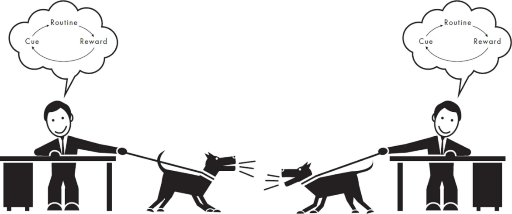
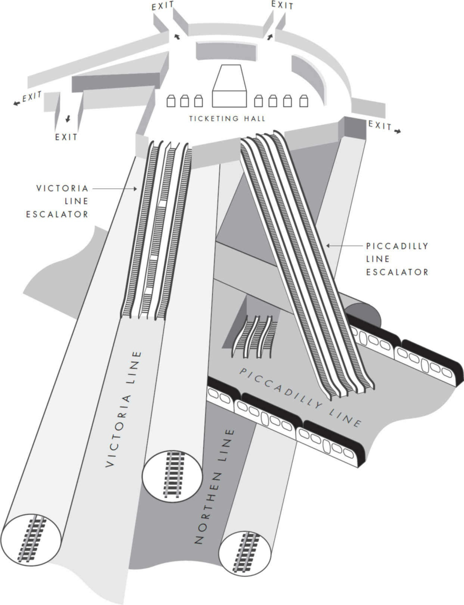

# Chapter 6: The Power of a Crisis

*How Leaders Create Habits Through Accident and Design*

## I.

The patient was already unconscious when he was wheeled into the operating room at Rhode Island Hospital. His jaw was slack, his eyes closed, and the top of an intubation tube peeked above his lips. As a nurse hooked him up to a machine that would force air into his lungs during surgery, one of his arms slipped off the gurney, the skin mottled with liver spots.

The man was eighty-six years old and, three days earlier, had fallen at home. Afterward, he had trouble staying awake[^1] and answering questions, and so eventually his wife called an ambulance. In the emergency room, a doctor asked him what happened, but the man kept nodding off in the middle of his sentences. A scan of his head revealed why: The fall had slammed his brain against his skull, causing what’s known as a subdural hematoma. Blood was pooling within the left portion of his cranium, pushing against the delicate folds of tissue inside his skull. The fluid had been building for almost seventy-two hours, and those parts of the brain that controlled his breathing and heart were beginning to falter. Unless the blood was drained,[^2] the man would die.

At the time, Rhode Island Hospital was one of the nation’s leading medical institutions, the main teaching hospital for Brown University and the only Level I trauma center in southeastern New England. Inside the tall brick and glass building, physicians had pioneered cutting-edge medical techniques, including the use of ultrasound waves to destroy tumors inside a patient’s body. In 2002, the National Coalition on Health Care[^3] rated the hospital’s intensive care unit as one of the finest in the country.

But by the time the elderly patient arrived, Rhode Island Hospital also had another reputation: a place riven by internal tensions. There were deep, simmering enmities between nurses and physicians. In 2000, the nurses’ union had voted to strike after complaining that they were being forced to work dangerously long hours. More than three hundred of them stood outside the hospital with signs reading “Stop Slavery” and “They can’t take away our pride.”[^4]

“This place can be awful,” one nurse recalled telling a reporter. “The doctors can make you feel like you’re worthless, like you’re disposable. Like you should be thankful to pick up after them.”

Administrators eventually agreed to limit[^5] nurses’ mandatory overtime, but tensions continued to rise. A few years later, a surgeon was preparing for a routine abdominal operation when a nurse called for a “time-out.” Such pauses are standard procedure at most hospitals, a way for doctors and staff to make sure mistakes are avoided.[^6] The nursing staff at Rhode Island Hospital was insistent on time-outs, particularly since a surgeon had accidentally removed the tonsils of a girl who was supposed to have eye surgery. Time-outs were supposed to catch such errors before they occurred.

At the abdominal surgery, when the OR nurse asked the team to gather around the patient for a time-out and to discuss their plan, the doctor headed for the doors.

“Why don’t you lead this?” the surgeon told the nurse. “I’m going to step outside for a call. Knock when you’re ready.”

“You’re supposed to be here for this, Doctor,” she replied.

“You can handle it,” the surgeon said, as he walked toward the door.

“Doctor, I don’t feel this is appropriate.”

The doctor stopped and looked at her. “If I want your damn opinion, I’ll ask for it,” he said. “Don’t ever question my authority again. If you can’t do your job, get the hell out of my OR.”

The nurse led the time-out, retrieved the doctor a few minutes later, and the procedure occurred without complication. She never contradicted a physician again, and never said anything when other safety policies were ignored.

“Some doctors were fine, and some were monsters,” one nurse who worked at Rhode Island Hospital in the mid-2000s told me. “We called it the glass factory, because it felt like everything could crash down at any minute.”

To deal with these tensions, the staff had developed informal rules—habits unique to the institution—that helped avert the most obvious conflicts. Nurses, for instance, always double-checked the orders of error-prone physicians and quietly made sure that correct doses were entered; they took extra time to write clearly on patients’ charts, lest a hasty surgeon make the wrong cut. One nurse told me they developed a system of color codes to warn one another. “We put doctors’ names in different colors on the whiteboards,” she said. “Blue meant ‘nice,’ red meant ‘jerk,’ and black meant, ‘whatever you do, don’t contradict them or they’ll take your head off.’ ”

Rhode Island Hospital was a place filled with a corrosive culture. Unlike at Alcoa, where carefully designed keystone habits surrounding worker safety had created larger and larger successes, inside Rhode Island Hospital, habits emerged on the fly among nurses seeking to offset physician arrogance. The hospital’s routines weren’t carefully thought out. Rather, they appeared by accident and spread through whispered warnings, until toxic patterns emerged. This can happen within any organization where habits aren’t deliberately planned. Just as choosing the right keystone habits can create amazing change, the wrong ones can create disasters.

And when the habits within Rhode Island Hospital imploded, they caused terrible mistakes.

* * *

When the emergency room staff saw the brain scans of the eighty-six-year-old man with the subdural hematoma, they immediately paged the neurosurgeon on duty. He was in the middle of a routine spinal surgery, but when he got the page, he stepped away from the operating table and looked at images of the elderly man’s head on a computer screen. The surgeon told his assistant—a nurse practitioner—to go to the emergency room and get the man’s wife to sign a consent form approving surgery. He finished his spinal procedure. A half hour later,[^7] the elderly man was wheeled into the same operating theater.

Nurses were rushing around. The unconscious elderly man was placed on the table. A nurse picked up his consent form and medical chart.

“Doctor,” the nurse said, looking at the patient’s chart. “The consent form doesn’t say where the hematoma is.” The nurse leafed through the paperwork. There was no clear indication of[^8] which side of his head they were supposed to operate on.

Every hospital relies upon paperwork to guide surgeries. Before any cut is made, a patient or family member is supposed to sign a document approving each procedure and verifying the details. In a chaotic environment, where as many as a dozen doctors and nurses may handle a patient between the ER and the recovery suite, consent forms are the instructions that keep track of what is supposed to occur. No one is supposed to go into surgery without a signed and detailed consent.

“I saw the scans before,” the surgeon said. “It was the right side of the head. If we don’t do this quickly, he’s gonna die.”

“Maybe we should pull up the films again,” the nurse said, moving toward a computer terminal. For security reasons, the hospital’s computers locked after fifteen minutes of idling. It would take at least a minute for the nurse to log in and load the patient’s brain scans onto the screen.

“We don’t have time,” the surgeon said. “They told me he’s crashing. We’ve got to relieve the pressure.”

“What if we find the family?” the nurse asked.

“If that’s what you want, then call the fucking ER and find the family! In the meantime, I’m going to save his life.” The surgeon grabbed the paperwork, scribbled “right” on the consent form, and initialed it.

“There,” he said. “We have to operate immediately.”[^9]

The nurse had worked at Rhode Island Hospital for a year. He understood the hospital’s culture. This surgeon’s name, the nurse knew, was often scribbled in black on the large whiteboard in the hallway, signaling that nurses should beware. The unwritten rules in this scenario were clear: The surgeon always wins.

The nurse put down the chart and stood aside as the doctor positioned the elderly man’s head in a cradle that provided access to the right side of his skull and shaved and applied antiseptic to his head. The plan was to open the skull and suction out the blood pooling on top of his brain. The surgeon sliced away a flap of scalp, exposed the skull, and put a drill against the white bone. He began pushing until the bit broke through with a soft pop. He made two more holes and used a saw to cut out a triangular piece of the man’s skull. Underneath was the dura, the translucent sheath surrounding the brain.

“Oh my God,” someone said.

There was no hematoma. They were operating on the wrong side of the head.

“We need him turned!” the surgeon yelled.[^10]

The triangle of bone was replaced and reattached with small metal plates and screws, and the patient’s scalp sewed up. His head was shifted to the other side and then, once again, shaved, cleansed, cut, and drilled until a triangle of skull could be removed. This time, the hematoma was immediately visible, a dark bulge that spilled like thick syrup when the dura was pierced. The surgeon vacuumed the blood and the pressure inside the old man’s skull fell immediately. The surgery, which should have taken about an hour, had run almost twice as long.

Afterward, the patient was taken to the intensive care unit, but he never regained full consciousness. Two weeks later, he died.

A subsequent investigation said it was impossible to determine the precise cause of death, but the patient’s family argued that the trauma of the medical error had overwhelmed his already fragile body, that the stress of removing two pieces of skull, the additional time in surgery, and the delay in evacuating the hematoma had pushed him over the edge. If not for the mistake, they claimed, he might still be alive. The hospital paid a settlement and the surgeon was barred from ever working at Rhode Island Hospital again.[^11]

Such an accident, some nurses later claimed, was inevitable. Rhode Island Hospital’s institutional habits were so dysfunctional, it was only a matter of time until a grievous mistake occurred.[^fn1] It’s not just hospitals that breed dangerous patterns, of course. Destructive organizational habits can be found within hundreds of industries and at thousands of firms. And almost always, they are the products of thoughtlessness, of leaders who avoid thinking about the culture and so let it develop without guidance. There are no organizations without institutional habits. There are only places where they are deliberately designed, and places where they are created without forethought, so they often grow from rivalries or fear.

But sometimes, even destructive habits can be transformed by leaders who know how to seize the right opportunities. Sometimes, in the heat of a crisis, the right habits emerge.

## II.

When An Evolutionary Theory of Economic Change was first published in 1982, very few people outside of academia noticed. The book’s bland cover and daunting[^12] first sentence—“In this volume we develop an evolutionary theory of the capabilities and behavior of business firms operating in a market environment, and construct and analyze a number of models consistent with that theory”— almost seemed designed to ward off readers. The authors, Yale professors Richard Nelson and Sidney Winter, were best known for a series of intensely analytic papers exploring Schumpeterian theory that even most PhD candidates didn’t pretend to understand.[^13]

Within the world of business strategy[^14] and organizational theory, however, the book went off like a bombshell. It was soon hailed as one of the most important texts of the century. Economics professors started talking about it to their colleagues at business schools, who started talking to CEOs at conferences, and soon executives were quoting Nelson and Winter inside corporations as different as General Electric, Pfizer, and Starwood Hotels.

Nelson and Winter had spent more than a decade examining how companies work, trudging through swamps of data before arriving at their central conclusion:[^15] “Much of firm behavior,” they wrote, is best “understood as a reflection of general habits and strategic orientations coming from the firm’s past,” rather than “the result of a detailed survey of the remote twigs of the decision tree.”

Or, put in language that people use outside of theoretical economics, it may seem like most organizations make rational choices based on deliberate decision making, but that’s not really how companies operate at all. Instead, firms are guided by long-held organizational habits, patterns that often emerge from thousands of employees’ independent decisions.[^16] And these habits have more profound impacts than anyone previously understood.

For instance, it might seem like the chief executive of a clothing company made the decision last year to feature a red cardigan on the catalog’s cover by carefully reviewing sales and marketing data. But, in fact, what really happened was that his vice president constantly trolls websites devoted to Japanese fashion trends (where red was hip last spring), and the firm’s marketers routinely ask their friends which colors are “in,” and the company’s executives, back from their annual trip to the Paris runway shows, reported hearing that designers at rival firms were using new magenta pigments. All these small inputs, the result of uncoordinated patterns among executives gossiping about competitors and talking to their friends, got mixed into the company’s more formal research and development routines until a consensus emerged: Red will be popular this year. No one made a solitary, deliberate decision. Rather, dozens of habits, processes, and behaviors converged until it seemed like red was the inevitable choice.

These organizational habits—or “routines,”[^17] as Nelson and Winter called them—are enormously important, because without them, most companies would never get any work done. Routines provide the hundreds of unwritten rules[^18] that companies need to operate.[^19] They allow workers to experiment with new ideas without having to ask for permission at every step. They provide a kind of “organizational memory,”[^20] so that managers don’t have to reinvent the sales process every six months or panic each time a VP quits. Routines reduce uncertainty[^21]—a study of recovery efforts after earthquakes in Mexico and Los Angeles, for instance, found that the habits of relief workers (which they carried from disaster to disaster, and which included things such as establishing communication networks by hiring children to carry messages between neighborhoods) were absolutely critical, “because without them, policy formulation and implementation would be lost in a jungle of detail.”

But among the most important benefits[^22] of routines is that they create truces between potentially warring groups or individuals within an organization.

Most economists are accustomed to treating companies as idyllic places where everyone is devoted to a common goal: making as much money as possible. Nelson and Winter pointed out that, in the real world, that’s not how things work at all. Companies aren’t big happy families where everyone plays together nicely. Rather, most workplaces are made up of fiefdoms where executives compete for power and credit, often in hidden skirmishes that make their own performances appear superior and their rivals’ seem worse. Divisions compete for resources and sabotage each other to steal glory. Bosses pit their subordinates against one another so that no one can mount a coup.

Companies aren’t families. They’re battlefields in a civil war.

Yet despite this capacity for internecine warfare, most companies roll along relatively peacefully, year after year, because they have routines—habits—that create truces that allow everyone to set aside their rivalries long enough to get a day’s work done.

Organizational habits offer a basic promise: If you follow the established patterns and abide by the truce, then rivalries won’t destroy the company, the profits will roll in, and, eventually, everyone will get rich. A salesperson, for example, knows she can boost her bonus by giving favored customers hefty discounts in exchange for larger orders. But she also knows that if every salesperson gives away hefty discounts, the firm will go bankrupt and there won’t be any bonuses to hand out. So a routine emerges: The salespeople all get together every January and agree to limit how many discounts they offer in order to protect the company’s profits, and at the end of the year everyone gets a raise.

Or take a young executive gunning for vice president who, with one quiet phone call to a major customer, could kill a sale and sabotage a colleague’s division, taking him out of the running for the promotion. The problem with sabotage is that even if it’s good for you, it’s usually bad for the firm. So at most companies, an unspoken compact emerges: It’s okay to be ambitious, but if you play too rough, your peers will unite against you. On the other hand, if you focus on boosting your own department, rather than undermining your rival, you’ll probably get taken care of over time.[^23]

*ROUTINES CREATE TRUCES THAT ALLOW WORK TO GET DONE*

Routines and truces offer a type of rough organizational justice, and because of them, Nelson and Winter wrote, conflict within companies usually “follows largely predictable paths and stays within predictable bounds that are consistent with the ongoing routine….The usual amount of work gets done, reprimands and compliments are delivered with the usual frequency….Nobody is trying to steer the organizational ship into a sharp turn in the hope of throwing a rival overboard.”[^24]

Most of the time, routines and truces work perfectly. Rivalries still exist, of course, but because of institutional habits, they’re kept within bounds and the business thrives.

However, sometimes even a truce proves insufficient. Sometimes, as Rhode Island Hospital discovered, an unstable peace can be as destructive as any civil war.

* * *

Somewhere in your office, buried in a desk drawer, there’s probably a handbook you received on your first day of work. It contains expense forms and rules about vacations, insurance options, and the company’s organizational chart. It has brightly colored graphs describing different health care plans, a list of relevant phone numbers, and instructions on how to access your email or enroll in the 401(k).

Now, imagine what you would tell a new colleague who asked for advice about how to succeed at your firm. Your recommendations probably wouldn’t contain anything you’d find in the company’s handbook. Instead, the tips you would pass along—who is trustworthy; which secretaries have more clout than their bosses; how to manipulate the bureaucracy to get something done—are the habits you rely on every day to survive. If you could somehow diagram all your work habits—and the informal power structures, relationships, alliances, and conflicts they represent—and then overlay your diagram with diagrams prepared by your colleagues, it would create a map of your firm’s secret hierarchy, a guide to who knows how to make things happen and who never seems to get ahead of the ball.

Nelson and Winter’s routines—and the truces they make possible—are critical to every kind of business. One study from Utrecht University in the Netherlands, for instance, looked at routines within the world of high fashion. To survive, every fashion designer has to possess some basic skills: creativity and a flair for haute couture as a start. But that’s not enough[^25] to succeed. What makes the difference between success or failure are a designer’s routines—whether they have a system for getting Italian broadcloth before wholesalers’ stocks sell out, a process for finding the best zipper and button seamstresses, a routine for shipping a dress to a store in ten days, rather than three weeks. Fashion is such a complicated business that, without the right processes, a new company will get bogged down with logistics, and once that happens, creativity ceases to matter.

And which new designers are most likely to have the right habits? The ones who have formed the right truces and found the right alliances.[^26] Truces are so important that new fashion labels usually succeed only if they are headed by people who left other fashion companies on good terms.

Some might think Nelson and Winter were writing a book on dry economic theory. But what they really produced was a guide to surviving in corporate America.

What’s more, Nelson and Winter’s theories also explain why things went so wrong at Rhode Island Hospital. The hospital had routines that created an uneasy peace between nurses and doctors—the whiteboards, for instance, and the warnings nurses whispered to one another were habits that established a baseline truce. These delicate pacts allowed the organization to function most of the time. But truces are only durable when they create real justice. If a truce is unbalanced —if the peace isn’t real—then the routines often fail when they are needed most.

The critical issue at Rhode Island Hospital was that the nurses were the only ones giving up power to strike a truce. It was the nurses who double-checked patients’ medications and made extra efforts to write clearly on charts; the nurses who absorbed abuse from stressed-out doctors; the nurses who helped separate kind physicians from the despots, so the rest of the staff knew who tolerated operating-room suggestions and who would explode if you opened your mouth. The doctors often didn’t bother to learn the nurses’ names. “The doctors were in charge, and we were underlings,” one nurse told me. “We tucked our tails and survived.”

The truces at Rhode Island Hospital were one-sided. So at those crucial moments—when, for instance, a surgeon was about to make a hasty incision and a nurse tried to intervene—the routines that could have prevented the accident crumbled, and the wrong side of an eighty-six-year-old man’s head was opened up.

Some might suggest that the solution is more equitable truces. That if the hospital’s leadership did a better job of allocating authority, a healthier balance of power might emerge and nurses and doctors would be forced into a mutual respect.

That’s a good start. Unfortunately, it isn’t enough. Creating successful organizations isn’t just a matter of balancing authority. For an organization to work, leaders must cultivate habits that both create a real and balanced peace and, paradoxically, make it absolutely clear who’s in charge.

## III.

Philip Brickell, a forty-three-year-old[^27] employee of the London Underground, was inside the cavernous main hall of the King’s Cross subway station on a November evening in 1987 when a commuter stopped him as he was collecting tickets and said there was a burning tissue at the bottom of a nearby escalator.[^28]

King’s Cross was one of the largest, grandest, and most heavily trafficked of London’s subway stops, a labyrinth of deep escalators, passageways, and tunnels, some of which were almost a century old. The station’s escalators, in particular, were famous for their size and age. Some stretched as many as five stories into the ground and were built of wooden slats and rubber handrails, the same materials used to construct them decades earlier. More than a quarter million passengers passed through King’s Cross every day on six different train lines. During evening rush hour, the station’s ticketing hall was a sea of people hurrying beneath a ceiling repainted so many times that no one could recall its original hue.

The burning tissue, the passenger said, was at the bottom of one of the station’s longest escalators, servicing the Piccadilly line. Brickell immediately left his position, rode the escalator down to the platform, found the smoldering wad of tissue, and, with a rolled-up magazine, beat out the fire. Then he returned to his post.

Brickell didn’t investigate further. He didn’t try to figure out why the tissue was burning or if it might have flown off of a larger fire somewhere else within the station. He didn’t mention the incident to another employee or call the fire department. A separate department handled fire safety, and Brickell, in keeping with the strict divisions that ruled the Underground, knew better than to step on anyone’s toes. Besides, even if he had investigated the possibility of a fire, he wouldn’t have known what to do with any information he learned. The tightly prescribed chain of command at the Underground prohibited him from contacting another department without a superior’s direct authorization. And the Underground’s routines—handed down from employee to employee—told him that he should never, under any circumstances, refer out loud to anything inside a station as a “fire,” lest commuters become panicked. It wasn’t how things were done.

The Underground was governed by a sort of theoretical rule book that no one had ever seen or read—and that didn’t, in fact, exist except in the unwritten rules that shaped every employee’s life. For decades, the Underground had been run by the “Four Barons”—the chiefs of civil, signal, electrical, and mechanical engineering—and within each of their departments, there were bosses and subbosses who all jealously guarded their authority. The trains ran on time because all nineteen thousand Underground employees cooperated in a delicate system that passed passengers and trains among dozens—sometimes hundreds—of hands all day long. But that cooperation depended upon a balance of power between each of the four departments and all their lieutenants that, itself, relied upon thousands of habits that employees adhered to. These habits created a truce among the Four Barons and their deputies. And from that truce arose policies that told Brickell: Looking for fires isn’t your job. Don’t overstep your bounds.

“Even at the highest level, one director was unlikely to trespass on the territory of another,” an investigator would later note. “Thus, the engineering director did not concern himself with whether the operating staff were properly trained in fire safety and evacuation procedures because he considered those matters to be the province of the Operations Directorate.”

So Brickell didn’t say anything about the burning tissue. In other circumstances, it might have been an unimportant detail. In this case, the tissue was a stray warning—a bit of fuel that had escaped from a larger, hidden blaze—that would show how perilous even perfectly balanced truces can become if they aren’t designed just right.[^29]

Fifteen minutes after Brickell returned to his booth, another passenger noticed a wisp of smoke as he rode up the Piccadilly escalator; he mentioned it to an Underground employee. The King’s Cross safety inspector, Christopher Hayes, was eventually roused to investigate. A third passenger, seeing smoke and a glow from underneath the escalator’s stairs, hit an emergency stop button and began shouting at passengers to exit the escalator. A policeman saw a slight smoky haze inside the escalator’s long tunnel, and, halfway down, flames beginning to dart above the steps.

Yet the safety inspector, Hayes, didn’t call the London Fire Brigade. He hadn’t seen any smoke himself, and another of the Underground’s unwritten rules was that the fire department should never be contacted unless absolutely necessary. The policeman who had noticed the haze, however, figured he should contact headquarters. His radio didn’t work underground, so he walked up a long staircase into the outdoors and called his superiors, who eventually passed word to the fire department. At 7:36 P.M.—twenty-two minutes after Brickell was alerted to the flaming tissue—the fire brigade received a call: “Small fire at King’s Cross.” Commuters were pushing past the policeman as he stood outside, speaking on his radio. They were rushing into the station, down into the tunnels, focused on getting home for dinner.

Within minutes, many of them would be dead.

* * *

At 7:36 P.M., an Underground worker roped off entry to the Piccadilly escalator and another started diverting people to a different stairway. New trains were arriving every few minutes. The platforms where passengers exited subway cars were crowded. A bottleneck started building at the bottom of an open staircase.

Hayes, the safety inspector, went into a passageway that led to the Piccadilly escalator’s machine room. In the dark, there was a set of controls for a sprinkler system specifically designed to fight fires on escalators. It had been installed years earlier, after a fire in another station had led to a series of dire reports about the risks of a sudden blaze. More than two dozen studies and reprimands had said that the Underground was unprepared for fires, and that staff needed to be trained in how to use sprinklers and fire extinguishers, which were positioned on every train platform. Two years earlier the deputy assistant chief of the London Fire Brigade had written to the operations director for railways, complaining about subway workers’ safety habits.

“I am gravely concerned,” the letter read. “I cannot urge too strongly that…clear instructions be given that on any suspicion of fire, the Fire Brigade be called without delay. This could save lives.”

However, Hayes, the safety inspector, never saw that letter because it was sent to a separate division from the one he worked within, and the Underground’s policies were never rewritten to reflect the warning. No one inside King’s Cross understood how to use the escalator sprinkler system or was authorized to use the extinguishers, because another department controlled them. Hayes completely forgot the sprinkler system existed. The truces ruling the Underground made sure everyone knew their place, but they left no room for learning about anything outside what you were assigned to know. Hayes ran past the sprinkler controls without so much as a glance.

When he reached the machine room, he was nearly overcome by heat. The fire was already too big to fight. He ran back to the main hall. There was a line of people standing at the ticket machines and hundreds of people milling about the room, walking to platforms or leaving the station. Hayes found a policeman.

“We’ve got to stop the trains and get everyone out of here,” he told him. “The fire is out of control. It’s going everywhere.”

At 7:42 p.m.—almost a half hour after the burning tissue—the first fireman arrived at King’s Cross. As he entered the ticketing hall he saw dense black smoke starting to snake along the ceiling. The escalator’s rubber handrails had begun to burn. As the acrid smell of burning rubber spread, commuters in the ticketing hall began to recognize that something was wrong. They moved toward the exits as firemen waded through the crowd, fighting against the tide.

Below, the fire was spreading. The entire escalator was now aflame, producing a superheated gas that rose to the top of the shaft enclosing the escalator, where it was trapped against the tunnel’s ceiling, which was covered with about twenty layers of old paint. A few years earlier, the Underground’s director of operations had suggested that all this paint might pose a fire hazard. Perhaps, he said, the old layers should be removed before a new one is applied?

Painting protocols were not in his purview, however. Paint responsibility resided with the maintenance department, whose chief politely thanked his colleague for the recommendation, and then noted that if he wanted to interfere with other departments, the favor would be swiftly returned.

The director of operations withdrew his recommendation.

As the superheated gases pooled along the ceiling of the escalator shaft, all those old layers of paint began absorbing the warmth. As each new train arrived, it pushed a fresh gust of oxygen into the station, feeding the fire like a bellows.

At 7:43 P.M., a train arrived and a salesman named Mark Silver exited. He knew immediately that something was wrong. The air was hazy, the platform packed with people. Smoke wafted around where he was standing, curling around the train cars as they sat on the tracks. He turned to reenter the train, but the doors had closed. He hammered on the windows, but there was an unofficial policy to avoid tardiness: Once the doors were sealed, they did not open again. Up and down the platform, Silver and other passengers screamed at the driver to open the doors. The signal light changed to green, and the train pulled away. One woman jumped on the tracks, running after the train as it moved into the tunnel. “Let me in!” she screamed.

Silver walked down the platform, to where a policeman was directing everyone away from the Piccadilly escalator and to another stairway. There were crowds of panicked people waiting to get upstairs. They could all smell the smoke, and everyone was packed together. It felt hot—either from the fire or the crush of people, Silver wasn’t sure. He finally got to the bottom of an escalator that had been turned off. As he climbed toward the ticketing hall, he could feel his legs burning from heat coming through a fifteen-foot wall separating him from the Piccadilly shaft. “I looked up and saw the walls and ceiling sizzling,” he later said.

At 7:45 P.M., an arriving train forced a large gust of air into the station. As the oxygen fed the fire, the blaze in the Piccadilly escalator roared. The superheated gases along the ceiling of the shaft, fueled by fire below and sizzling paint above, reached a combustion temperature, known as a “flashover point.” At that moment, everything inside the shaft—the paint, the wooden escalator stairs, and any other available fuel—ignited in a fiery blast. The force of the sudden incineration acted like the explosion of gunpowder at the base of a rifle barrel. It began pushing the fire upward through the long shaft, absorbing more heat and velocity as the blaze expanded until it shot out of the tunnel and into the ticketing hall in a wall of flames that set metal, tile, and flesh on fire. The temperature inside the hall shot up 150 degrees in half a second. A policeman riding one of the side escalators later told investigators that he saw “a jet of flame that shot up and then collected into a kind of ball.” There were nearly fifty people inside the hall at the time.

Aboveground, on the street, a passerby felt heat explode from one of the subway’s exits, saw a passenger stagger out, and ran to help. “I got hold of his right hand with my right hand but as our hands touched I could feel his was red hot and some of the skin came off in my hand,” the rescuer said. A policeman who was entering the ticketing hall as the explosion occurred later told reporters, from a hospital bed, that “a fireball hit me in the face and knocked me off my feet. My hands caught fire. They were just melting.”

He was one of the last people to exit the hall alive.

Shortly after the explosion, dozens of fire trucks arrived. But because the fire department’s rules instructed them to connect their hoses to street-level hydrants, rather than those installed by the Underground inside the station, and because none of the subway employees had blueprints showing the station’s layout—all the plans were in an office that was locked, and none of the ticketing agents or the station manager had keys—it took hours to extinguish the flames.

When the blaze was finally put out at 1:46 A.M.—six hours after the burning tissue was noticed—the toll stood at thirty-one dead and dozens injured.

“Why did they send me straight into the fire?” a twenty-year-old music teacher asked the next day from a hospital bed. “I could see them burning. I could hear them screaming. Why didn’t someone take charge?”[^30]

* * *

To answer those questions, consider a few of the truces the London Underground relied upon to function:

Ticketing clerks were warned that their jurisdiction was strictly limited to selling tickets, so if they saw a burning tissue, they didn’t warn anyone for fear of overstepping their bounds.

Station employees weren’t trained how to use the sprinkler system or extinguishers, because that equipment was overseen by a different division.

The station’s safety inspector never saw a letter from the London Fire Brigade warning about fire risks because it was sent to the operations director, and information like that wasn’t shared across divisions.

Employees were instructed only to contact the fire brigade as a last resort, so as not to panic commuters unnecessarily.

The fire brigade insisted on using its own street-level hydrants, ignoring pipes in the ticketing hall that could have delivered water, because they had been ordered not to use equipment installed by other agencies.

In some ways, each of these informal rules, on its own, makes a certain amount of sense. For instance, the habits that kept ticketing clerks focused on selling tickets instead of doing anything else—including keeping an eye out for warning signs of fire—existed because, years earlier, the Underground had problems with understaffed kiosks. Clerks kept leaving their posts to pick up trash or point tourists toward their trains, and as a result, long lines would form. So clerks were ordered to stay in their booths, sell tickets, and not worry about anything else. It worked. Lines disappeared. If clerks saw something amiss outside their kiosks—beyond their scope of responsibility—they minded their own business.

And the fire brigade’s habit of insisting on their own equipment? That was a result of an incident, a decade earlier, when a fire had raged in another station as firemen wasted precious minutes trying to hook up their hoses to unfamiliar pipes. Afterward, everyone decided it was best to stick with what they knew.

None of these routines, in other words, were arbitrary. Each was designed for a reason. The Underground was so vast and complicated that it could operate smoothly only if truces smoothed over potential obstacles. Unlike at Rhode Island Hospital, each truce created a genuine balance of power. No department had the upper hand.

Yet thirty-one people died.

The London Underground’s routines and truces all seemed logical until a fire erupted. At which point, an awful truth emerged: No one person, department, or baron had ultimate responsibility for passengers’ safety.[^31]

Sometimes, one priority—or one department or one person or one goal—needs to overshadow everything else, though it might be unpopular or threaten the balance of power that keeps trains running on time. Sometimes, a truce can create dangers that outweigh any peace.

There’s a paradox in this observation, of course. How can an organization implement habits that balance authority and, at the same time, choose a person or goal that rises above everyone else? How do nurses and doctors share authority while still making it clear who is in charge? How does a subway system avoid becoming bogged down in turf battles while making sure safety is still a priority, even if that means lines of authority must be redrawn?

The answer lies in seizing the same advantage that Tony Dungy encountered when he took over the woeful Bucs and Paul O’Neill discovered when he became CEO of flailing Alcoa. It’s the same opportunity Howard Schultz exploited when he returned to a flagging Starbucks in 2007. All those leaders seized the possibilities created by a crisis. During turmoil, organizational habits become malleable enough to both assign responsibility and create a more equitable balance of power. Crises are so valuable, in fact, that sometimes it’s worth stirring up a sense of looming catastrophe rather than letting it die down.

## IV.

Four months after the elderly man with the botched skull surgery died at Rhode Island Hospital, another surgeon at the hospital committed a similar error, operating on the wrong section of another patient’s head. The state’s health department reprimanded the facility and fined it $50,000. Eighteen months later, a surgeon operated on the wrong part of a child’s mouth during a cleft palate surgery. Five months after that, a surgeon operated on a patient’s wrong finger. Ten months after that, a drill bit was left inside a man’s head. For these transgressions, the hospital was fined another $450,000.[^32]

Rhode Island Hospital is not the only medical institution where such accidents happen, of course, but they were unlucky enough to become the poster child for such mistakes. Local newspapers printed detailed stories of each incident. Television stations set up camp outside the hospital. The national media joined in, too. “The problem’s not going away,”[^33] a vice president of the national hospital accreditation organization told an Associated Press reporter. Rhode Island Hospital, the state’s medical authorities declared to reporters, was a facility in chaos.

“It felt like working in a war zone,” a nurse told me. “There were TV reporters ambushing doctors as they walked to their cars. One little boy asked me to make sure the doctor wouldn’t accidentally cut off his arm during surgery. It felt like everything was out of control.”[^34]

As critics and the media piled on, a sense of crisis emerged[^35] within the hospital. Some administrators started worrying that the facility would lose its accreditation. Others became defensive, attacking the television stations for singling them out. “I found a button that said ‘Scapegoat’ that I was going to wear to work,” one doctor told me. “My wife said that was a bad idea.”

Then an administrator, Dr. Mary Reich Cooper, who had become chief quality officer a few weeks before the eighty-six-year-old man’s death, spoke up. In meetings with the hospital’s administrators and staff, Cooper said that they were looking at the situation all wrong.

All this criticism wasn’t a bad thing, she said. In fact, the hospital had been given an opportunity that few organizations ever received.

“I saw this as an opening,” Dr. Cooper told me. “There’s a long history of hospitals trying to attack these problems and failing. Sometimes people need a jolt, and all the bad publicity was a serious jolt. It gave us a chance to reexamine everything.”

Rhode Island Hospital shut down all elective surgery units for an entire day—a huge expense—and put the entire staff through an intensive training program that emphasized teamwork and stressed the importance of empowering nurses and medical staff. The chief of neurosurgery resigned and a new leader was selected. The hospital invited the Center for Transforming Healthcare—a coalition of leading medical institutions—to help redesign its surgical safeguards. Administrators installed video cameras in operating rooms to make sure time-outs occurred[^36] and checklists were mandated for every surgery. A computerized system[^37] allowed any hospital employee to anonymously report problems that endangered patient health.

Some of those initiatives had been proposed at Rhode Island Hospital in previous years, but they had always been struck down. Doctors and nurses didn’t want people recording their surgeries or other hospitals telling them how to do their jobs.

But once a sense of crisis gripped[^38] Rhode Island Hospital, everyone became more open to change.

Other hospitals have made similar[^39] shifts in the wake of mistakes and have brought down error rates that just years earlier had seemed immune to improvement. Like Rhode Island Hospital, these institutions have found that reform is usually possible only once a sense of crisis takes hold. For instance, one of Harvard University’s teaching hospitals, Beth Israel Deaconess Medical Center, went through a spate of errors and internal battles in the late 1990s that spilled into newspaper articles and ugly shouting matches between nurses and administrators at public meetings. There was talk among some state officials of forcing the hospital to close departments until they could prove the mistakes would stop. Then the hospital, under attack, coalesced around solutions to change its culture. Part of the answer was “safety rounds,” in which, every three months, a senior physician discussed a particular surgery or diagnosis and described, in painstaking detail, a mistake or near miss to an audience of hundreds of her or his peers.

“It’s excruciating to admit a mistake publicly,” said Dr. Donald Moorman, until recently Beth Israel Deaconess’s associate surgeon in chief. “Twenty years ago, doctors wouldn’t do it. But a real sense of panic has spread through hospitals now, and even the best surgeons are willing to talk about how close they came to a big error. The culture of medicine is changing.”

* * *

Good leaders seize crises to remake organizational habits. NASA administrators, for instance, tried for years to improve the agency’s safety habits, but those efforts were unsuccessful until the space shuttle Challenger exploded in 1986. In the wake of that tragedy,[^40] the organization was able to overhaul how it enforced quality standards. Airline pilots, too, spent years trying to convince plane manufacturers and air traffic controllers to redesign how cockpits were laid out and traffic controllers communicated. Then, a runway error[^41] on the Spanish island of Tenerife in 1977 killed 583 people and, within five years, cockpit design, runway procedures, and air traffic controller communication routines were overhauled.

In fact, crises are such valuable opportunities that a wise leader often prolongs a sense of emergency on purpose. That’s exactly what occurred after the King’s Cross station fire. Five days after the blaze, the British secretary of state appointed a special investigator, Desmond Fennell, to study the incident. Fennell began by interviewing the Underground’s leadership, and quickly discovered that everyone had known—for years—that fire safety was a serious problem, and yet nothing had changed. Some administrators had proposed new hierarchies that would have clarified responsibility for fire prevention. Others had proposed giving station managers more power so that they could bridge departmental divides. None of those reforms had been implemented.

When Fennell began suggesting changes of his own, he saw the same kinds of roadblocks—department chiefs refusing to take responsibility or undercutting him with whispered threats to their subordinates—start to emerge.

So he decided to turn his inquiry into a media circus.

He called for public hearings that lasted ninety-one days and revealed an organization that had ignored multiple warnings of risks. He implied to newspaper reporters that commuters were in grave danger whenever they rode the subway. He cross-examined dozens of witnesses who described an organization where turf battles mattered more than commuter safety. His final report, released almost a year after the fire, was a scathing, 250-page indictment of the Underground portraying an organization crippled by bureaucratic ineptitude. “Having set out as an Investigation into the events of one night,” Fennell wrote, the report’s “scope was necessarily enlarged into the examination of a system.” He concluded with pages and pages of stinging criticisms and recommendations that, essentially, suggested much of the organization was either incompetent or corrupt.

The response was instantaneous and overwhelming. Commuters picketed the Underground’s offices. The organization’s leadership was fired. A slew of new laws were passed and the culture of the Underground was overhauled. Today, every station has a manager whose primary responsibility is passenger safety, and every employee has an obligation to communicate at the smallest hint of risk. All the trains still run on time. But the Underground’s habits and truces have adjusted just enough to make it clear who has ultimate responsibility for fire prevention, and everyone is empowered to act, regardless of whose toes they might step on.

The same kinds of shifts are possible at any company where institutional habits—through thoughtlessness or neglect—have created toxic truces. A company with dysfunctional habits can’t turn around simply because a leader orders it. Rather, wise executives seek out moments of crisis—or create the perception of crisis—and cultivate the sense that something must change, until everyone is finally ready to overhaul the patterns they live with each day.

“You never want a serious crisis to go to waste,” Rahm Emanuel told a conference of chief executives in the wake of the 2008 global financial meltdown, soon after he was appointed as President Obama’s chief of staff. “This crisis provides the opportunity for us to do things that you could not do before.” Soon afterward, the Obama administration convinced a once-reluctant Congress to pass the president’s $787 billion stimulus plan. Congress also passed Obama’s health care reform law, reworked consumer protection laws, and approved dozens of other statutes, from expanding children’s health insurance to giving women new opportunities to sue over wage discrimination. It was one of the biggest policy overhauls since the Great Society and the New Deal, and it happened because, in the aftermath of a financial catastrophe, lawmakers saw opportunity.

Something similar happened at Rhode Island Hospital in the wake of the eighty-six-year-old man’s death and the other surgical errors. Since the hospital’s new safety procedures were fully implemented in 2009, no wrong-site errors have occurred. The hospital recently earned a Beacon Award, the most prestigious recognition of critical care nursing, and honors from the American College of Surgeons for the quality of cancer care.

More important, say the nurses and doctors who work there, Rhode Island Hospital feels like a completely different place.

In 2010, a young nurse named Allison Ward walked into an operating room to assist on a routine surgery. She had started working in the OR a year earlier. She was the youngest and least experienced person in the room. Before the surgery began, the entire surgical team gathered over the unconscious patient for a time-out. The surgeon read from a checklist, posted on the wall, which detailed every step of the operation.

“Okay, final step,” he said before he picked up his scalpel. “Does anyone have any concerns before we start?”

The doctor had performed hundreds of these surgeries. He had an office full of degrees and awards.

“Doctor,” the twenty-seven-year-old Ward said, “I want to remind everyone that we have to pause before the first and second procedures. You didn’t mention that, and I just want to make sure we remember.”

It was the type of comment that, a few years ago, might have earned her a rebuke. Or ended her career.

“Thanks for adding that,” the surgeon said. “I’ll remember to mention it next time.

“Okay,” he said, “let’s start.”

“I know this hospital has gone through some hard periods,” Ward later told me. “But it’s really cooperative now. Our training, all the role models—the whole culture of the hospital is focused on teamwork. I feel like I can say anything. It’s an amazing place to work.”

## Footnotes

[^fn1]: The reporting in this chapter is based upon interviews with multiple people working at Rhode Island Hospital and involved in this incident some of whom provided different accounts of events. For details on responses from hospital representatives and the surgeon involved, please see the notes.

## Notes

[^1]: **Afterward, he had trouble staying awake** Details on this case come from a variety of sources, including interviews with the professionals involved, witnesses in the operating room and emergency room, and news accounts and documents published by the Rhode Island Department of Health. Those include consent orders published by the Rhode Island Department of Health; the Statement of Deficiencies and Plan of Correction published by Rhode Island Hospital on August 8, 2007; Felicia Mello, “Wrong-Site Surgery Case Leads to Probe,” The Boston Globe, August 4, 2007; Felice Freyer, “Doctor to Blame in Wrong-Side Surgery, Panel Says,” The Providence Journal, October 14, 2007; Felice Freyer, “R.I. Hospital Cited for Wrong-Side Surgery,” The Providence Journal, August 3, 2007; “Doctor Disciplined for Wrong-Site Brain Surgery,” Associated Press, August 3, 2007; Felice Freyer, “Surgeon Relied on Memory, Not CT Scan,” The Providence Journal, August 24, 2007; Felicia Mello, “Wrong-Site Surgery Case Leads to Probe 2nd Case of Error at R.I. Hospital This Year,” The Boston Globe, August 4, 2007; “Patient Dies After Surgeon Operates on Wrong Side of Head,” Associated Press, August 24, 2007; “Doctor Back to Work After Wrong-Site Brain Surgery,” Associated Press, October 15, 2007; Felice Freyer, “R.I. Hospital Fined After Surgical Error,” The Providence Journal, November 27, 2007.

[^2]: **Unless the blood was drained** Accounts of this case were described by multiple individuals, and some versions of events differ with one another. Those differences, where appropriate, are described in the notes.

[^3]: **In 2002, the National Coalition on Health Care** http://www.rhodeislandhospital.org.

[^4]: **“They can’t take away our pride.”** Mark Pratt, “Nurses Rally on Eve of Contract Talks,” Associated Press, June 22, 2000; “Union Wants More Community Support During Hospital Contract Dispute,” Associated Press, June 25, 2000; “Nurses Say Staff Shortage Hurting Patients,” Associated Press, August 31, 2000; “Health Department Surveyors Find Hospitals Stressed,” Associated Press, November 18, 2001; “R.I. Hospital Union Delivers Strike Notice,” Associated Press, June 20, 2000.

[^5]: **Administrators eventually agreed to limit** In a statement, a spokeswoman for Rhode Island Hospital said: “The strike was not about relationships between physicians and nurses, it was about wages and work rules. Mandatory overtime is a common practice and has been an issue in unionized hospitals across the country. I don’t know whether there were signs with those messages during the 2000 union negotiations, but if so, they would have referred to mandatory overtime, not relationships between physicians and nurses.”

[^6]: **to make sure mistakes are avoided** American Academy of Orthopaedic Surgeons Joint Commission Guidelines, http://www3.aaos.org/member/safety/guidelines.cfm.

[^7]: **A half hour later** RIDH Statement of Deficiencies and Plan of Correction, August 7, 2007.

[^8]: **There was no clear indication of** In a statement, Rhode Island Hospital said some of these details are incorrect, and referred to the August 7, 2007, RIDH Statement of Deficiencies and Plan of Correction. That document says, “There is no evidence in the medical record that the Nurse Practitioner, employed by the covering Neurosurgeon, received, or attempted to obtain, the necessary information related to the patient’s CT scan…to confirm the correct side of the bleed and [sic] prior to having the consent form signed for craniotomy surgery….The medical record indicates that the surgical consent was obtained by a Nurse Practitioner working for the Neurosurgeon who was on call. Although the surgical consent indicates that the procedure to be performed was a ‘Right craniotomy and evacuation of subdural hematoma,’ the side (right) was not initially entered onto the consent form. Interview on 8/2/07 at 2:05 PM with the Director of Perioperative Surgery indicated that patient… was transported from the emergency department with an incomplete (as to side) signed surgical consent. The Circulating Nurse noted that the site of the craniotomy was not included on the signed surgical consent as required by hospital policy. She indicated that the site of the craniotomy surgery was then added by the Neurosurgeon, in the operating room, once he was questioned by the Circulating Nurse regarding the site of the surgery.” In a follow-up statement, Rhode Island Hospital wrote that the surgeon “and his assistant finished the spinal surgery, the OR was readied, and when they were in the hall, about to return to the OR, the OR nurse saw the consent form did not include the side of the surgery and told [the surgeon]. The doctor took the consent from the nurse and wrote ‘right’ on it.”

[^9]: **“We have to operate immediately.”** In a letter sent in response to fact-checking inquiries, the physician involved in this case contradicted or challenged some of the events described in this chapter. The physician wrote that the nurse in this case was not concerned that the physician was operating on the wrong side. The nurse’s concern focused on paperwork issues. The physician contended that the nurse did not question the physician’s expertise or accuracy. The nurse did not ask the physician to pull up the films, according to the physician. The physician said that he asked the nurse to find the family to see if it was possible to “redo the consent form properly,” rather than the other way around. When the family could not be found, according to the physician, the physician asked for clarification from the nurse regarding the procedure to improve the paperwork. The nurse, according to the physician, said he wasn’t sure, and as a result, the physician decided to “put a correction to the consent form and write a note in the chart detailing that we needed to proceed.” The physician said he never swore and was not excited. Rhode Island Hospital, when asked about this account of events, said it was not accurate and referred to the August 7, 2007, RIDH Statement of Deficiencies and Plan of Correction. In a statement, the hospital wrote, “During our investigation, no one said they heard [the surgeon] say that the patient was going to die.” “Those quotes with all the excitement and irritation in my manner, even swearing was completely inaccurate,” the physician wrote. “I was calm and professional. I showed some emotion only for a brief moment when I realized I had started on the wrong side. The critical problem was that we would not have films to look at during the procedure….Not having films to view during the case is malpractice by the hospital; however we had no choice but to proceed without films.” Rhode Island Hospital responded that the institution “can’t comment on [the surgeon’s] statement but would note that the hospital assumed that surgeons would put films up as they performed surgery if there was any question about the case. After this event, the hospital mandated that films would be available for the team to view.” In a second statement, the hospital wrote the surgeon “did not swear during this exchange. The nurse told [the surgeon] he had not received report from the ED and the nurse spent several minutes in the room trying to reach the correct person in the ED. The NP indicated he had received report from the ED physician. However, the CRNA (nurse anesthetist) needed to know the drugs that had been given in the ED, so the nurse was going thru the record to get her the info.” The Rhode Island Board of Medical Licensure and Discipline, in a consent order, wrote that the physician “failed to make an accurate assessment of the location of the hematoma prior to performing the surgical evacuation.” The State Department of Health found that “an initial review of this incident reveals hospital surgical safeguards are deficient and that some systems were not followed.” Representatives of both the Board and Department of Health declined to comment further.

[^10]: **the surgeon yelled** In a statement, a representative of Rhode Island Hospital wrote “I believe [the surgeon] was the one who noticed that there was no bleeding—there are various versions as to what he said at that time. He asked for the films to be pulled up, confirmed the error and they proceeded to close and perform the procedure on the correct side. Except for [the surgeon’s] comments, the staff said the room was very quiet once they realized the error.”

[^11]: **ever working at Rhode Island Hospital again** In the physician’s letter responding to fact-checking inquiries, he wrote that “no one has claimed that this mistake cost [the patient] his life. The family never claimed wrongful death, and they personally expressed their gratitude to me for saving his life on that day. The hospital and the nurse practitioner combined paid more towards a $140,000 settlement than I did.” Rhode Island Hospital, when asked about this account, declined to comment.

[^12]: **The book’s bland cover and daunting** R. R. Nelson and S. G. Winter, An Evolutionary Theory of Economic Change (Cambridge, Mass.: Belknap Press of Harvard University Press, 1982).

[^13]: **candidates didn’t pretend to understand** R. R. Nelson and S. G. Winter, “The Schumpeterian Tradeoff Revisited,” The American Economic Review 72 (1982): 114–32. Winter, in a note in response to fact-checking questions, wrote: “The ‘Schumpeterian tradeoff’ (subject of a 1982 AER paper and a kindred chapter, 14, in our book) was only a facet of the project, and not a motivating one. Nelson and I were discussing a collection of issues around technological change, economic growth and firm behavior long before 1982, long before we were together at Yale, and particularly at RAND in 1966–68. Nelson went to Yale in 1968; I went to Michigan that year and joined the Yale faculty in 1976. We were ‘on the trail’ of the 1982 book from 1967, and started publishing related work in 1973….In short, while the ‘Schumpeter’ influence is obviously strong in the heritage, the specific ‘Schumpeterian tradeoff’ aspect is not.”

[^14]: **Within the world of business strategy** For an overview of subsequent research, see M. C. Becker, “Organizational Routines: A Review of the Literature,” Industrial and Corporate Change 13 (2004): 643–78; Marta S. Feldman, “Organizational Routines as a Source of Continuous Change,” Organization Science 11 (2000): 611– 29.

[^15]: **before arriving at their central conclusion** Winter, in a note in response to fact-checking questions, wrote: “There was very little empirical work of my own, and even less that got published—most of that being Nelson on aspects of technological change. In the domain of firm behavior, we mostly stood on the shoulders of the giants of the Carnegie School (Simon, Cyert, and March), and relied on a wide range of other sources—technology studies, business histories, development economics, some psychologists…and Michael Polanyi, however you classify him.”

[^16]: **thousands of employees’ independent decisions** Winter, in a note in response to fact-checking questions, clarified that such patterns that emerge from thousands of employees’ independent decisions are an aspect of routines, but routines also “get shaped from a lot of directions, one of which is deliberate managerial design. We emphasized, however, that when that happens, the actual routine that emerges, as opposed to the nominal one that was deliberately designed, is influenced, again, by a lot of choices at the individual level, as well as other considerations (see book [Evolutionary Theory of Economic Change] p. 108).”

[^17]: **These organizational habits—or “routines”** For more on the fascinating topic of how organizational routines emerge and work, see Paul S. Adler, Barbara Goldoftas, and David I. Levine, “Flexibility Versus Efficiency? A Case Study of Model Changeovers in the Toyota Production System,” Organization Science 10 (1999): 43–67; B. E. Ashforth and Y. Fried, “The Mindlessness of Organisational Behaviors,” Human Relations 41 (1988): 305–29; Donde P. Ashmos, Dennis Duchon, and Reuben R. McDaniel, “Participation in Strategic Decision Making: The Role of Organisational Predisposition and Issue Interpretation,” Decision Sciences 29 (1998): 25–51; M. C. Becker, “The Influence of Positive and Negative Normative Feedback on the Development and Persistence of Group Routines,” doctoral thesis, Purdue University, 2001; M. C. Becker and N. Lazaric, “The Role of Routines in Organizations: An Empirical and Taxonomic Investigation,” doctoral thesis, Judge Institute of Management, University of Cambridge, 2004; Bessant, Caffyn, and Gallagher, “The Influence of Knowledge in the Replication of Routines,” Economie Appliquée LVI, 65–94; “An Evolutionary Model of Continuous Improvement Behaviour,” Technovation 21 (2001): 67–77; Tilmann Betsch, Klaus Fiedler, and Julia Brinkmann, “Behavioral Routines in Decision Making: The Effects of Novelty in Task Presentation and Time Pressure on Routine Maintenance and Deviation,” European Journal of Psychology 28 (1998): 861–78; Tilmann Betsch et al., “When Prior Knowledge Overrules New Evidence: Adaptive Use of Decision Strategies and Role Behavioral Routines,” Swiss Journal of Psychology 58 (1999): 151–60; Tilmann Betsch et al., “The Effects of Routine Strength on Adaptation and Information Search in Recurrent Decision Making,” Organisational Behaviour and Human Decision Processes 84 (2001): 23–53; J. Burns, “The Dynamics of Accounting Change: Interplay Between New Practices, Routines, Institutions, Power, and Politics,” Accounting, Auditing and Accountability Journal 13 (2000): 566–86; M. D. Cohen, “Individual Learning and Organisational Routine: Emerging Connections,” Organisation Science 2 (1991): 135–39; M. Cohen and P. Bacdayan, “Organisational Routines Are Stored as Procedural Memory: Evidence from a Laboratory Study,” Organisation Science 5 (1994): 554–68; M. D. Cohen et al., “Routines and Other Recurring Action Patterns of Organisations: Contemporary Research Issues,” Industrial and Corporate Change 5 (1996): 653–98; B. Coriat, “Variety, Routines, and Networks: The Metamorphosis of Fordist Firms,” Industrial and Corporate Change 4 (1995): 205–27; B. Coriat and G. Dosi, “Learning How to Govern and Learning How to Solve Problems: On the Co- evolution of Competences, Conflicts, and Organisational Routines,” in The Role of Technology, Strategy, Organisation, and Regions, ed. A. D. J. Chandler, P. Hadstroem, and O. Soelvell (Oxford: Oxford University Press, 1998); L. D’Adderio, “Configuring Software, Reconfiguring Memories: The Influence of Integrated Systems on the Reproduction of Knowledge and Routines,” Industrial and Corporate Change 12 (2003): 321–50; P. A. David, Path Dependence and the Quest for Historical Economics: One More Chorus of the Ballad of QWERTY (Oxford: Oxford University Press, 1997); G. Delmestri, “Do All Roads Lead to Rome…or Berlin? The Evolution of Intra- and Inter- organisational Routines in the Machine-Building Industry,” Organisation Studies 19 (1998): 639–65; Giovanni Dosi, Richard R. Nelson, and Sidney Winter, “Introduction: The Nature and Dynamics of Organisational Capabilities,” The Nature and Dynamics of Organisational Capabilities, ed. G. Dosi, R. R. Nelson, and S. G. Winter (Oxford: Oxford University Press, 2000), 1–22; G. Dowell and A. Swaminathan, “Racing and Back-pedalling into the Future: New Product Introduction and Organisational Mortality in the US Bicycle Industry, 1880–1918,” Organisation Studies 21 (2000): 405–31; A. C. Edmondson, R. M. Bohmer, and G. P. Pisano, “Disrupted Routines: Team Learning and New Technology Implementation in Hospitals,” Administrative Science Quarterly 46 (2001): 685–716; M. Egidi, “Routines, Hierarchies of Problems, Procedural Behaviour: Some Evidence from Experiments,” in The Rational Foundations of Economic Behaviour, ed. K. Arrow et al. (London: Macmillan, 1996), 303–33; M. S. Feldman, “Organisational Routines as a Source of Continuous Change,” Organisation Science 11 (2000): 611–29; Marta S. Feldman, “A Performative Perspective on Stability and Change in Organizational Routines,” Industrial and Corporate Change 12 (2003): 727–52; Marta S. Feldman and B. T. Pentland, “Reconceptualizing Organizational Routines as a Source of Flexibility and Change,” Administrative Science Quarterly 48 (2003): 94–118; Marta S. Feldman and A. Rafaeli, “Organisational Routines as Sources of Connections and Understandings,” Journal of Management Studies 39 (2002): 309–31; A. Garapin and A. Hollard, “Routines and Incentives in Group Tasks,” Journal of Evolutionary Economics 9 (1999): 465–86; C. J. Gersick and J. R. Hackman, “Habitual Routines in Task-Performing Groups,” Organisational Behaviour and Human Decision Processes 47 (1990): 65–97; R. Grant, “Toward a Knowledge- Based Theory of the Firm,” Strategic Management Journal 17 (1996): 109–22; R. Heiner, “The Origin of Predictable Behaviour,” American Economic Review 73 (1983): 560–95; G. M. Hodgson, “The Ubiquity of Habits and Rules,” Cambridge Journal of Economics 21 (1997): 663–84; G. M. Hodgson, “The Mystery of the Routine: The Darwinian Destiny of An Evolutionary Theory of Economic Change,” Revue Économique 54 (2003): 355–84; G. M. Hodgson and T. Knudsen, “The Firm as an Interactor: Firms as Vehicles for Habits and Routines,” Journal of Evolutionary Economics 14, no. 3 (2004): 281– 307; A. Inam, “Institutions, Routines, and Crises: Post-earthquake Housing Recovery in Mexico City and Los Angeles,” doctoral thesis, University of Southern California, 1997; A. Inam, “Institutions, Routines, and Crises—Post-earthquake Housing Recovery in Mexico City and Los Angeles,” Cities 16 (1999): 391–407; O. Jones and M. Craven, “Beyond the Routine: Innovation Management and the Teaching Company Scheme,” Technovation 21 (2001): 267–79; M. Kilduff, “Performance and Interaction Routines in Multinational Corporations,” Journal of International Business Studies 23 (1992): 133–45; N. Lazaric, “The Role of Routines, Rules, and Habits in Collective Learning: Some Epistemological and Ontological Considerations,” European Journal of Economic and Social Systems 14 (2000): 157–71; N. Lazaric and B. Denis, “How and Why Routines Change: Some Lessons from the Articulation of Knowledge with ISO 9002 Implementation in the Food Industry,” Economies et Sociétés 6 (2001): 585–612; B. Levitt and J. March, “Organisational Learning,” Annual Review of Sociology 14 (1988): 319–40; P. Lillrank, “The Quality of Standard, Routine, and Nonroutine Processes,” Organization Studies 24 (2003): 215–33; S. Massini et al., “The Evolution of Organizational Routines Among Large Western and Japanese Firms,” Research Policy 31 (2002): 1333–48; T. J. McKeown, “Plans and Routines, Bureaucratic Bargaining, and the Cuban Missile Crisis,” Journal of Politics 63 (2001): 1163–90; A. P. Minkler, “The Problem with Dispersed Knowledge: Firms in Theory and Practice,” Kyklos 46 (1993): 569–87; P. Morosini, S. Shane, and H. Singh, “National Cultural Distance and Cross-Border Acquisition Performance,” Journal of International Business Studies 29 (1998): 137–58; A. Narduzzo, E. Rocco, and M. Warglien, “Talking About Routines in the Field,” in The Nature and Dynamics of Organizational Capabilities, ed. G. Dosi, R. Nelson, and S. Winter (Oxford: Oxford University Press, 2000), 27–50; R. R. Nelson, “Routines,” in The Elgar Companion to Institutional and Evolutionary Economics, vol. 2, ed. G. Hodgson, W. Samuels, and M. Tool (Aldershot, U.K.: Edward Elgar, 1992), 249–53; B. T. Pentland, “Conceptualizing and Measuring Variety in the Execution of Organizational Work Processes,” Management Science 49 (2003): 857–70; B. T. Pentland and H. Rueter, “Organisational Routines as Grammars of Action,” Administrative Sciences Quarterly 39 (1994): 484–510; L. Perren and P. Grant, “The Evolution of Management Accounting Routines in Small Businesses: A Social Construction Perspective,” Management Accounting Research 11 (2000): 391–411; D. J. Phillips, “A Genealogical Approach to Organizational Life Chances: The Parent–Progeny Transfer Among Silicon Valley Law Firms, 1946–1996,” Administrative Science Quarterly 47 (2002): 474–506; S. Postrel and R. Rumelt, “Incentives, Routines, and Self- Command,” Industrial and Corporate Change 1 (1992): 397–425; P. D. Sherer, N. Rogovksy, and N. Wright, “What Drives Employment Relations in Taxicab Organisations?” Organisation Science 9 (1998): 34–48; H. A. Simon, “Programs as Factors of Production,” Proceedings of the Nineteenth Annual Winter Meeting, 1966, Industrial Relations Research Association, 1967, 178–88; L. A. Suchman, “Office Procedure as Practical Action: Models of Work and System Design,” ACM Transactions on Office Information Systems 1 (1983): 320–28; G. Szulanski, “Appropriability and the Challenge of Scope: Banc One Routinizes Replication,” in Nature and Dynamics of Organisational Capabilities, ed. G. Dosi, R. R. Nelson, and S. G. Winter (Oxford: Oxford University Press, 1999), 69–97; D. Tranfield and S. Smith, “The Strategic Regeneration of Manufacturing by Changing Routines,” International Journal of Operations and Production Management 18 (1998): 114–29; Karl E. Weick, “The Vulnerable System: An Analysis of the Tenerife Air Disaster,” Journal of Management 16 (1990): 571–93; Karl E. Weick, “The Collapse of Sensemaking in Organizations: The Mann–Gulch Disaster,” Administrative Science Quarterly 38 (1993): 628–52; H. M. Weiss and D. R. Ilgen, “Routinized Behaviour in Organisations,” Journal of Behavioral Economics 14 (1985): 57–67; S. G. Winter, “Economic ‘Natural Selection’ and the Theory of the Firm,” Yale Economic Essays 4 (1964): 225–72; S. G. Winter, “Optimization and Evolution in the Theory of the Firm,” in Adaptive Economic Models, ed. R. Day and T. Groves (New York: Academic Press, 1975), 73–118; S. G. Winter and G. Szulanski, “Replication as Strategy,” Organization Science 12 (2001): 730–43; S. G. Winter and G. Szulanski, “Replication of Organisational Routines: Conceptualizing the Exploitation of Knowledge Assets,” in The Strategic Management of Intellectual Capital and Organisational Knowledge: A Collection of Readings, ed. N. Bontis and C. W. Choo (New York: Oxford University Press, 2001), 207–21; M. Zollo, J. Reuer, and H. Singh, “Interorganizational Routines and Performance in Strategic Alliances,” Organization Science 13 (2002): 701–13.

[^18]: **hundreds of unwritten rules** Esbjoern Segelod, “The Content and Role of the Investment Manual: A Research Note,” Management Accounting Research 8, no. 2 (1997): 221–31; Anne Marie Knott and Bill McKelvey, “Nirvana Efficiency: A Comparative Test of Residual Claims and Routines,” Journal of Economic Behavior and Organization 38 (1999): 365–83; J. H. Gittell, “Coordinating Mechanisms in Care Provider Groups: Relational Coordination as a Mediator and Input Uncertainty as a Moderator of Performance Effects,” Management Science 48 (2002): 1408–26; A. M. Knott and Hart Posen, “Firm R&D Behavior and Evolving Technology in Established Industries,” Organization Science 20 (2009): 352–67.

[^19]: **companies need to operate** G. M. Hodgson, Economics and Evolution (Cambridge: Polity Press, 1993); Richard N. Langlois, “Transaction-Cost Economics in Real Time,” Industrial and Corporate Change (1992): 99–127; R. R. Nelson, “Routines”; R. Coombs and J. S. Metcalfe, “Organizing for Innovation: Co-ordinating Distributed Innovation Capabilities,” in Competence, Governance, and Entrepreneurship, ed. J. N. Foss and V. Mahnke (Oxford: Oxford University Press, 2000); R. Amit and M. Belcourt, “HRM Processes: A Value-Creating Source of Competitive Advantage,” European Management Journal 17 (1999): 174–81.

[^20]: **They provide a kind of “organizational memory** ” G. Dosi, D. Teece, and S. G. Winter, “Toward a Theory of Corporate Coherence: Preliminary Remarks,” in Technology and Enterprise in a Historical Perspective, ed. G. Dosi, R. Giannetti, and P. A. Toninelli (Oxford: Clarendon Press, 1992), 185–211; S. G. Winter, Y. M. Kaniovski, and G. Dosi, “A Baseline Model of Industry Evolution,” Journal of Evolutionary Economics 13, no. 4 (2003): 355–83; B. Levitt and J. G. March, “Organizational Learning,” Annual Review of Sociology 14 (1988): 319–40; D. Teece and G. Pisano, “The Dynamic Capabilities of Firms: An Introduction,” Industrial and Corporate Change 3 (1994): 537–56; G. M. Hodgson, “The Approach of Institutional Economics,” Journal of Economic Literature 36 (1998): 166–92; Phillips, “Genealogical Approach to Organizational Life Chances”; M. Zollo, J. Reuer, and H. Singh, “Interorganizational Routines and Performance in Strategic Alliances,” Organization Science 13 (2002): 701–13; P. Lillrank, “The Quality of Standard, Routine, and Nonroutine Processes,” Organization Studies 24 (2003): 215–33.

[^21]: **Routines reduce uncertainty** M. C. Becker, “Organizational Routines: A Review of the Literature,” Industrial and Corporate Change 13, no. 4 (2004): 643–78.

[^22]: **But among the most important benefits** B. Coriat and G. Dosi, “Learning How to Govern and Learning How to Solve Problems: On the Co-evolution of Competences, Conflicts, and Organisational Routines,” in The Role of Technology, Strategy, Organisation, and Regions, ed. A. D. J. Chandler, P. Hadstroem, and O. Soelvell (Oxford: Oxford University Press, 1998); C. I. Barnard, The Functions of the Executive (Cambridge, Mass.: Harvard University Press, 1938); P. A. Mangolte, “La dynamique des connaissances tacites et articulées: une approche socio-cognitive,” Economie Appliquée 50, no. 2 (1997): 105– 34; P. A. Mangolte, “Le concept de ‘routine organisationelle’ entre cognition et institution,” doctoral thesis, Université Paris-Nord, U.F.R. de Sciences Economiques et de Gestion, Centre de Recherche en Economie Industrielle, 1997; P. A. Mangolte, “Organisational Learning and the Organisational Link: The Problem of Conflict, Political Equilibrium and Truce,” European Journal of Economic and Social Systems 14 (2000): 173–90; N. Lazaric and P. A. Mangolte, “Routines et mémoire organisationelle: un questionnement critique de la perspective cognitiviste,” Revue Internationale de Systémique 12 (1998): 27–49; N. Lazaric and B. Denis, “How and Why Routines Change: Some Lessons from the Articulation of Knowledge with ISO 9002 Implementation in the Food Industry,” Economies et Sociétés 6 (2001): 585–612; N. Lazaric, P. A. Mangolte, and M. L. Massué, “Articulation and Codification of Know-How in the Steel Industry: Some Evidence from Blast Furnace Control in France,” Research Policy 32 (2003): 1829–47; J. Burns, “The Dynamics of Accounting Change: Interplay Between New Practices, Routines, Institutions, Power, and Politics,” Accounting, Auditing and Accountability Journal 13 (2000): 566–86.

[^23]: **you’ll probably get taken care of over time** Winter, in a note in response to fact-checking questions, wrote: “The ‘routine as truce’ formulation has turned out to have particularly long legs, and I think that is because anybody with some experience in working inside an organization quickly recognizes it as a convenient label for the sorts of goings-on that they are very familiar with….But some of your example about the salesperson evokes issues of trust, cooperation, and organizational culture that go beyond the scope of ‘routine as truce.’ Those are subtle issues, which can be illuminated from a variety of directions. The ‘routine as truce’ idea is a lot more specific than related ideas about ‘culture.’ It says, ‘If you, Mr. or Ms. Manager, VISIBLY DEFECT from a widely shared understanding of ‘how we do things around here,’ you are going to encounter strong resistance, fueled by levels of suspicion about your motives that are far beyond anything you might reasonably expect. And if these responses are not entirely independent of the quality of the arguments you advance, they will be so nearly independent that you will find it hard to see any difference.’ So, for example, suppose we take your ‘red this year’ example down the road a bit, into the implementation phase, where enormous effort has gone into making sure that the red on the sweater is the same on the catalog cover and on catalog p. 17, and both of those match what is in the CEO’s head, and that red is also the same one produced in response to contracts with suppliers in Malaysia, Thailand, and Guatemala. That stuff is at the other end of the routines spectrum from the decision on ‘red’; people are engaged in complex coordinated behavior—it is more like the semiconductor case. People in the organization think they know what they are doing (because they did more or less the same with the green pullovers featured last year), and they are working like hell to do it, more or less on time. This is guts management stuff, and it is very hard work, thanks partly, in this case, to the (alleged) fact that the human eye can distinguish 7 million different colors. Into that, YOU, Mr. or Ms. Manager, come in and say ‘Sorry, it’s a mistake, it should be purple. I know we are well down the road with our commitment to red, but hear me out, because…’ If you have lined up strong allies in the organization who also favor a belated switch to purple, you have just touched off another battle in the ‘civil war,’ with uncertain consequence. If you don’t have such allies, your espoused cause and you are both dead in the organization, in short order. And it doesn’t matter what logic and evidence you offer following your ‘because.’ ”

[^24]: **of throwing a rival overboard”** Nelson and Winter, Evolutionary Theory of Economic Change, 110.

[^25]: **But that’s not enough** Rik Wenting, “Spinoff Dynamics and the Spatial Formation of the Fashion Design Industry, 1858–2005,” Journal of Economic Geography 8, no. 5 (2008): 593–614. Wenting, in a response to fact-checking questions, wrote: “Nelson and Winter speak of organisational routines as repetitive collective actions which determine firm behaviour and performance. Notably they argue that routines are hard to codify and part of company culture, and as such are hard to change. Also, routines are a major reason why firms differ in their performance and the continued difference over time between firms. The literature started by Steven Klepper interpreted this aspect of routines as part of the reason why spinoffs are in performance similar to their parents. I use this same reasoning in the fashion design industry: fashion design entrepreneurs form to a large extent their new firm’s blueprint based on the organisational routines learned at their former employer. In my PhD research, I found evidence that from the start of the haute couture industry (1858 Paris), spinoff designer firms (whether located in NY, Paris, Milan or London, etc.) do indeed have a similar performance as their motherfirms.”

[^26]: **and found the right alliances** Details regarding truces—as opposed to routines—within the fashion industry draw on interviews with designers themselves. Wenting, in a response to fact-checking questions, wrote: “Note that I do not speak of truces between entrepreneur and former employer. This is an extension of the organisational routines literature I did not specifically explore. However, in my research on the ‘inheritage’ effect between motherfirm and spinoff, the role of ‘reputation’ and ‘social network’ are often times mentioned by designers in how they experience advantages of their mother company.”

[^27]: **Philip Brickell, a forty-three-year-old** Rodney Cowton and Tony Dawe, “Inquiry Praises PC Who Helped to Fight King’s Cross Blaze,” The Times, February 5, 1988.

[^28]: **at the bottom of a nearby escalator** Details on this incident come from a variety of sources, including interviews, as well as D. Fennell, Investigation into the King’s Cross Underground Fire (Norwich, U.K.: Stationery Office Books, 1988); P. Chambers, Body 115: The Story of the Last Victim of the King’s Cross Fire (New York: John Wiley and Sons, 2006); K. Moodie, “The King’s Cross Fire: Damage Assessment and Overview of the Technical Investigation,” Fire Safety Journal 18 (1992): 13–33; A. F. Roberts, “The King’s Cross Fire: A Correlation of the Eyewitness Accounts and Results of the Scientific Investigation,” Fire Safety Journal, 1992; “Insight: Kings Cross,” The Sunday Times, November 22, 1987; “Relatives Angry Over Tube Inquest; King’s Cross Fire,” The Times, October 5, 1988.

[^29]: **if they aren’t designed just right** In the Fennell report, the investigator was ambiguous about how much of the tragedy could have been averted if the burning tissue had been reported. The Fennell report is deliberately agnostic about this point: “It will remain a matter of conjecture what would have happened if the London Fire Brigade had been summoned to deal with the burning tissue….It is a matter of speculation what course things would have taken if he had followed the new procedure and called the London Fire Brigade immediately.”

[^30]: **“Why didn’t someone take charge?”** “Answers That Must Surface —The King’s Cross Fire Is Over but the Controversy Continues,” The Times, December 2, 1987; “Businessman Praised for Rescuing Two from Blazing Station Stairwell; King’s Cross Fire Inquest,” The Times, October 6, 1998.

[^31]: **responsibility for passengers’ safety** In a statement in response to fact-checking questions, a spokesman for London Underground and Rail wrote: “London Underground has given this careful consideration and will not, on this occasion, be able to provide further comment or assistance on this. LU’s response to the King’s Cross fire and the organisational changes made to address the issues are well- documented, and the sequence of events leading to the fire is covered in great detail in Mr Fennell’s report, so LU does not consider it necessary to add more comment to the already large body of work on the matter. I appreciate this is not the response you were hoping for.”

[^32]: **the hospital was fined another $450,000** Felice Freyer, “Another Wrong-Site Surgery at R.I. Hospital,” The Providence Journal, October 28, 2009; “Investigators Probing 5th Wrong-Site Surgery at Rhode Island Hospital Since 2007,” Associated Press, October 23, 2009; “R.I. Hospital Fined $150,000 in 5th Wrong-Site Surgery Since 2007, Video Cameras to Be Installed,” Associated Press, November 2, 2009; Letter to Rhode Island Hospital from Rhode Island Department of Health, November 2, 2009; Letter to Rhode Island Hospital from Rhode Island Department of Health, October 26, 2010; Letter to Rhode Island Hospital from Centers for Medicare and Medicaid Services, October 25, 2010.

[^33]: **“The problem’s not going away,”** “ ‘The Problem’s Not Going Away’: Mistakes Lead to Wrong-Side Brain Surgeries at R.I. Hospital,” Associated Press, December 15, 2007.

[^34]: **“everything was out of control.”** In a statement, a Rhode Island Hospital spokeswoman wrote: “I never heard of any reporter ‘ambushing’ a doctor—and never saw any such incident on any of the news stations. While I can’t comment on individual perceptions, the quote implies a media frenzy, which did not happen. While the incidents received national attention, none of the national media came to Rhode Island.”

[^35]: **a sense of crisis emerged** In a statement, a Rhode Island Hospital spokeswoman wrote: “I would not describe the atmosphere as being one of crisis—it was more accurately one of demoralization among many. Many people felt beleaguered.”

[^36]: **to make sure time-outs occurred** The cameras were installed as part of a consent order with the state’s department of health.

[^37]: **A computerized system** Rhode Island Hospital Surgical Safety Backgrounder, provided by hospital administrators. More information on Rhode Island Hospital’s safety initiatives is available at http://rhodeislandhospital.org/.

[^38]: **But once a sense of crisis gripped** For more on how crises can create an atmosphere where change is possible in medicine, and how wrong-site surgeries occur, see Douglas McCarthy and David Blumenthal, “Stories from the Sharp End: Case Studies in Safety Improvement,” Milbank Quarterly 84 (2006): 165–200; J. W. Senders et al., “The Egocentric Surgeon or the Roots of Wrong Side Surgery,” Quality and Safety in Health Care 17 (2008): 396–400; Mary R. Kwaan et al., “Incidence, Patterns, and Prevention of Wrong- Site Surgery,” Archives of Surgery 141, no. 4 (April 2006): 353–57.

[^39]: **Other hospitals have made similar** For a discussion on this topic, see McCarthy and Blumenthal, “Stories from the Sharp End”; Atul Gawande, Better: A Surgeon’s Notes on Performance (New York: Metropolitan Books, 2008); Atul Gawande, The Checklist Manifesto: How to Get Things Right (New York: Metropolitan Books, 2009).

[^40]: **In the wake of that tragedy** NASA, “Report to the President: Actions to Implement the Recommendations of the Presidential Commission on the Space Shuttle Challenger Accident,” July 14, 1986; Matthew W. Seeger, “The Challenger Tragedy and Search for Legitimacy,” Communication Studies 37, no. 3 (1986): 147–57; John Noble Wilford, “New NASA System Aims to Encourage Blowing the Whistle,” The New York Times, June 5, 1987; Joseph Lorenzo Hall, “Columbia and Challenger: Organizational Failure at NASA,” Space Policy 19, no. 4 (November 2003), 239–47; Barbara Romzek and Melvin Dubnick, “Accountability in the Public Sector: Lessons from the Challenger Tragedy,” Public Administration Review 47, no. 3 (May–June 1987): 227–38.

[^41]: **Then, a runway error** Karl E. Weick, “The Vulnerable System: An Analysis of the Tenerife Air Disaster,” Journal of Management 16, no. 3 (1990): 571–93; William Evan and Mark Manion, Minding the Machines: Preventing Technological Disasters (Upper Saddle River, N.J.: Prentice Hall Professional, 2002); Raimo P. Hämäläinen and Esa Saarinen, Systems Intelligence: Discovering a Hidden Competence in Human Action and Organizational Life (Helsinki: Helsinki University of Technology, 2004).
