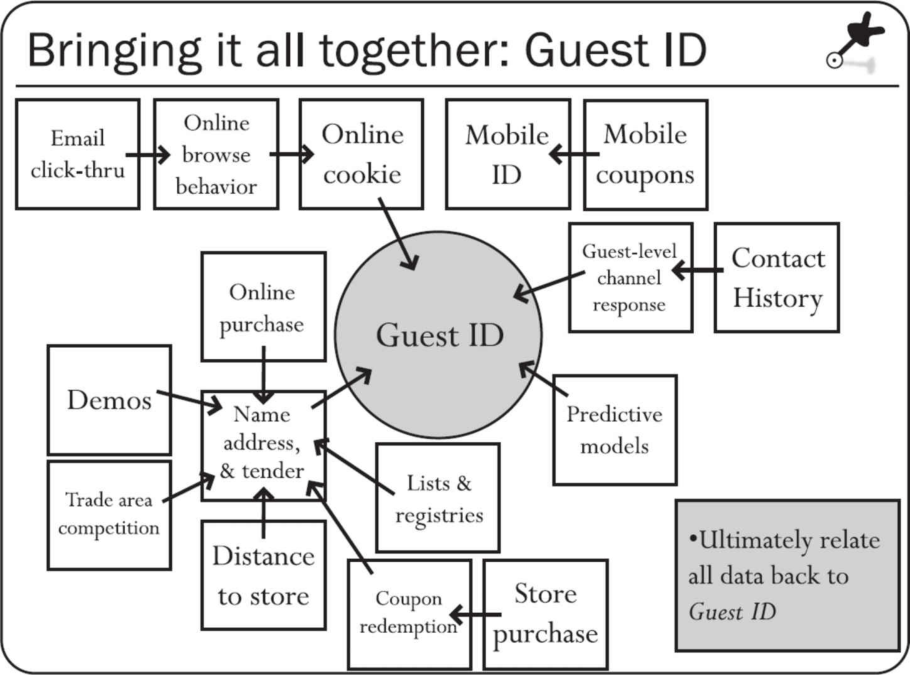
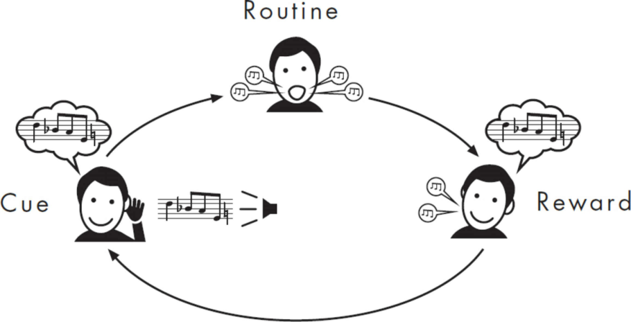
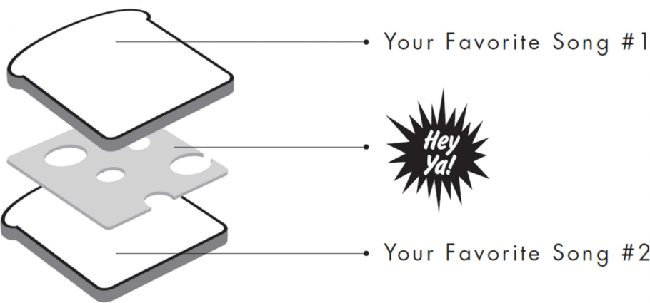

# Chapter 7: How Target Knows What You Want Before You Do

*When Companies Predict (and Manipulate) Habits*

## I.

Andrew Pole had just started working as a data expert for Target when a few colleagues from the marketing department stopped by his desk one day and asked the kind of question Pole had been born to answer:

“Can your computers figure out which customers are pregnant, even if they don’t want us to know?”

Pole was a statistician. His entire life revolved around using data to understand people. He had grown up in a small North Dakota town, and while his friends were attending 4-H or building model rockets, Pole was playing with computers. After college, he got a graduate degree in statistics and then another in economics, and while most of his classmates in the econ program at the University of Missouri were headed to insurance companies or government bureaucracies, Pole was on a different track. He’d become obsessed with the ways economists were using pattern analysis to explain human behavior. Pole, in fact, had tried his hand at a few informal experiments himself. He once threw a party and polled everyone on their favorite jokes, and then attempted to create a mathematical model for the perfect one-liner. He had sought to calculate the exact amount of beer he needed to drink in order to work up the confidence to talk to women at parties, but not so much that he would make a fool of himself. (That particular study never seemed to come out right.)

But those experiments were child’s play, he knew, to how corporate America was using data to scrutinize people’s lives. Pole wanted in. So when he graduated and heard that Hallmark, the greeting card company, was looking to hire statisticians in Kansas City, he submitted an application and was soon spending his days scouring sales data to determine if pictures of pandas or elephants sold more birthday cards, and if “What Happens at Grandma’s Stays at Grandma’s” is funnier in red or blue ink. It was heaven.

Six years later, in 2002, when Pole learned that Target was looking for number crunchers, he made the jump. Target, he knew, was a whole other magnitude when it came to data collection. Every year, millions of shoppers walked into Target’s 1,147 stores and handed over terabytes of information about themselves. Most had no idea they were doing it. They used their customer loyalty cards, redeemed coupons they had received in the mail, or used a credit card, unaware that Target could then link their purchases to an individualized demographic profile.

To a statistician, this data was a magic window for peering into customers’ preferences. Target sold everything from groceries to clothing, electronics and lawn furniture, and by closely tracking people’s buying habits, the company’s analysts could predict what was occurring within their homes. Someone’s buying new towels, sheets, silverware, pans, and frozen dinners? They probably just bought a new house—or are getting a divorce. A cart loaded up with bug spray, kids’ underwear, a flashlight, lots of batteries, Real Simple, and a bottle of Chardonnay? Summer camp is around the corner and Mom can hardly wait.

Working at Target offered Pole a chance to study the most complicated of creatures—the American shopper—in its natural habitat. His job was to build mathematical models that could crawl through data and determine which households contained kids and which were dedicated bachelors; which shoppers loved the outdoors and who was more interested in ice cream and romance novels. Pole’s mandate was to become a mathematical mind reader, deciphering shoppers’ habits in order to convince them to spend more.

Then, one afternoon, a few of Pole’s colleagues from the marketing department stopped by his desk. They were trying to figure out which of Target’s customers were pregnant based on their buying patterns, they said. Pregnant women and new parents, after all, are the holy grail of retail. There is almost no more profitable, product-hungry, price-insensitive group in existence. It’s not just diapers and wipes. People with infants are so tired that they’ll buy everything they need—juice and toilet paper, socks and magazines—wherever they purchase their bottles and formula. What’s more, if a new parent starts shopping at Target, they’ll keep coming back for years.

Figuring out who was pregnant, in other words, could make Target millions of dollars.

Pole was intrigued. What better challenge for a statistical fortune-teller than not only getting inside shoppers’ minds, but their bedrooms?

By the time the project was done, Pole would learn some important lessons about the dangers of preying on people’s most intimate habits. He would learn, for example, that hiding what you know is sometimes as important as knowing it, and that not all women are enthusiastic about a computer program scrutinizing their reproductive plans.

Not everyone, it turns out, thinks mathematical mind reading is cool.

“I guess outsiders could say this is a little bit like Big Brother,” Pole told me. “That makes some people uncomfortable.”

* * *

Once upon a time, a company like Target would never have hired a guy like Andrew Pole. As little as twenty years ago retailers didn’t do this kind of intensely data-driven analysis. Instead, Target, as well as grocery stores, shopping malls, greeting card sellers, clothing retailers, and other firms, tried to peer inside consumers’ heads the old-fashioned way: by hiring psychologists who peddled vaguely scientific tactics they claimed could make customers spend more.

Some of those methods are still in use today. If you walk into a Walmart, Home Depot, or your local shopping center and look closely, you’ll see retailing tricks that have been around for decades, each designed to exploit your shopping subconscious.

Take, for instance, how you buy food.

Chances are, the first things you see upon entering your grocery store are fruits and vegetables arranged in attractive, bountiful piles. If you think about it, positioning produce at the front of a store doesn’t make much sense, because fruits and vegetables bruise easily at the bottom of a shopping cart; logically, they should be situated by the registers, so they come at the end of a trip. But as marketers and psychologists figured out long ago, if we start our shopping sprees by loading up on healthy stuff, we’re much more likely to buy Doritos, Oreos, and frozen pizza when we encounter them later on. The burst of subconscious virtuousness that comes from first buying butternut squash makes it easier to put a pint of ice cream in the cart later.

Or take the way most of us turn to the right after entering a store. (Did you know you turn right? It’s almost certain you do. There are thousands of hours of videotapes showing shoppers turning right once they clear the front doors.) As a result of this tendency, retailers fill the right side of the store with the most profitable products they’re hoping you’ll buy right off the bat. Or consider cereal and soups: When they’re shelved out of alphabetical order and seemingly at random, our instinct is to linger a bit longer and look at a wider selection. So you’ll rarely find Raisin Bran next to Rice Chex. Instead, you’ll have to search the shelves for the cereal you want, and maybe get tempted to grab an extra box[^1] of another brand.

The problem with these tactics, however, is that they treat each shopper exactly the same. They’re fairly primitive, one-size-fits-all solutions for triggering buying habits.

In the past two decades, however, as the retail marketplace has become more and more competitive, chains such as Target began to understand they couldn’t rely on the same old bag of tricks. The only way to increase profits was to figure out each individual shopper’s habits and to market to people one by one, with personalized pitches designed to appeal to customers’ unique buying preferences.

In part, this realization came from a growing awareness of how powerfully habits influence almost every shopping decision. A series of experiments convinced marketers that if they managed to understand a particular shopper’s habits, they could get them to buy almost anything.[^2] One study tape-recorded consumers as they walked through grocery stores. Researchers wanted to know how people made buying decisions. In particular, they looked for shoppers who had come with shopping lists—who, theoretically, had decided ahead of time what they wanted to get.

What they discovered was that despite those lists, more than 50 percent of purchasing decisions occurred at the moment a customer saw a product on the shelf, because, despite shoppers’ best intentions, their habits were stronger than their written intentions. “Let’s see,” one shopper muttered to himself as he walked through a store. “Here are the chips. I will skip them. Wait a minute. Oh! The Lay’s potato chips are on sale!”[^3] He put a bag in his cart. Some shoppers bought the same brands, month after month, even if they admitted they didn’t like the product very much (“I’m not crazy about Folgers, but it’s what I buy, you know? What else is there?” one woman said as she stood in front of a shelf containing dozens of other coffee brands). Shoppers bought roughly the same amount of food each time they went shopping, even if they had pledged to cut back.

“Consumers sometimes act like creatures of habit, automatically repeating past behavior with little regard to current goals,” two psychologists at the University of Southern California[^4] wrote in 2009.

The surprising aspect of these studies, however, was that even though everyone relied on habits to guide their purchases, each person’s habits were different. The guy who liked potato chips bought a bag every time, but the Folgers woman never went down the potato chip aisle. There were people who bought milk whenever they shopped —even if they had plenty at home—and there were people who always purchased desserts when they said they were trying to lose weight. But the milk buyers and the dessert addicts didn’t usually overlap.

The habits were unique to each person.

Target wanted to take advantage of those individual quirks. But when millions of people walk through your doors every day, how do you keep track of their preferences and shopping patterns?

You collect data. Enormous, almost inconceivably large amounts of data.

Starting a little over a decade ago, Target began building a vast data warehouse that assigned every shopper an identification code—known internally as the “Guest ID number”—that kept tabs on how each person shopped. When a customer used a Target-issued credit card, handed over a frequent-buyer tag at the register, redeemed a coupon that was mailed to their house, filled out a survey, mailed in a refund, phoned the customer help line, opened an email from Target, visited Target.com, or purchased anything online, the company’s computers took note. A record of each purchase was linked to that shopper’s Guest ID number along with information on everything else they’d ever bought.

Also linked to that Guest ID number was demographic information that Target collected or purchased from other firms, including the shopper’s age, whether they were married and had kids, which part of town they lived in, how long it took them to drive to the store, an estimate of how much money they earned, if they’d moved recently, which websites they visited, the credit cards they carried in their wallet, and their home and mobile phone numbers. Target can purchase data that indicates a shopper’s ethnicity, their job history, what magazines they read, if they have ever declared bankruptcy, the year they bought (or lost) their house, where they went to college or graduate school, and whether they prefer certain brands of coffee, toilet paper, cereal, or applesauce.

There are data peddlers such as InfiniGraph that “listen” to shoppers’ online conversations on message boards and Internet forums, and track which products people mention favorably. A firm named Rapleaf sells information on shoppers’ political leanings, reading habits, charitable giving, the number of cars they own, and whether they prefer religious news or deals on cigarettes.[^5] Other companies analyze photos that consumers post online, cataloging if they are obese or skinny, short or tall, hairy or bald, and what kinds of products they might want to buy as a result. (Target, in a statement, declined to indicate what demographic companies it does business with and what kinds of information it studies.)

“It used to be that companies only knew what their customers wanted them to know,” said Tom Davenport, one of the leading researchers on how businesses use data and analytics. “That world is far behind us. You’d be shocked how much information is out there—and every company buys it, because it’s the only way to survive.”

If you use your Target credit card to purchase a box of Popsicles once a week, usually around 6:30 P.M. on a weekday, and megasized trash bags every July and October, Target’s statisticians and computer programs will determine that you have kids at home, tend to stop for groceries on your way back from work, and have a lawn that needs mowing in the summer and trees that drop leaves in the fall. It will look at your other shopping patterns and notice that you sometimes buy cereal, but never purchase milk—which means that you must be buying it somewhere else. So Target will mail you coupons for 2 percent milk, as well as for chocolate sprinkles, school supplies, lawn furniture, rakes, and—since it’s likely you’ll want to relax after a long day at work—beer. The company will guess what you habitually buy, and then try to convince you to get it at Target. The firm has the capacity to personalize the ads and coupons it sends to every customer, even though you’ll probably never realize you’ve received a different flyer in the mail than your neighbors.

“With the Guest ID, we have your name, address, and tender, we know you’ve got a Target Visa, a debit card, and we can tie that to your store purchases,” Pole told an audience of retail statisticians at a conference in 2010. The company can link about half of all in-store sales to a specific person, almost all online sales, and about a quarter of online browsing.

At that conference, Pole flashed a slide[^6] showing a sample of the data Target collects, a diagram that caused someone in the audience to whistle in wonder when it appeared on the screen:

The problem with all this data, however, is that it’s meaningless without statisticians to make sense of it. To a layperson, two shoppers who both buy orange juice look the same. It requires a special kind of mathematician to figure out that one of them is a thirty-four-year-old woman purchasing juice for her kids (and thus might appreciate a coupon for a Thomas the Tank Engine DVD) and the other is a twenty-eight-year-old bachelor who drinks juice after going for a run (and thus might respond to discounts on sneakers). Pole and the fifty other members of Target’s Guest Data and Analytical Services department were the ones who found the habits hidden in the facts.

“We call it the ‘guest portrait,’ ” Pole told me. “The more I know about someone, the better I can guess their buying patterns. I’m not going to guess everything about you every time, but I’ll be right more often than I’m wrong.”

By the time Pole joined Target in 2002, the analytics department had already built computer programs to identify households containing children and, come each November, send their parents catalogs of bicycles and scooters that would look perfect under the Christmas tree, as well as coupons for school supplies in September and advertisements for pool toys in June. The computers looked for shoppers buying bikinis in April, and sent them coupons for sunscreen in July and weight-loss books in December. If it wanted, Target could send each customer a coupon book filled with discounts for products they were fairly certain the shoppers were going to buy, because they had already purchased those exact items before.

Target isn’t alone in its desire to predict consumers’ habits. Almost every major retailer, including Amazon.com, Best Buy, Kroger supermarkets, 1-800-Flowers, Olive Garden, Anheuser-Busch, the U.S. Postal Service, Fidelity Investments, Hewlett-Packard, Bank of America, Capital One, and hundreds of others, have “predictive analytics” departments devoted to figuring out consumers’ preferences. “But Target has always been one of the smartest at this,” said Eric Siegel, who runs a conference called Predictive Analytics World. “The data doesn’t mean anything on its own. Target’s good at figuring out the really clever questions.”

It doesn’t take a genius to know that someone buying cereal probably also needs milk. But there were other, much harder—and more profitable—questions to be answered.

Which is why, a few weeks after Pole was hired, his colleagues asked if it was possible to determine who was pregnant, even if that woman didn’t want anyone to know.

* * *

In 1984, a visiting professor at UCLA named Alan Andreasen published a paper that set out to answer a basic question: Why do some people suddenly change their shopping routines?

Andreasen’s team had spent the previous year conducting telephone surveys with consumers around Los Angeles, interrogating them about their recent shopping trips. Whenever someone answered the phone, the scientists would barrage them with questions about which brands of toothpaste and soap they had purchased and if their preferences had shifted. All told, they interviewed almost three hundred people. Like other researchers, they found that most people bought the same brands of cereal and deodorant week after week. Habits reigned supreme.

Except when they didn’t.

For instance, 10.5 percent of the people Andreasen surveyed had switched toothpaste brands in the previous six months. More than 15 percent had started buying a new kind of laundry detergent.

Andreasen wanted to know why these people had deviated from their usual patterns. What he discovered has become a pillar of modern marketing theory: People’s buying habits are more likely to change when they go through a major life event. When someone gets married, for example, they’re more likely to start buying a new type of coffee. When they move into a new house, they’re more apt to purchase a different kind of cereal. When they get divorced, there’s a higher chance they’ll start buying different brands of beer.[^7] Consumers going through major life events often don’t notice, or care, that their shopping patterns have shifted. However, retailers notice, and they care quite a bit.[^8]

“Changing residence, getting married or divorced, losing or changing a job, having someone enter or leave the household,” Andreasen wrote, are life changes that make consumers more “vulnerable to intervention by marketers.”

And what’s the biggest life event for most people? What causes the greatest disruption and “vulnerability to marketing interventions”? Having a baby. There’s almost no greater upheaval for most customers than the arrival of a child. As a result, new parents’ habits are more flexible at that moment than at almost any other period in an adult’s life.

So for companies, pregnant women are gold mines.

New parents buy lots of stuff—diapers and wipes, cribs and Onesies, blankets and bottles—that stores such as Target sell at a significant profit. One survey conducted in 2010 estimated that the average parent spends $6,800 on baby items before a child’s first birthday.[^9]

But that’s just the tip of the shopping iceberg. Those initial expenditures are peanuts compared with the profits a store can earn by taking advantage of a new parent’s shifting shopping habits. If exhausted moms and sleep-deprived dads start purchasing baby formula and diapers at Target, they’ll start buying their groceries, cleaning supplies, towels, underwear, and—well, the sky’s the limit—from Target as well. Because it’s easy. To a new parent, easy matters most of all.

“As soon as we get them buying diapers from us, they’re going to start buying everything else, too,” Pole told me. “If you’re rushing through the store, looking for bottles, and you pass orange juice, you’ll grab a carton. Oh, and there’s that new DVD I want. Soon, you’ll be buying cereal and paper towels from us, and keep coming back.”

New parents are so valuable that major retailers will do almost anything to find them, including going inside maternity wards, even if their products have nothing to do with infants. One New York hospital, for instance, provides every new mother with a gift bag containing samples of hair gel, face wash, shaving cream, an energy bar, shampoo, and a soft-cotton T-shirt. Inside are coupons for an online photo service, hand soap, and a local gym. There are also samples of diapers and baby lotions, but they’re lost among the nonbaby supplies. In 580 hospitals across the United States, new mothers get gifts from the Walt Disney Company, which in 2010 started a division specifically aimed at marketing to the parents of infants. Procter…Gamble, Fisher-Price, and other firms have similar giveaway programs. Disney estimates the North American new baby market is worth $36.3 billion a year.[^10]

But for companies such as Target, approaching new moms in the maternity ward is, in some senses, too late. By then, they’re already on everyone else’s radar screen. Target didn’t want to compete with Disney and Procter…Gamble; they wanted to beat them. Target’s goal was to start marketing to parents before the baby arrived—which is why Andrew Pole’s colleagues approached him that day to ask about building a pregnancy-prediction algorithm. If they could identify expecting mothers as early as their second trimester, they could capture them before anyone else.

The only problem was that figuring out which customers are pregnant is harder than it seems. Target had a baby shower registry, and that helped identify some pregnant women—and what’s more, all those soon-to-be mothers willingly handed over valuable information, like their due dates, that let the company know when to send them coupons for prenatal vitamins or diapers. But only a fraction of Target’s pregnant customers used the registry.

Then there were other customers who executives suspected were pregnant because they purchased maternity clothing, nursery furniture, and boxes of diapers. Suspecting and knowing, however, are two different things. How do you know whether someone buying diapers is pregnant or buying a gift for a pregnant friend? What’s more, timing matters. A coupon that’s useful a month before the due date might get put in the trash a few weeks after the baby arrives.

Pole started working on the problem by scouring the information in Target’s baby shower registry, which let him observe how the average woman’s shopping habits changed as her due date approached. The registry was like a laboratory where he could test hunches. Each expectant mother handed over her name, her spouse’s name, and her due date. Target’s data warehouse could link that information to the family’s Guest IDs. As a result, whenever one of these women purchased something in a store or online, Pole, using the due date the woman provided, could plot the trimester in which the purchase occurred. Before long, he was picking up patterns.

Expectant mothers, he discovered, shopped in fairly predictable ways. Take, for example, lotions. Lots of people buy lotion, but a Target data analyst noticed that women on the baby registry were buying unusually large quantities of unscented lotion around the beginning of their second trimester. Another analyst noted that sometime in the first twenty weeks, many pregnant women loaded up on vitamins, such as calcium, magnesium, and zinc. Lots of shoppers purchase soap and cotton balls every month, but when someone suddenly starts buying lots of scent-free soap and cotton balls, in addition to hand sanitizers and an astounding number of washcloths, all at once, a few months after buying lotions and magnesium and zinc, it signals they are getting close to their delivery date.

As Pole’s computer program crawled through the data, he was able to identify about twenty-five different products that, when analyzed together, allowed him to, in a sense, peer inside a woman’s womb. Most important, he could guess what trimester she was in—and estimate her due date—so Target could send her coupons when she was on the brink of making new purchases. By the time Pole was done, his program could assign almost any regular shopper a “pregnancy prediction” score.

Jenny Ward, a twenty-three-year-old[^11] in Atlanta who bought cocoa butter lotion, a purse large enough to double as a diaper bag, zinc, magnesium, and a bright blue rug? There’s an 87 percent chance that she’s pregnant and that her delivery date is sometime in late August. Liz Alter in Brooklyn, a thirty-five-year-old who purchased five packs of washcloths, a bottle of “sensitive skin” laundry detergent, baggy jeans, vitamins containing DHA, and a slew of moisturizers? She’s got a 96 percent chance of pregnancy, and she’ll probably give birth in early May. Caitlin Pike, a thirty-nine-year-old in San Francisco who purchased a $250 stroller, but nothing else? She’s probably buying for a friend’s baby shower. Besides, her demographic data shows she got divorced two years ago.

Pole applied his program to every shopper in Target’s database. When it was done, he had a list of hundreds of thousands of women who were likely to be pregnant that Target could inundate with advertisements for diapers, lotions, cribs, wipes, and maternity clothing at times when their shopping habits were particularly flexible. If a fraction of those women or their husbands started doing their shopping at Target, it would add millions to the company’s bottom line.

Then, just as this advertising avalanche was about to begin, someone within the marketing department asked a question: How are women going to react when they figure out how much Target knows?

“If we send someone a catalog and say, ‘Congratulations on your first child!’ and they’ve never told us they’re pregnant, that’s going to make some people uncomfortable,” Pole told me. “We are very conservative about compliance with all privacy laws. But even if you’re following the law, you can do things where people get queasy.”

There’s good reason for such worries. About a year after Pole created his pregnancy prediction model, a man walked into a Minnesota Target and demanded to see the manager. He was clutching an advertisement. He was very angry.

“My daughter got this in the mail!” he said. “She’s still in high school, and you’re sending her coupons for baby clothes and cribs? Are you trying to encourage her to get pregnant?”

The manager didn’t have any idea what the man was talking about. He looked at the mailer. Sure enough, it was addressed to the man’s daughter and contained advertisements for maternity clothing, nursery furniture, and pictures of smiling infants gazing into their mothers’ eyes.

The manager apologized profusely, and then called, a few days later, to apologize again.

The father was somewhat abashed.

“I had a talk with my daughter,” he said. “It turns out there’s been some activities in my house I haven’t been completely aware of.” He took a deep breath. “She’s due in August. I owe you an apology.”

Target is not the only firm to have raised concerns among consumers. Other companies have been attacked for using data in far less intrusive ways. In 2011, for instance, a New York resident sued McDonald’s, CBS, Mazda, and Microsoft, alleging those companies’ advertising agency monitored people’s Internet usage to profile their buying habits.[^12] There are ongoing class action lawsuits in California against Target, Walmart, Victoria’s Secret, and other retail chains for asking customers to give their zip codes when they use credit cards, and then using that information to ferret out their mailing addresses.[^13]

Using data to predict a woman’s pregnancy, Pole and his colleagues knew, was a potential public relations disaster. So how could they get their advertisements into expectant mothers’ hands without making it appear they were spying on them? How do you take advantage of someone’s habits without letting them know you’re studying every detail of their lives?[^fn1]

## II.

In the summer of 2003, a promotion executive at Arista Records named Steve Bartels began calling up radio DJs to tell them about a new song he was certain they would love. It was called “Hey Ya!” by the hip-hop group OutKast.

“Hey Ya!” was an upbeat fusion of funk, rock, and hip-hop with a dollop of Big Band swing, from one of the most popular bands on earth. It sounded like nothing else on the radio. “It made the hair on my arms stand up the first time I heard it,” Bartels told me. “It sounded like a hit, like the kind of song you’d be hearing at bar mitzvahs and proms for years.” Around the Arista offices, executives sang the chorus—“shake it like a Polaroid picture”—to one another in the hallways. This song, they all agreed, is going to be huge.

That certainty wasn’t based solely on intuition. At the time, the record business was undergoing a transformation similar to the data-driven shifts occurring at Target and elsewhere. Just as retailers were using computer algorithms to forecast shoppers’ habits, music and radio executives were using computer programs to forecast listeners’ habits. A company named Polyphonic HMI—a collection of artificial intelligence experts and statisticians based in Spain—had created a program called Hit Song Science that analyzed the mathematical characteristics of a tune and predicted its popularity. By comparing the tempo, pitch, melody, chord progression, and other factors of a particular song against the thousands of hits stored in Polyphonic HMI’s database, Hit Song Science could deliver a score that forecasted if a tune was likely to succeed.[^14]

The program had predicted that Norah Jones’s Come Away with Me, for instance, would be a hit after most of the industry had dismissed the album. (It went on to sell ten million copies and win eight Grammys.) It had predicted that “Why Don’t You and I” by Santana would be popular, despite DJs’ doubts. (It reached number three on the Billboard Top 40 list.)

When executives at radio stations ran “Hey Ya!” through Hit Song Science, it did well. In fact, it did better than well: The score was among the highest anyone had ever seen.

“Hey Ya!,” according to the algorithm, was going to be a monster hit.

On September 4, 2003, in the prominent slot of 7:15 P.M., the Top 40 station WIOQ in Philadelphia started playing “Hey Ya!” on the radio. It aired the song seven more times that week, and a total of thirty-seven times throughout the month.[^15]

At the time, a company named Arbitron was testing a new technology that made it possible to figure out how many people were listening to a particular radio station at a given moment, and how many switched channels during a specific song. WIOQ was one of the stations included in the test. The station’s executives were certain “Hey Ya!” would keep listeners glued to their radios.

Then the data came back.

Listeners didn’t just dislike “Hey Ya!”[^16] They hated it according to the data. They hated it so much that nearly a third of them changed the station within the first thirty seconds of the song. It wasn’t only at WIOQ, either. Across the nation, at radio stations in Chicago, Los Angeles, Phoenix, and Seattle, whenever “Hey Ya!” came on, huge numbers of listeners would click off.

“I thought it was a great song the first time I heard it,” said John Garabedian, the host of a syndicated Top 40 radio show heard by more than two million people each weekend. “But it didn’t sound like other songs, and so some people went nuts when it came on. One guy told me it was the worst thing he had ever heard.

“People listen to Top 40 because they want to hear their favorite songs or songs that sound just like their favorite songs. When something different comes on, they’re offended. They don’t want anything unfamiliar.”

Arista had spent a lot of money promoting “Hey Ya!” The music and radio industries needed it to be a success. Hit songs are worth a fortune—not only because people buy the song itself, but also because a hit can convince listeners to abandon video games and the Internet for radio. A hit can sell sports cars on television and clothing inside trendy stores. Hit songs are at the root of dozens of spending habits that advertisers, TV stations, bars, dance clubs—even technology firms such as Apple—rely on.

Now, one of the most highly anticipated songs—a tune that the algorithms had predicted would become the song of the year—was flailing. Radio executives were desperate to find something that would make “Hey Ya!” into a hit.[^17]

* * *

That question—how do you make a song into a hit?—has been puzzling the music industry ever since it began, but it’s only in the past few decades that people have tried to arrive at scientific answers. One of the pioneers was a onetime station manager named Rich Meyer who, in 1985, with his wife, Nancy, started a company called Mediabase in the basement of their Chicago home. They would wake up every morning, pick up a package of tapes of stations that had been recorded the previous day in various cities, and count and analyze every song that had been played. Meyer would then publish a weekly newsletter tracking which tunes were rising or declining in popularity.

In his first few years, the newsletter had only about a hundred subscribers, and Meyer and his wife struggled to keep the company afloat. However, as more and more stations began using Meyer’s insights to increase their audiences—and, in particular, studying the formulas he devised to explain listening trends—his newsletter, the data sold by Mediabase, and then similar services provided by a growing industry of data-focused consultants, overhauled how radio stations were run.

One of the puzzles Meyer most loved was figuring out why, during some songs, listeners never seemed to change the radio dial. Among DJs, these songs are known as “sticky.” Meyer had tracked hundreds of sticky songs over the years, trying to divine the principles that made them popular. His office was filled with charts and graphs plotting the characteristics of various sticky songs. Meyer was always looking for new ways to measure stickiness, and about the time “Hey Ya!” was released, he started experimenting with data from the tests that Arbitron was conducting to see if it provided any fresh insights.

Some of the stickiest songs at the time were sticky for obvious reasons—“Crazy in Love” by Beyoncé and “Señorita” by Justin Timberlake, for instance, had just been released and were already hugely popular, but those were great songs by established stars, so the stickiness made sense. Other songs, though, were sticky for reasons no one could really understand. For instance, when stations played “Breathe” by Blu Cantrell during the summer of 2003, almost no one changed the dial. The song is an eminently forgettable, beat-driven tune that DJs found so bland that most of them only played it reluctantly, they told music publications. But for some reason, whenever it came on the radio, people listened, even if, as pollsters later discovered, those same listeners said they didn’t like the song very much. Or consider “Here Without You” by 3 Doors Down, or almost any song by the group Maroon 5. Those bands are so featureless that critics and listeners created a new music category —“bath rock”—to describe their tepid sounds. Yet whenever they came on the radio, almost no one changed the station.

Then there were songs that listeners said they actively disliked, but were sticky nonetheless. Take Christina Aguilera or Celine Dion. In survey after survey, male listeners said they hated Celine Dion and couldn’t stand her songs. But whenever a Dion tune came on the radio, men stayed tuned in. Within the Los Angeles market, stations that regularly played Dion at the end of each hour—when the number of listeners was measured—could reliably boost their audience by as much as 3 percent, a huge figure in the radio world. Male listeners may have thought they disliked Dion, but when her songs played, they stayed glued.[^18]

One night, Meyer sat down and started listening to a bunch of sticky songs in a row, one right after the other, over and over again. As he did, he started to notice a similarity among them. It wasn’t that the songs sounded alike. Some of them were ballads, others were pop tunes. However, they all seemed similar in that each sounded exactly like what Meyer expected to hear from that particular genre. They sounded familiar—like everything else on the radio—but a little more polished, a bit closer to the golden mean of the perfect song.

“Sometimes stations will do research by calling listeners on the phone, and play a snippet of a song, and listeners will say, ‘I’ve heard that a million times. I’m totally tired of it,’ ” Meyer told me. “But when it comes on the radio, your subconscious says, ‘I know this song! I’ve heard it a million times! I can sing along!’ Sticky songs are what you expect to hear on the radio. Your brain secretly wants that song, because it’s so familiar to everything else you’ve already heard and liked. It just sounds right.”

There is evidence that a preference for things that sound “familiar” is a product of our neurology. Scientists have examined people’s brains as they listen to music, and have tracked which neural regions are involved in comprehending aural stimuli. Listening to music activates numerous areas of the brain, including the auditory cortex, the thalamus, and the superior parietal cortex.[^19] These same areas are also associated with pattern recognition and helping the brain decide which inputs to pay attention to and which to ignore. The areas that process music, in other words, are designed to seek out patterns and look for familiarity. This makes sense. Music, after all, is complicated. The numerous tones, pitches, overlapping melodies, and competing sounds inside almost any song—or anyone speaking on a busy street, for that matter—are so overwhelming that, without our brain’s ability to focus on some sounds and ignore others, everything would seem like a cacophony of noise.[^20]

Our brains crave familiarity in music because familiarity is how we manage to hear without becoming distracted by all the sound. Just as the scientists at MIT discovered that behavioral habits prevent us from becoming overwhelmed by the endless decisions we would otherwise have to make each day, listening habits exist because, without them, it would be impossible to determine if we should concentrate on our child’s voice, the coach’s whistle, or the noise from a busy street during a Saturday soccer game. Listening habits allow us to unconsciously separate important noises from those that can be ignored.

That’s why songs that sound “familiar”—even if you’ve never heard them before—are sticky. Our brains are designed to prefer auditory patterns that seem similar to what we’ve already heard. When Celine Dion releases a new song—and it sounds like every other song she’s sung, as well as most of the other songs on the radio—our brains unconsciously crave its recognizability and the song becomes sticky. You might never attend a Celine Dion concert, but you’ll listen to her songs on the radio, because that’s what you expect to hear as you drive to work. Those songs correspond perfectly to your habits.

This insight helped explain why “Hey Ya!” was failing on the radio, despite the fact that Hit Song Science and music executives were sure it would be a hit. The problem wasn’t that “Hey Ya!” was bad. The problem was that “Hey Ya!” wasn’t familiar. Radio listeners didn’t want to make a conscious decision each time they were presented with a new song. Instead, their brains wanted to follow a habit. Much of the time, we don’t actually choose if we like or dislike a song. It would take too much mental effort. Instead, we react to the cues (“This sounds like all the other songs I’ve ever liked”) and rewards (“It’s fun to hum along!”) and without thinking, we either start singing, or reach over and change the station.

*THE FAMILIARITY LOOP*

In a sense, Arista and radio DJs faced a variation of the problem Andrew Pole was confronting at Target. Listeners are happy to sit through a song they might say they dislike, as long as it seems like something they’ve heard before. Pregnant women are happy to use coupons they receive in the mail, unless those coupons make it obvious that Target is spying into their wombs, which is unfamiliar and kind of creepy. Getting a coupon that makes it clear Target knows you’re pregnant is at odds from what a customer expects. It’s like telling a forty-two-year-old investment banker that he sang along to Celine Dion. It just feels wrong.

So how do DJs convince listeners to stick with songs such as “Hey Ya!” long enough for them to become familiar? How does Target convince pregnant women to use diaper coupons without creeping them out?

By dressing something new in old clothes, and making the unfamiliar seem familiar.

## III.

In the early 1940s, the U.S. government began shipping much of the nation’s domestic meat supply to Europe and the Pacific theater to support troops fighting in World War II. Back home, the availability of steaks and pork chops began to dwindle. By the time the United States entered the war in late 1941, New York restaurants were using horse meat for hamburgers and a black market for poultry[^21] had emerged. Federal officials became worried that a lengthy war effort would leave the nation starved of protein. This “problem will loom larger and larger in the United States as the war goes on,” former president Herbert Hoover wrote to Americans in a government pamphlet in 1943. “Our farms are short of labor to care for livestock; and on top of it all we must furnish supplies to the British and Russians. Meats and fats are just as much munitions in this war as are tanks and aeroplanes.”

Concerned, the Department of Defense approached dozens of the nation’s leading sociologists, psychologists, and anthropologists—including Margaret Mead and Kurt Lewin, who would go on to become celebrity academics—and gave them an assignment: Figure out how to convince Americans to eat organ meats. Get housewives to serve their husbands and children the protein-rich livers, hearts, kidneys, brains, stomachs, and intestines that were left behind after the rib eyes and roast beef went overseas.

At the time, organ meat wasn’t popular in America. A middle-class woman in 1940 would sooner starve than despoil her table with tongue or tripe. So when the scientists recruited into the Committee on Food Habits met for the first time in 1941, they set themselves a goal of systematically identifying the cultural barriers that discouraged Americans from eating organ meat. In all, more than two hundred studies were eventually published, and at their core, they all contained a similar finding: To change people’s diets, the exotic must be made familiar. And to do that, you must camouflage it in everyday garb.[^22]

To convince Americans to eat livers and kidneys, housewives had to know how to make the foods look, taste, and smell as similar as possible to what their families expected to see on the dinner table, the scientists concluded. For instance, when the Subsistence Division of the Quartermaster Corps—the people in charge of feeding soldiers—started serving fresh cabbage to troops in 1943, it was rejected. So mess halls chopped and boiled the cabbage until it looked like every other vegetable on a soldier’s tray—and the troops ate it without complaint. “Soldiers were more likely to eat food, whether familiar or unfamiliar, when it was prepared similar to their prior experiences and served in a familiar fashion,” a present-day researcher[^23] evaluating those studies wrote.

The secret to changing the American diet, the Committee on Food Habits concluded, was familiarity. Soon, housewives were receiving mailers from the government telling them “every husband will cheer for steak and kidney pie.”[^24] Butchers started handing out recipes that explained how to slip liver into meatloaf.

A few years after World War II ended, the Committee on Food Habits was dissolved. By then, however, organ meats had been fully integrated into the American diet. One study indicated that offal consumption rose by 33 percent during the war. By 1955, it was up 50 percent.[^25] Kidney had become a staple at dinner. Liver was for special occasions. America’s dining patterns had shifted to such a degree that organ meats had become emblems of comfort.

Since then, the U.S. government has launched dozens of other efforts to improve our diets. For example, there was the “Five a Day” campaign, intended to encourage people to eat five fruits or vegetables, the USDA’s food pyramid, and a push for low-fat cheeses and milks. None of them adhered to the committee’s findings. None tried to camouflage their recommendations in existing habits, and as a result, all of the campaigns failed. To date, the only government program ever to cause a lasting change in the American diet was the organ meat push of the 1940s.

However, radio stations and massive companies—including Target—are a bit savvier.

* * *

To make “Hey Ya!” a hit, DJs soon realized, they needed to make the song feel familiar. And to do that, something special was required.

The problem was that computer programs such as Hit Song Science were pretty good at predicting people’s habits. But sometimes, those algorithms found habits that hadn’t actually emerged yet, and when companies market to habits we haven’t adopted or, even worse, are unwilling to admit to ourselves—like our secret affection for sappy ballads—firms risk going out of business. If a grocery store boasts “We have a huge selection of sugary cereals and ice cream!” shoppers stay away. If a butcher says “Here’s a piece of intestine for your dinner table,” a 1940s housewife serves tuna casserole instead. When a radio station boasts “Celine Dion every half hour!” no one tunes in. So instead, supermarket owners tout their apples and tomatoes (while making sure you pass the M&M’s and Häagen-Dazs on the way to the register), butchers in the 1940s call liver “the new steak,” and DJs quietly slip in the theme song from Titanic.

“Hey Ya!” needed to become part of an established listening habit to become a hit. And to become part of a habit, it had to be slightly camouflaged at first, the same way housewives camouflaged kidney by slipping it into meatloaf. So at WIOQ in Philadelphia—as well as at other stations around the nation—DJs started making sure that whenever “Hey Ya!” was played, it was sandwiched between songs that were already popular. “It’s textbook playlist theory now,” said Tom Webster, a radio consultant. “Play a new song between two consensus popular hits.”

DJs, however, didn’t air “Hey Ya!” alongside just any kind of hit. They sandwiched it between the types of songs that Rich Meyer had discovered were uniquely sticky, from artists like Blu Cantrell, 3 Doors Down, Maroon 5, and Christina Aguilera. (Some stations, in fact, were so eager they used the same song twice.)

Consider, for instance, the WIOQ playlist for September 19, 2003:

11:43 “Here Without You” by 3 Doors Down

11:54 “Breathe” by Blu Cantrell

11:58 “Hey Ya!” by OutKast

12:01 “Breathe” by Blu Cantrell

Or the playlist for October 16:

9:41 “Harder to Breathe” by Maroon 5

9:45 “Hey Ya!” by OutKast

9:49 “Can’t Hold Us Down” by Christina Aguilera

10:00 “Frontin’ ” by Pharrell

November 12:

9:58 “Here Without You” by 3 Doors Down

10:01 “Hey Ya!” by OutKast

10:05 “Like I Love You” by Justin Timberlake

10:09 “Baby Boy” by Beyoncé

“Managing a playlist is all about risk mitigation,” said Webster. “Stations have to take risks on new songs, otherwise people stop listening. But what listeners really want are songs they already like. So you have to make new songs seem familiar as fast as possible.”

When WIOQ first started playing “Hey Ya!” in early September—before the sandwiching started—26.6 percent of listeners changed the station whenever it came on. By October, after playing it alongside sticky hits, that “tune-out factor” dropped to 13.7 percent. By December, it was 5.7 percent. Other major radio stations around the nation used the same sandwiching technique, and the tune-out rate followed the same pattern.

And as listeners heard “Hey Ya!” again and again, it became familiar. Once the song had become popular, WIOQ was playing “Hey Ya!” as many as fifteen times a day. People’s listening habits had shifted to expect—crave, even—“Hey Ya!” A “Hey Ya!” habit emerged. The song went on to win a Grammy, sell more than 5.5 million albums, and earn radio stations millions of dollars. “This album cemented OutKast in the pantheon of superstars,” Bartels, the promotion executive, told me. “This is what introduced them to audiences outside of hip-hop. It’s so fulfilling now when a new artist plays me their single and says, This is going to be the next ‘Hey Ya!’ ”

* * *

After Andrew Pole built his pregnancy-prediction machine, after he identified hundreds of thousands of female shoppers who were probably pregnant, after someone pointed out that some—in fact, most —of those women might be a little upset if they received an advertisement making it obvious Target knew their reproductive status, everyone decided to take a step back and consider their options.

The marketing department thought it might be wise to conduct a few small experiments before rolling out a national campaign. They had the ability to send specially designed mailers to small groups of customers, so they randomly chose women from Pole’s pregnancy list and started testing combinations of advertisements to see how shoppers reacted.

“We have the capacity to send every customer an ad booklet, specifically designed for them, that says, ‘Here’s everything you bought last week, and a coupon for it,’ ” one Target executive with firsthand knowledge of Pole’s pregnancy predictor told me. “We do that for grocery products all the time.

“With the pregnancy products, though, we learned that some women react badly. Then we started mixing in all these ads for things we knew pregnant women would never buy, so the baby ads looked random. We’d put an ad for a lawnmower next to diapers. We’d put a coupon for wineglasses next to infant clothes. That way, it looked like all the products were chosen by chance.

“And we found out that as long as a pregnant woman thinks she hasn’t been spied on, she’ll use the coupons. She just assumes that everyone else on her block got the same mailer for diapers and cribs. As long as we don’t spook her, it works.”

The answer to Target and Pole’s question—how do you advertise to a pregnant woman without revealing that you know she’s pregnant?—was essentially the same one that DJs used to hook listeners on “Hey Ya!” Target started sandwiching the diaper coupons between nonpregnancy products that made the advertisements seem anonymous, familiar, comfortable. They camouflaged what they knew.

Soon, Target’s “Mom and Baby” sales exploded. The company doesn’t break out sales figures for specific divisions, but between 2002 —when Pole was hired—and 2009, Target’s revenues grew from $44 billion to $65 billion. In 2005, the company’s president, Gregg Steinhafel, boasted to a room full of investors about the company’s “heightened focus on items and categories that appeal to specific guest segments such as mom and baby.

“As our database tools grow increasingly sophisticated, Target Mail has come into its own as a useful tool for promoting value and convenience to specific guest segments such as new moms or teens,” he said. “For example, Target Baby is able to track life stages from prenatal care to car seats and strollers. In 2004, the Target Baby Direct Mail Program drove sizable increases in trips and sales.”[^26]

Whether selling a new song, a new food, or a new crib, the lesson is the same: If you dress a new something in old habits, it’s easier for the public to accept it.

## IV.

The usefulness of this lesson isn’t limited to large corporations, government agencies, or radio companies hoping to manipulate our tastes. These same insights can be used to change how we live.

In 2000, for instance, two statisticians were hired by the YMCA—one of the nation’s largest nonprofit organizations—to use the powers of data-driven fortune-telling to make the world a healthier place. The YMCA has more than 2,600 branches in the United States, most of them gyms and community centers. About a decade ago, the organization’s leaders began worrying about how to stay competitive. They asked a social scientist and a mathematician—Bill Lazarus and Dean Abbott—for help.

The two men gathered data from more than 150,000 YMCA member satisfaction surveys that had been collected over the years and started looking for patterns. At that point, the accepted wisdom among YMCA executives was that people wanted fancy exercise equipment and sparkling, modern facilities. The YMCA had spent millions of dollars building weight rooms and yoga studios. When the surveys were analyzed, however, it turned out that while a facility’s attractiveness and the availability of workout machines might have caused people to join in the first place, what got them to stay was something else.

Retention, the data said, was driven by emotional factors, such as whether employees knew members’ names or said hello when they walked in. People, it turns out, often go to the gym looking for a human connection, not a treadmill. If a member made a friend at the YMCA, they were much more likely to show up for workout sessions. In other words, people who join the YMCA have certain social habits. If the YMCA satisfied them, members were happy. So if the YMCA wanted to encourage people to exercise, it needed to take advantage of patterns that already existed, and teach employees to remember visitors’ names. It’s a variation of the lesson learned by Target and radio DJs: to sell a new habit—in this case exercise—wrap it in something that people already know and like, such as the instinct to go places where it’s easy to make friends.

“We’re cracking the code on how to keep people at the gym,” Lazarus told me. “People want to visit places that satisfy their social needs. Getting people to exercise in groups makes it more likely they’ll stick with a workout. You can change the health of the nation this way.”

Someday soon, say predictive analytics experts, it will be possible for companies to know our tastes and predict our habits better than we know ourselves. However, knowing that someone might prefer a certain brand of peanut butter isn’t enough to get them to act on that preference. To market a new habit—be it groceries or aerobics—you must understand how to make the novel seem familiar.

The last time I spoke to Andrew Pole, I mentioned that my wife was seven months pregnant with our second child. Pole himself has children, and so we talked a bit about kids. My wife and I shop at Target on occasion, I said, and about a year earlier we had given the company our address, so we could start getting coupons in the mail. Recently, as my wife’s pregnancy had progressed, I’d been noticing a subtle upswing in the number of advertisements for diapers, lotions, and baby clothes arriving at our house.

I was planning on using some of those coupons that very weekend, I told him. I was also thinking of buying a crib, and some drapes for the nursery, and maybe some Bob the Builder toys for my toddler. It was really helpful that Target was sending me exactly the right coupons for what I needed to buy.

“Just wait till the baby comes,” Pole said. “We’ll be sending you coupons for things you want before you even know you want them.”

## Footnotes

[^fn1]: The reporting in this chapter is based on interviews with more than a dozen current and former Target employees, many of them conducted on a not-for-attribution basis because sources feared dismissal from the company or other retribution. Target was provided with an opportunity to review and respond to the reporting in this chapter, and was asked to make executives involved in the Guest Analytics department available for on-the-record interviews. The company declined to do so and declined to respond to fact-checking questions except in two emails. The first said: “At Target, our mission is to make Target the preferred shopping destination for our guests by delivering outstanding value, continuous innovation and an exceptional guest experience by consistently fulfilling our ‘Expect More. Pay Less.’ brand promise. Because we are so intently focused on this mission, we have made considerable investments in understanding our guests’ preferences. To assist in this effort, we’ve developed a number of research tools that allow us to gain insights into trends and preferences within different demographic segments of our guest population. We use data derived from these tools to inform our store layouts, product selection, promotions and coupons. This analysis allows Target to provide the most relevant shopping experience to our guests. For example, during an in-store transaction, our research tool can predict relevant offers for an individual guest based on their purchases, which can be delivered along with their receipt. Further, opt-in programs such as our baby registry help Target understand how guests’ needs evolve over time, enabling us to provide new mothers with money-saving coupons. We believe these efforts directly benefit our guests by providing more of what they need and want at Target—and have benefited Target by building stronger guest loyalty, driving greater shopping frequency and delivering increased sales and profitability.” A second email read: “Almost all of your statements contain inaccurate information and publishing them would be misleading to the public. We do not intend to address each statement point by point. Target takes its legal obligations seriously and is in compliance with all applicable federal and state laws, including those related to protected health information.”

## Notes

[^1]: **grab an extra box** The details on subconscious tactics retailers use comes from Jeremy Caplan, “Supermarket Science,” Time, May 24, 2007; Paco Underhill, Why We Buy: The Science of Shopping (New York: Simon and Schuster, 2000); Jack Hitt; “The Theory of Supermarkets,” The New York Times, March 10, 1996; “The Science of Shopping: The Way the Brain Buys,” The Economist, December 20, 2008; “Understanding the Science of Shopping,” Talk of the Nation, National Public Radio, December 12, 2008; Malcolm Gladwell, “The Science of Shopping,” The New Yorker, November 4, 1996.

[^2]: **to buy almost anything** There are literally thousands of studies that have scrutinized how habits influence consumer behaviors—and how unconscious and semi-conscious urges influence decisions that might otherwise seem immune from habitual triggers. For more on these fascinating topics, see H. Aarts, A. van Knippenberg, and B. Verplanken, “Habit and Information Use in Travel Mode Choices,” Acta Psychologica 96, nos. 1–2 (1997): 1–14; J. A. Bargh, “The Four Horsemen of Automaticity: Awareness, Efficiency, Intention, and Control in Social Cognition,” in Handbook of Social Cognition, ed. R. S. Wyer, Jr., and T. K. Srull (Hillsdale, N.J.: Lawrence Erlbaum Associates, 1994); D. Bell, T. Ho, and C. Tang, “Determining Where to Shop: Fixed and Variable Costs of Shopping,” Journal of Marketing Research 35, no. 3 (1998): 352–69; T. Betsch, S. Haberstroh, B. Molter, A. Glöckner, “Oops, I Did It Again—Relapse Errors in Routinized Decision Making,” Organizational Behavior and Human Decision Processes 93, no. 1 (2004): 62–74; M. Cunha, C. Janiszewski, Jr., and J. Laran, “Protection of Prior Learning in Complex Consumer Learning Environments,” Journal of Consumer Research 34, no. 6 (2008): 850–64; H. Aarts, U. Danner, and N. de Vries, “Habit Formation and Multiple Means to Goal Attainment: Repeated Retrieval of Target Means Causes Inhibited Access to Competitors,” Personality and Social Psychology Bulletin 33, no. 10 (2007): 1367– 79; E. Ferguson and P. Bibby, “Predicting Future Blood Donor Returns: Past Behavior, Intentions, and Observer Effects,” Health Psychology 21, no. 5 (2002): 513–18; Edward Fox and John Semple, “Understanding ‘Cherry Pickers’: How Retail Customers Split Their Shopping Baskets,” unpublished manuscript, Southern Methodist University, 2002; S. Gopinath, R. Blattberg, and E. Malthouse, “Are Revived Customers as Good as New?” unpublished manuscript, Northwestern University, 2002; H. Aarts, R. Holland, and D. Langendam, “Breaking and Creating Habits on the Working Floor: A Field-Experiment on the Power of Implementation Intentions,” Journal of Experimental Social Psychology 42, no. 6 (2006): 776–83; Mindy Ji and Wendy Wood, “Purchase and Consumption Habits: Not Necessarily What You Intend,” Journal of Consumer Psychology 17, no. 4 (2007): 261–76; S. Bellman, E. J. Johnson, and G. Lohse, “Cognitive Lock-In and the Power Law of Practice,” Journal of Marketing 67, no. 2 (2003): 62–75; J. Bettman et al., “Adapting to Time Constraints,” in Time Pressure and Stressing Human Judgment and Decision Making, ed. O. Svenson and J. Maule (New York: Springer, 1993); Adwait Khare and J. Inman, “Habitual Behavior in American Eating Patterns: The Role of Meal Occasions,” Journal of Consumer Research 32, no. 4 (2006): 567–75; David Bell and R. Lal, “The Impact of Frequent Shopper Programs in Grocery Retailing,” Quantitative Marketing and Economics 1, no. 2 (2002): 179–202; Yuping Liu, “The Long-Term Impact of Loyalty Programs on Consumer Purchase Behavior and Loyalty,” Journal of Marketing 71, no. 4 (2007): 19–35; Neale Martin, Habit: The 95% of Behavior Marketers Ignore (Upper Saddle River, N.J.: FT Press, 2008); H. Aarts, K. Fujia, and K. C. McCulloch, “Inhibition in Goal Systems: A Retrieval-Induced Forgetting Account,” Journal of Experimental Social Psychology 44, no. 3 (2008): 614–23; Gerald Häubl and K. B. Murray, “Explaining Cognitive Lock-In: The Role of Skill-Based Habits of Use in Consumer Choice,” Journal of Consumer Research 34 (2007) 77–88; D. Neale, J. Quinn, and W. Wood, “Habits: A Repeat Performance,” Current Directions in Psychological Science 15, no. 4 (2006) 198–202; R. L. Oliver, “Whence Consumer Loyalty?” Journal of Marketing 63 (1999): 33–44; C. T. Orleans, “Promoting the Maintenance of Health Behavior Change: Recommendations for the Next Generation of Research and Practice,” Health Psychology 19 (2000): 76–83; Judith Ouellette and Wendy Wood, “Habit and Intention in Everyday Life: The Multiple Processes by Which Past Behavior Predicts Future Behavior,” Psychological Bulletin 124, no. 1 (1998) 54–74; E. Iyer, D. Smith, and C. Park, “The Effects of Situational Factors on In-Store Grocery Shopping Behavior: The Role of Store Environment and Time Available for Shopping,” Journal of Consumer Research 15, no. 4 (1989): 422–33; O. Amir, R. Dhar, and A. Pocheptsova, “Deciding Without Resources: Resource Depletion and Choice in Context,” Journal of Marketing Research 46, no. 3 (2009): 344–55; H. Aarts, R. Custers, and P. Sheeran, “The Goal- Dependent Automaticity of Drinking Habits,” British Journal of Social Psychology 44, no. 1 (2005): 47–63; S. Orbell and P. Sheeran, “Implementation Intentions and Repeated Behavior: Augmenting the Predictive Validity of the Theory of Planned Behavior,” European Journal of Social Psychology 29, nos. 2–3 (1999): 349–69; P. Sheeran, P. Gollwitzer, and P. Webb, “The Interplay Between Goal Intentions and Implementation Intentions,” Personality and Social Psychology Bulletin 31, no. 1 (2005): 87–98; H. Shen and R. S. Wyer, “Procedural Priming and Consumer Judgments: Effects on the Impact of Positively and Negatively Valenced Information,” Journal of Consumer Research 34, no. 5 (2007): 727–37; Itamar Simonson, “The Effect of Purchase Quantity and Timing on Variety-Seeking Behavior,” Journal of Marketing Research 27, no. 2 (1990): 150–62; G. Taylor and S. Neslin, “The Current and Future Sales Impact of a Retail Frequency Reward Program,” Journal of Retailing 81, no. 4, 293–305; H. Aarts and B. Verplanken, “Habit, Attitude, and Planned Behavior: Is Habit an Empty Construct or an Interesting Case of Goal-Directed Automaticity?” European Review of Social Psychology 10 (1999): 101–34; B. Verplanken, Henk Aarts, and Ad Van Knippenberg, “Habit, Information Acquisition, and the Process of Making Travel Mode Choices,” European Journal of Social Psychology 27, no. 5 (1997): 539–60; B. Verplanken et al., “Attitude Versus General Habit: Antecedents of Travel Mode Choice,” Journal of Applied Social Psychology 24, no. 4 (1994): 285–300; B. Verplanken et al., “Consumer Style and Health: The Role of Impulsive Buying in Unhealthy Eating,” Psychology and Health 20, no. 4 (2005): 429–41; B. Verplanken et al., “Context Change and Travel Mode Choice: Combining the Habit Discontinuity and Self-Activation Hypotheses,” Journal of Environmental Psychology 28 (2008): 121–27; Bas Verplanken and Wendy Wood, “Interventions to Break and Create Consumer Habits,” Journal of Public Policy and Marketing 25, no. 1 (2006): 90–103; H. Evanschitzky, B. Ramaseshan, and V. Vogel, “Customer Equity Drivers and Future Sales,” Journal of Marketing 72 (2008): 98–108; P. Sheeran and T. L. Webb, “Does Changing Behavioral Intentions Engender Behavioral Change? A Meta-Analysis of the Experimental Evidence,” Psychological Bulletin 132, no. 2 (2006): 249–68; P. Sheeran, T. L. Webb, and A. Luszczynska, “Planning to Break Unwanted Habits: Habit Strength Moderates Implementation Intention Effects on Behavior Change,” British Journal of Social Psychology 48, no. 3 (2009): 507–23; D. Wegner and R. Wenzlaff, “Thought Suppression,” Annual Review of Psychology 51 (2000): 59–91; L. Lwin, A. Mattila, and J. Wirtz, “How Effective Are Loyalty Reward Programs in Driving Share of Wallet?” Journal of Service Research 9, no. 4 (2007): 327–34; D. Kashy, J. Quinn, and W. Wood, “Habits in Everyday Life: Thought, Emotion, and Action,” Journal of Personality and Social Psychology 83, no. 6 (2002): 1281–97; L. Tam, M. Witt, and W. Wood (2005), “Changing Circumstances, Disrupting Habits,” Journal of Personality and Social Psychology 88, no. 6 (2005): 918–33; Alison Jing Xu and Robert S. Wyer, “The Effect of Mind-sets on Consumer Decision Strategies,” Journal of Consumer Research 34, no. 4 (2007): 556–66; C. Cole, M. Lee, and C. Yoon, “Consumer Decision Making and Aging: Current Knowledge and Future Directions,” Journal of Consumer Psychology 19 (2009): 2–16; S. Dhar, A. Krishna, and Z. Zhang, “The Optimal Choice of Promotional Vehicles: Front-Loaded or Rear-Loaded Incentives?” Management Science 46, no. 3 (2000): 348–62.

[^3]: **“potato chips are on sale!”** C. Park, E. Iyer, and D. Smith, “The Effects of Situational Factors on In-Store Grocery Shopping Behavior: The Role of Store Environment and Time Available for Shopping,” The Journal of Consumer Research 15, no. 4 (1989): 422–33. For more on this topic, see J. Belyavsky Bayuk, C. Janiszewski, and R. Leboeuf, “Letting Good Opportunities Pass Us By: Examining the Role of Mind- set During Goal Pursuit,” Journal of Consumer Research 37, no. 4 (2010): 570–83; Ab Litt and Zakary L. Tormala, “Fragile Enhancement of Attitudes and Intentions Following Difficult Decisions,” Journal of Consumer Research 37, no. 4 (2010): 584–98.

[^4]: **University of Southern California** D. Neal and W. Wood, “The Habitual Consumer,” Journal of Consumer Psychology 19, no. 4 (2009): 579–92. For more on similar research, see R. Fazio and M. Zanna, “Direct Experience and Attitude–Behavior Consistency,” in Advances in Experimental Social Psychology, ed. L. Berkowitz (New York: Academic Press, 2005); R. Abelson and R. Schank, “Knowledge and Memory: The Real Story,” in Knowledge and Memory: The Real Story, ed. R. S. Wyer, Jr. (Hillsdale, N.J.: Lawrence Erlbaum, 2004); Nobert Schwarz, “Meta-Cognitive Experiences in Consumer Judgment and Decision Making,” Journal of Consumer Psychology 14, no. 4 (September 2004): 332–48; R. Wyer and A. Xu, “The Role of Behavioral Mindsets in Goal-Directed Activity: Conceptual Underpinnings and Empirical Evidence,” Journal of Consumer Psychology 20, no. 2 (2010): 107–25.

[^5]: **news or deals on cigarettes** Julia Angwin and Steve Stecklow, “ ‘Scrapers’ Dig Deep for Data on Web,” The Wall Street Journal, October 12, 2010; Mark Maremont and Leslie Scism, “Insurers Test Data Profiles to Identify Risky Clients,” The Wall Street Journal, November 19, 2010; Paul Sonne and Steve Stecklow, “Shunned Profiling Technology on the Verge of Comeback,” The Wall Street Journal, November 24, 2010.

[^6]: **Pole flashed a slide** This slide is from a keynote speech by Pole at Predicted Analytics World, New York, October 20, 2009. It is no longer available online. Additionally, see Andrew Pole, “Challenges of Incremental Sales Modeling in Direct Marketing.”

[^7]: **buying different brands of beer** It’s difficult to make specific correlations between types of life changes and specific products. So, while we know that people who move or get divorced will change their buying patterns, we don’t know that divorce always influences beer, or that a new home always influences cereal purchases. But the general trend holds. Alan Andreasen, “Life Status Changes and Changes in Consumer Preferences and Satisfaction,” Journal of Consumer Research 11, no. 3 (1984): 784–94. For more on this topic, see E. Lee, A. Mathur, and G. Moschis, “A Longitudinal Study of the Effects of Life Status Changes on Changes in Consumer Preferences,” Journal of the Academy of Marketing Science 36, no. 2 (2007): 234–46; L. Euehun, A. Mathur, and G. Moschis, “Life Events and Brand Preferences Changes,” Journal of Consumer Behavior 3, no. 2 (2003): 129–41.

[^8]: **and they care quite a bit** For more on the fascinating topic of how particular moments offer opportunities for marketers (or government agencies, health activists, or anyone else, for that matter) to influence habits, see Bas Verplanken and Wendy Wood, “Interventions to Break and Create Consumer Habits,” Journal of Public Policy and Marketing 25, no. 1 (2006): 90–103; D. Albarracin, A. Earl, and J. C. Gillette, “A Test of Major Assumptions About Behavior Change: A Comprehensive Look at the Effects of Passive and Active HIV- Prevention Interventions Since the Beginning of the Epidemic,” Psychological Bulletin 131, no. 6 (2005): 856–97; T. Betsch, J. Brinkmann, and K. Fiedler, “Behavioral Routines in Decision Making: The Effects of Novelty in Task Presentation and Time Pressure on Routine Maintenance and Deviation,” European Journal of Social Psychology 28, no. 6 (1998): 861–78; L. Breslow, “Social Ecological Strategies for Promoting Healthy Lifestyles,” American Journal of Health Promotion 10, no. 4 (1996), 253–57; H. Buddelmeyer and R. Wilkins, “The Effects of Smoking Ban Regulations on Individual Smoking Rates,” Melbourne Institute Working Paper Series no. 1737, Melbourne Institute of Applied Economic and Social Research, University of Melbourne, 2005; P. Butterfield, “Thinking Upstream: Nurturing a Conceptual Understanding of the Societal Context of Health Behavior,” Advances in Nursing Science 12, no. 2 (1990): 1–8; J. Derzon and M. Lipsey, “A Meta-Analysis of the Effectiveness of Mass Communication for Changing Substance-Use Knowledge, Attitudes, and Behavior,” in Mass Media and Drug Prevention: Classic and Contemporary Theories and Research, ed. W. D. Crano and M. Burgoon (East Sussex, U.K.: Psychology, 2001); R. Fazio, J. Ledbetter, and T. Ledbetter, “On the Costs of Accessible Attitudes: Detecting That the Attitude Object Has Changed,” Journal of Personality and Social Psychology 78, no. 2 (2000): 197–210; S. Fox et al., “Competitive Food Initiatives in Schools and Overweight in Children: A Review of the Evidence,” Wisconsin Medical Journal 104, no. 8 (2005): 38–43; S. Fujii, T. Gärling, and R. Kitamura, “Changes in Drivers’ Perceptions and Use of Public Transport During a Freeway Closure: Effects of Temporary Structural Change on Cooperation in a Real-Life Social Dilemma,” Environment and Behavior 33, no. 6 (2001): 796–808; T. Heatherton and P. Nichols, “Personal Accounts of Successful Versus Failed Attempts at Life Change,” Personality and Social Psychology Bulletin 20, no. 6 (1994): 664–75; J. Hill and H. R. Wyatt, “Obesity and the Environment: Where Do We Go from Here?” Science 299, no. 5608 (2003): 853–55; P. Johnson, R. Kane, and R. Town, “A Structured Review of the Effect of Economic Incentives on Consumers’ Preventive Behavior,” American Journal of Preventive Medicine 27, no. 4 (2004): 327–52; J. Fulkerson, M. Kubrik, and L. Lytle, “Fruits, Vegetables, and Football: Findings from Focus Groups with Alternative High School Students Regarding Eating and Physical Activity,” Journal of Adolescent Health 36, no. 6 (2005): 494–500; M. Abraham, S. Kalmenson, and L. Lodish, “How T.V. Advertising Works: A Meta-Analysis of 389 Real World Split Cable T.V. Advertising Experiments,” Journal of Marketing Research 32, no. 5 (1995): 125– 39; J. McKinlay, “A Case for Re-Focusing Upstream: The Political Economy of Illness,” in Applying Behavioral Science to Cardiovascular Risk, ed. A. J. Enelow and J. B. Henderson (New York: American Heart Association, 1975); N. Milio, “A Framework for Prevention: Changing Health-Damaging to Health-Generating Life Patterns,” American Journal of Public Health 66, no. 5 (1976): 435– 39; S. Orbell, “Intention-Behavior Relations: A Self-Regulatory Perspective,” in Contemporary Perspectives on the Psychology of Attitudes, ed. G. Haddock and G. Maio (New York: Psychology Press, 2004); C. T. Orleans, “Promoting the Maintenance of Health Behavior Change: Recommendations for the Next Generation of Research and Practice,” Health Psychology 19, no. 1 (2000): 76–83; C. G. DiClemente, J. C. Norcross, and J. Prochaska, “In Search of How People Change: Applications to Addictive Behaviors,” American Psychologist 47, no. 9 (1992): 1102–14; J. Quinn and W. Wood, “Inhibiting Habits and Temptations: Depends on Motivational Orientation,” 2006 manuscript under editorial review; T. Mainieri, S. Oskamp, and P. Schultz, “Who Recycles and When? A Review of Personal and Structural Factors,” Journal of Environmental Psychology 15, no. 2 (1995): 105–21; C. D. Jenkins, C. T. Orleans, and T. W. Smith, “Prevention and Health Promotion: Decades of Progress, New Challenges, and an Emerging Agenda,” Health Psychology 23, no. 2 (2004): 126–31; H. C. Triandis, “Values, Attitudes, and Interpersonal Behavior,” Nebraska Symposium on Motivation 27 (1980): 195–259.

[^9]: **before a child’s first birthday** “Parents Spend £5,000 on Newborn Baby Before Its First Birthday,” Daily Mail, September 20, 2010.

[^10]: **$36.3 billion a year** Brooks Barnes, “Disney Looking into Cradle for Customers,” The New York Times, February 6, 2011.

[^11]: **Jenny Ward, a twenty-three-year-old** The names in this paragraph are pseudonyms, used to illustrate the types of customers Target’s models can detect. These are not real shoppers.

[^12]: **profile their buying habits** “McDonald’s, CBS, Mazda, and Microsoft Sued for ‘History Sniffing,’ ” Forbes.com, January 3, 2011.

[^13]: **ferret out their mailing addresses** Terry Baynes, “California Ruling Sets Off More Credit Card Suits,” Reuters, February 16, 2011.

[^14]: **forecasted if a tune was likely to succeed** A. Elberse, J. Eliashbert, and J. Villanueva, “Polyphonic HMI: Mixing Music with Math,” Harvard Business Review, August 24, 2005.

[^15]: **thirty-seven times throughout the month** My thanks to Adam Foster, director of data services, Nielsen BDS.

[^16]: **Listeners didn’t just dislike “Hey Ya!”** My thanks to Paul Heine, now of Inside Radio; Paul Heine, “Fine-tuning People Meter,” Billboard, November 6, 2004; Paul Heine, “Mscore Data Shows Varying Relationship with Airplay,” Billboard, April 3, 2010.

[^17]: **make “Hey Ya!” into a hit** In fact-checking communications, Steve Bartels, the Arista promotions executive, emphasized that he saw the fact that “Hey Ya!” was polarizing as a good thing. The song was released and promoted with another tune—“The Way You Move”—that was the other big single from OutKast’s two-disc release Speakerboxxx/The Love Below. “You want there to be a reaction,” Bartels told me. “Some of the smarter [program directors] looked at the polarization as an opportunity to give the station an identity. The fact that there was a quick turn-off reaction, to me, doesn’t mean we’re not succeeding. It’s my job to convince PDs that’s why they should look at this song.”

[^18]: **they stayed glued** Stephanie Clifford, “You Never Listen to Celine Dion? Radio Meter Begs to Differ,” The New York Times, December 15, 2009; Tim Feran, “Why Radio’s Changing Its Tune,” The Columbus Dispatch, June 13, 2010.

[^19]: **the superior parietal cortex** G. S. Berns, C. M. Capra, and S. Moore, “Neural Mechanisms of the Influence of Popularity on Adolescent Ratings of Music,” NeuroImage 49, no. 3 (2010): 2687– 96; J. Bharucha, F. Musiek, and M. Tramo, “Music Perception and Cognition Following Bilateral Lesions of Auditory Cortex,” Journal of Cognitive Neuroscience 2, no. 3 (1990): 195–212; Stefan Koelsch and Walter Siebel, “Towards a Neural Basis of Music Perception,” Trends in Cognitive Sciences 9, no. 12 (2005): 578–84; S. Brown, M. Martinez, and L. Parsons, “Passive Music Listening Spontaneously Engages Limbic and Paralimbic Systems,” NeuroReport 15, no. 13 (2004): 2033–37; Josef Rauschecker, “Cortical Processing of Complex Sounds,” Current Opinion in Neurobiology 8, no. 4 (1998): 516–21; J. Kaas, T. Hackett, and M. Tramo, “Auditory Processing in Primate Cerebral Cortex,” Current Opinion in Neurobiology 9, no. 2 (1999): 164–70; S. Koelsch, “Neural Substrates of Processing Syntax and Semantics in Music,” Current Opinion in Neurobiology 15 (2005): 207–12; A. Lahav, E. Saltzman, and G. Schlaug, “Action Representation of Sound: Audiomotor Recognition Network While Listening to Newly Acquired Actions,” Journal of Neuroscience 27, no. 2 (2007): 308–14; D. Levitin and V. Menon, “Musical Structure Is Processed in ‘Language’ Areas of the Brain: A Possible Role for Brodmann Area 47 in Temporal Coherence,” NeuroImage 20, no. 4 (2003): 2142–52; J. Chen, V. Penhume, and R. Zatorre, “When the Brain Plays Music: Auditory-Motor Interactions in Music Perception and Production,” Nature Reviews Neuroscience 8, 547–58.

[^20]: **a cacophony of noise** N. S. Rickard and D. Ritossa, “The Relative Utility of ‘Pleasantness’ and ‘Liking’ Dimensions in Predicting the Emotions Expressed by Music,” Psychology of Music 32, no. 1 (2004): 5–22; G. Berns, C. Capra, and S. Moore, “Neural Mechanisms of the Influence of Popularity on Adolescent Ratings of Music,” NeuroImage 49, no. 3 (2010): 2687–96; David Hargreaves and Adrian North, “Subjective Complexity, Familiarity, and Liking for Popular Music,” Psychomusicology 14, no. 1996 (1995): 77–93. For more on this fascinating topic of how familiarity influences attractiveness across numerous senses, see also G. Berns, S. McClure, and G. Pagnoni, “Predictability Modulates Human Brain Response to Reward,” Journal of Neuroscience 21, no. 8 (2001): 2793–98; D. Brainard, “The Psychophysics Toolbox,” Spatial Vision 10 (1997): 433–36; J. Cloutier, T. Heatherton, and P. Whalen, “Are Attractive People Rewarding? Sex Differences in the Neural Substrates of Facial Attractiveness,” Journal of Cognitive Neuroscience 20, no. 6 (2008): 941–51; J. Kable and P. Glimcher, “The Neural Correlates of Subjective Value During Intertemporal Choice,” Nature Neuroscience 10, no. 12 (2007): 1625– 33; S. McClure et al., “Neural Correlates of Behavioral Preference for Culturally Familiar Drinks,” Neuron 44, no. 2 (2004): 379–87; C. J. Assad and Padoa-Schioppa, “Neurons in the Orbitofrontal Cortex Encode Economic Value,” Nature 441, no. 7090 (2006): 223–26; H. Plassmann et al., “Marketing Actions Can Modulate Neural Representations of Experienced Pleasantness,” Proceedings of the National Academy of Science 105, no. 3 (2008): 1050–54; Muzafer Sherif, The Psychology of Social Norms (New York: Harper and Row, 1936); Wendy Wood, “Attitude Change: Persuasion and Social Influence,” Annual Review of Psychology 51 (2000): 539–70; Gustave Le Bon, The Crowd: A Study of the Popular Mind (Mineola, N.Y.: Dover Publications, 2001); G. Berns et al., “Neural Mechanisms of Social Influence in Consumer Decisions,” working paper, 2009; G. Berns et al., “Nonlinear Neurobiological Probability Weighting Functions for Aversive Outcomes,” NeuroImage 39, no. 4 (2008): 2047–57; G. Berns et al., “Neurobiological Substrates of Dread,” Science 312, no. 5 (2006): 754–58; G. Berns, J. Chappelow, and C. Zink, “Neurobiological Correlates of Social Conformity and Independence During Mental Rotation,” Biological Psychiatry 58, no. 3 (2005): 245–53; R. Bettman, M. Luce, and J. Payne, “Constructive Consumer Choice Processes,” Journal of Consumer Research 25, no. 3 (1998): 187–217; A. Blood and R. Zatorre, “Intensely Pleasurable Responses to Music Correlate with Activity in Brain Regions Implicated in Reward and Emotion,” Proceedings of the National Academy of Science 98, no. 20 (2001): 11818–23; C. Camerer, G. Loewenstein, and D. Prelec, “Neuroeconomics: How Neuroscience Can Inform Economics,” Journal of Economic Literature 43, no. 1 (2005): 9–64; C. Capra et al., “Neurobiological Regret and Rejoice Functions for Aversive Outcomes,” NeuroImage 39, no. 3 (2008): 1472–84; H. Critchley et al., “Neural Systems Supporting Interoceptive Awareness,” Nature Neuroscience 7, no. 2 (2004): 189–95; H. Bayer, M. Dorris, and P. Glimcher, “Physiological Utility Theory and the Neuroeconomics of Choice,” Games and Economic Behavior 52, no. 2, 213–56; M. Brett and J. Grahn, “Rhythm and Beat Perception in Motor Areas of the Brain,” Journal of Cognitive Neuroscience 19, no. 5 (2007): 893–906; A. Hampton and J. O’Doherty, “Decoding the Neural Substrates of Reward-Related Decision-Making with Functional MRI,” Proceedings of the National Academy of Science 104, no. 4 (2007): 1377–82; J. Birk et al., “The Cortical Topography of Tonal Structures Underlying Western Music,” Science 298 (2002): 2167–70; B. Knutson et al., “Neural Predictors of Purchases,” Neuron 53, no. 1 (2007): 147–56; B. Knutson et al., “Distributed Neural Representation of Expected Value,” Journal of Neuroscience 25, no. 19 (2005): 4806–12; S. Koelsch, “Neural Substrates of Processing Syntax and Semantics in Music,” Current Opinion in Neurobiology 15, no. 2 (2005): 207–12; T. Fritz et al., “Adults and Children Processing Music: An fMRI Study,” NeuroImage 25 (2005): 1068–76; T. Fritz et al., “Investigating Emotion with Music: An fMRI Study,” Human Brain Mapping 27 (2006): 239–50; T. Koyama et al., “The Subjective Experience of Pain: Where Expectations Becomes Reality,” Proceedings of the National Academy of Science 102, no. 36 (2005): 12950–55; A. Lahav, E. Saltzman, and G. Schlaug, “Action Representation of Sound: Audiomotor Recognition Network While Listening to Newly Acquired Actions,” Journal of Neuroscience 27, no. 2 (2007): 308–14; D. Levitin and V. Menon, “Musical Structure Is Processed in ‘Language’ Areas of the Brain: A Possible Role for Brodmann Area 47 in Temporal Coherence,” NeuroImage 20, no. 4 (2003): 2142–52; G. Berns and P. Montague, “Neural Economics and the Biological Substrates of Valuation,” Neuron 36 (2002): 265–84; C. Camerer, P. Montague, and A. Rangel, “A Framework for Studying the Neurobiology of Value-Based Decision Making,” Nature Reviews Neuroscience 9 (2008): 545–56; C. Chafe et al., “Neural Dynamics of Event Segmentation in Music: Converging Evidence for Dissociable Ventral and Dorsal Networks,” Neuron 55, no. 3 (2007): 521–32; Damian Ritossa and Nikki Rickard, “The Relative Utility of ‘Pleasantness’ and ‘Liking’ Dimensions in Predicting the Emotions Expressed by Music,” Psychology of Music 32, no. 1 (2004): 5–22; Gregory S. Berns et al., “Neural Mechanisms of the Influence of Popularity on Adolescent Ratings of Music,” NeuroImage 49, no. 3 (2010): 2687–96; Adrian North and David Hargreaves, “Subjective Complexity, Familiarity, and Liking for Popular Music,” Psychomusicology 14, nos. 1–2 (1995): 77–93; Walter Ritter, Elyse Sussman, and Herbert Vaughan, “An Investigation of the Auditory Streaming Effect Using Event-Related Brain Potentials,” Psychophysiology 36, no. 1 (1999): 22–34; Elyse Sussman, Rika Takegata, and István Winkler, “Event-Related Brain Potentials Reveal Multiple Stages in the Perceptual Organization of Sound,” Cognitive Brain Research 25, no. 1 (2005): 291–99; Isabelle Peretz and Robert Zatorre, “Brain Organization for Music Processing,” Annual Review of Psychology 56, no. 1 (2005): 89–114.

[^21]: **a black market for poultry** Charles Grutzner, “Horse Meat Consumption by New Yorkers Is Rising,” The New York Times, September 25, 1946.

[^22]: **camouflage it in everyday garb** It is worth noting that this was only one of the committee’s many findings (which ranged far and wide). For a fascinating study on the committee and its impacts, see Brian Wansink, “Changing Eating Habits on the Home Front: Lost Lessons from World War II Research,” Journal of Public Policy and Marketing 21, no. 1 (2002): 90–99.

[^23]: **present-day researcher** Wansink, “Changing Eating Habits on the Home Front.”

[^24]: **cheer for steak and kidney pie”** Brian Wansink, Marketing Nutrition: Soy, Functional Foods, Biotechnology, and Obesity (Champaign: University of Illinois, 2007).

[^25]: **it was up 50 percent** Dan Usher, “Measuring Real Consumption from Quantity Data, Canada 1935–1968,” in Household Production and Consumption, ed. Nestor Terleckyj (New York: National Bureau of Economic Research, 1976). It’s very hard to get U.S. data on offal consumption, and so these calculations are based on Canadian trends, where data on the topic is more plentiful. In interviews, U.S. officials said that Canada is a fair proxy for U.S. trends. The calculations in Usher’s paper draw on calculations of “canned meat,” which contained offal.

[^26]: **“sizable increases in trips and sales”** Target Corporation Analyst Meeting, October 18, 2005.
